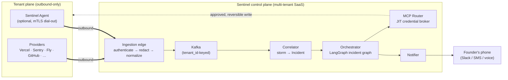

# Project Sentinel

> **Agentic on-call SRE as a service for solo founders & tiny teams.** Connect your stack in ten minutes; when prod breaks at 3 a.m., Sentinel diagnoses the root cause, drafts the fix as a PR, and only wakes you when it's genuinely stuck — with the full investigation already done.

<p align="center">
  <b>297 tests green</b> · <code>mypy --strict</code> clean (83 files) · <code>ruff</code> clean · <b>offline by default</b> · ≈ <b>$0.003</b> to run on real Claude
</p>

Sentinel is the on-call SRE for teams who can't afford one. A solo founder or a 2–4 person team has production but no on-call rotation: when something breaks they either lose hours context-switching at 3 a.m., or don't notice until a customer complains. Existing tools (PagerDuty, Datadog, Sentry) *tell you something is wrong* — they don't *figure out why* or *fix it*. Sentinel sells the outcome: **you sleep, we triage.**

This repository is both the **engineering design blueprint** (a master overview here plus companion docs under [`docs/`](docs/)) **and a substantial, runnable implementation** under [`src/sentinel/`](src/sentinel/) — pure, fully typed, and offline by default, with the security- and correctness-critical guarantees *proven by tests*, not just designed.

---

## ⚡ Quickstart (under a minute, no key, no database, no cost)

```bash
cd sentinel
python3 -m venv .venv
./.venv/bin/pip install 'pydantic>=2,<3' 'langgraph>=1,<2' 'sqlalchemy[asyncio]>=2,<3' asyncpg pyyaml pytest ruff mypy
PYTHONPATH=src ./.venv/bin/python -m sentinel.demo     # ← drive a 3 a.m. incident end to end
```

That single command ingests a sample provider webhook, redacts its secrets, runs five specialists, synthesizes a calibrated root cause, and prints the page-a-human card — entirely offline:

```text
Edge: ingested 3 provider webhooks for ten_demo.
  secrets redacted before persistence (C2): {'pg_password': 1, 'pii.phone': 1}

── Scenario B — T1 page-with-fix ───────────────────────
  root cause:  deploy abc123 introduced an N+1 query that exhausted the DB connection pool
  confidence:  HIGH (calibrated 99%)
  decision:    page_with_drafted_fix  →  ESCALATED

🚨  Incident inc_demo_b — needs you
Drafted fix  (reversible ✓)
    deploy.rollback → svc_api  ·  roll svc_api back to abc122 to clear the pool exhaustion
Evidence
    • [deploy] release abc123 shipped 40s before the error spike
    • [metric] DB pool-checkout p99 jumped 12ms → 9.4s in the same minute
    • [trace] 87% of slow spans hit one repeated N+1 ORM call path
→ Approve in one tap to apply the fix, or open the incident to investigate.
```

---

## 🧪 Run it & test it

Everything below runs from the repo root after the Quickstart install. Test commands need no `PYTHONPATH` (it's set in `pyproject.toml`); the runnable entry points use `PYTHONPATH=src`.

**Prerequisites**

| For… | You need | Without it |
|---|---|---|
| The demo, the full suite, every offline proof | **Python 3.12+** only | — |
| The multi-tenant RLS + durable proofs | **PostgreSQL 16** (local) | those tests **skip** cleanly |
| The live triage run | an **Anthropic API key** (~$0.003/run) | `realrun` prints how to configure and exits |

### 1 · The whole quality gate + all 297 tests

```bash
./.venv/bin/ruff check .          # lint
./.venv/bin/mypy                  # types — strict, config in pyproject.toml
./.venv/bin/pytest                # 297 tests (Postgres-backed proofs skip if no local DB)
```

### 2 · See it work — the offline demo (free)

```bash
PYTHONPATH=src ./.venv/bin/python -m sentinel.demo
```

### 3 · Watch the headline proofs

Each command below targets one "hard concept" and shows it actually holding:

| Command | What it proves |
|---|---|
| `./.venv/bin/pytest tests/test_data_postgres.py` | **Multi-tenant isolation** — tenant A cannot read B, forged `WHERE tenant_id=B` is powerless, unset scope is fail-closed, history is append-only. |
| `SENTINEL_TEST_RLS=0 ./.venv/bin/pytest tests/test_data_postgres.py` | **The RED** — the *same* assertions **fail without RLS**, proving the database (not app code) enforces the boundary. |
| `./.venv/bin/pytest tests/test_calibration.py -v` | **Calibration** — an over-confident model's Expected Calibration Error **collapses** after fitting a temperature map. |
| `./.venv/bin/pytest tests/test_audit.py -v` | **Tamper-evidence** — the SHA-256 hash-chain's `verify()` catches any edited or deleted entry. |
| `./.venv/bin/pytest tests/test_golden_eval.py -v` | **Eval-driven dev (L1)** — golden cases: smoking-gun specialist fires, evidence is redacted, escalation verdict per tier. |
| `./.venv/bin/pytest tests/test_judge.py -v` | **Eval-driven dev (L2)** — the LLM-as-judge rubric + the hard veto on hallucinated evidence. |

### 4 · Run one incident through **real Claude** (opt-in, ≈ $0.003)

```bash
cp .env.example .env                       # then add ANTHROPIC_API_KEY and set SENTINEL_USE_LLM=1
./.venv/bin/pip install anthropic
PYTHONPATH=src ./.venv/bin/python -m sentinel.realrun
```

Defaults to the cheapest model (Haiku 4.5); every call's tokens **and dollar cost** are printed via the metered seam in `agents/`. The model only ever sees **redacted** events (C2).

### 5 · The Postgres-backed proofs (optional — multi-tenant isolation, event sourcing, audit chain, inbox/outbox)

```bash
# 1. Start a local Postgres 16 (Homebrew shown; any local PG 16 works):
brew install postgresql@16
/opt/homebrew/opt/postgresql@16/bin/pg_ctl -D /opt/homebrew/var/postgresql@16 \
  -l /opt/homebrew/var/log/postgresql@16.log -w start

# 2. Provision roles + schema + RLS policies (idempotent; safe to re-run):
PYTHONPATH=src ./.venv/bin/python -m sentinel.data.bootstrap

# 3. Run the proofs:
./.venv/bin/pytest tests/test_data_postgres.py -v
```

> **Tip:** run `SENTINEL_TEST_RLS=0 ./.venv/bin/pytest tests/test_data_postgres.py` first to watch the isolation assertions **fail** without RLS, then the plain command to watch them **pass** — the single most convincing thing in the repo. If Postgres isn't running, every DB-backed test simply **skips** and the rest of the suite stays green.

---

## What makes this hard (and worth building)

The defining fact: **Sentinel runs against paying strangers' production infrastructure.** That single constraint moves the problem from "can an agent diagnose an incident" (largely solved) to the real engineering: doing it across thousands of tenants, with near-zero onboarding friction, without ever being the reason their prod went down, and without ever seeing data it shouldn't. Three inviolable constraints fall out, and *every* component is a response to at least one of them:

- **C1 — Never be the cause of an outage.** Read-heavy by default. Every write (rollback, restart, scale) is opt-in, allow-listed, reversible, and approval-gated until a tenant explicitly grants autonomy for that specific action type.
- **C2 — Minimize what we can see.** Agentless where possible, least-privilege always, and secrets/PII redacted *at the edge, before they ever persist* in the control plane.
- **C3 — Onboard in minutes, not days.** Time-to-first-value is the product's life-or-death metric. If setup takes a weekend, a solo founder never finishes.

These are formalized — along with the canonical vocabulary, identifiers, data contracts, and twelve Architecture Decision Records the whole system defers to — in **[`docs/00-glossary-and-decisions.md`](docs/00-glossary-and-decisions.md)** (the constitution). Read it first.

---

## How it works

Two planes, one trust boundary, and a single canonical event that carries an incident from a provider webhook to either an autonomous remediation or a page with the fix already attached. Connectivity is **outbound-only** from the tenant — Sentinel never opens a port into a customer's network.



An incident's life: providers (or the optional agent) push telemetry → the **edge** authenticates, redacts secrets *before persistence*, and normalizes everything into one `CanonicalEvent` → **Kafka**, partitioned per tenant → the **correlator** collapses the storm into one `Incident` → the **orchestrator** spawns a tenant-bound **LangGraph** incident graph: an Incident Commander dispatches five specialists (Log, Metric, Trace, Change/Deploy, Error) in parallel, synthesizes a root-cause hypothesis, and scores *calibrated* confidence. Then the **graduated-escalation engine** decides the outcome — and that decision is the product.

### The graduated-autonomy ladder — *this is the product*

Trust is a ladder the tenant climbs deliberately, per action type. Default is observe-only.

| Tier | Name | Behavior |
|---|---|---|
| **T0** | Observe | Read-only. Diagnose and page only. No writes, ever. *(default)* |
| **T1** | Suggest | Drafts a fix (PR / patch / command) but never executes. |
| **T2** | Approve-to-act | Executes an allow-listed, reversible action after one-tap human approval. |
| **T3** | Autonomous | Auto-executes allow-listed, reversible, **calibrated-HIGH-confidence** actions, then reports. |

Combined with calibrated confidence and reversibility, this yields the behavior that sells the product: high confidence + reversible + the tenant granted T3 → **act and report**; otherwise → **page a human, but with the suspected root cause, the evidence chain, competing hypotheses, and a drafted fix already attached.** The founder approves in ~15 seconds instead of starting an investigation from zero at 3 a.m. Irreversible actions and low-confidence diagnoses *always* page — no granted tier can override those hard stops.

---

## What's actually built

A substantial **core is implemented** under [`src/sentinel/`](src/sentinel/) — pure, fully typed (`mypy --strict`), and **offline by default**: external systems are modeled as injected interfaces with in-memory fakes, and the two real dependencies (Postgres, Claude) are **opt-in and gated**, so the whole suite runs green without either (no Kafka/Redis/Vault yet). The incident graph runs on a **real LangGraph runtime** with durable checkpointing and a genuine human-in-the-loop approval **interrupt**, with the Postgres checkpointer left as a one-argument production swap. The full ingestion path is wired front-to-back: webhook → authenticate → dedup → **redact before anything persists (C2)** → normalize → tenant-keyed bus → correlate → graph → remediated-or-escalated outcome.

**Six further slices prove the parts that *can't* be faked offline:**

1. **Postgres + Row-Level Security** — the mandatory **cross-tenant isolation test** (ADR-001): the same five assertions **fail without RLS and pass with it**, so isolation is the *database's* guarantee, not application code that could regress.
2. **Golden incident library + L1 evals** — a corpus stratified by stack archetype; deterministic checks that the smoking-gun specialist fires with a valid contract, evidence is redacted, and the §00.6 escalation verdict is right for *every* grant tier.
3. **Calibration / ECE** — a from-scratch reliability + Expected-Calibration-Error measurement and a temperature fit (NLL-minimizing) that makes an over-confident model's ECE collapse toward zero.
4. **Tamper-evident audit hash-chain** — `SHA-256(seq ‖ prev_hash ‖ row)`; `verify()` catches any edit/delete, and the append-only-granted app role can't rewrite history at all.
5. **L2 LLM-as-judge** — a weighted rubric with a hard veto on hallucinated evidence (C1), completing the L1→L2 eval layers.
6. **Durable inbox/outbox** — exactly-once ingestion despite provider redeliveries, RLS-private per tenant.

**297 tests, all green.** (The Postgres-backed proofs skip cleanly wherever no database is present.)

| Module | Implements |
|---|---|
| `ids.py`, `enums.py` | Canonical identifiers + enums and the confidence-band cut (doc 00 §4–§6) |
| `contracts/` | Pydantic v2 domain + inter-agent contracts (doc 00 §5, doc 04 §4) |
| `escalation.py` | The graduated-escalation engine — the §00.6 matrix as a pure function (doc 04 §7) |
| `redaction.py` | Edge-side layered secret/PII redaction (doc 05 §4) |
| `connectors/` | `Connector` protocol + Sentry/Vercel adapters + webhook idempotency (doc 03) |
| `correlator.py` | Storm → incident correlation with the cross-provider commit-SHA join (doc 01 §5) |
| `confidence.py` | Confidence blend + temperature-scaling calibration (doc 04 §6, doc 06 §6) |
| `safety/` | Independent rule-based reversibility floor (doc 05 §6) |
| `incidents/` | Event-sourced incident projection (doc 02 §4, ADR-011) |
| `data/`, `audit.py` | **Postgres + Row-Level Security** — durable schema + the **cross-tenant isolation proof** (RLS fails closed; forged filters powerless), event-sourced repository, durable **inbox/outbox** (exactly-once ingestion), and a tamper-evident **audit-log hash-chain** (doc 02 §2–§4, §6; doc 03 §3; doc 05 §5; ADR-001) |
| `mcp/` | MCP router + JIT credential broker, confused-deputy-safe (doc 05 §2) |
| `billing/` | Idempotent metering + per-tenant cost circuit breaker (doc 07) |
| `orchestrator/` | The runtime-agnostic incident-graph driver wiring it all into a runnable end-to-end loop (doc 04) |
| `graph/` | The durable **LangGraph runtime**: a checkpointed `StateGraph` with a real HITL `interrupt()` at the T2 approval gate — resumable across the suspend (doc 04 §2, §9) |
| `edge/` | The **ingestion edge + pipeline** end-to-end (doc 01 §3, doc 03 §3, doc 05 §4) |
| `notify/` | The **Notifier**: renders a `PagePayload` into the 15-second-approval page (doc 00 §6, doc 04 §8) |
| `agents/`, `config.py` | Cost-metered LLM seam + `.env` key loading: real Claude is **opt-in**, cheapest model by default, every call's tokens + cost reported (doc 07) |
| `eval/`, `golden/` | The **golden incident library**, **L1 evals**, an **L2 LLM-as-judge**, and the **ECE / temperature-scaling calibration** measurement (doc 06 §2, §3.1–§3.2, §6) |
| `demo.py`, `realrun.py` | The **offline demo** (free) and the **real-Claude** single-incident run (≈ $0.003) |

The `db`, `eval`, `llm`, and `graph` dependency groups are declared as optional extras in `pyproject.toml`. Implementation plans live under [`docs/superpowers/plans/`](docs/superpowers/plans/).

---

## The documentation set

Each companion is self-contained and owns one concern; together they are the full blueprint. Suggested reading order is top to bottom, but [`00`](docs/00-glossary-and-decisions.md) is a prerequisite for all.

| Doc | Owns | Headline artifacts |
|---|---|---|
| [`00-glossary-and-decisions.md`](docs/00-glossary-and-decisions.md) | **The constitution** — vocabulary, identifiers, data-contract shapes, the autonomy ladder, 12 ADRs | Canonical schemas, ADR-001…012 |
| [`01-architecture.md`](docs/01-architecture.md) | System map: planes, trust boundary, ingestion edge, tenant-keyed Kafka, scaling | Component topology + incident-dataflow diagrams; services table |
| [`02-data-model-and-isolation.md`](docs/02-data-model-and-isolation.md) | The durable data model and three-layer isolation | Full DDL, **RLS policy SQL**, ER diagram, the cross-tenant isolation test |
| [`03-connectors-and-integrations.md`](docs/03-connectors-and-integrations.md) | The connector "moat" + the outbound-only Sentinel Agent | `Connector` Protocol, 12-provider catalog, normalization mappings, agent tunnel |
| [`04-agent-orchestration.md`](docs/04-agent-orchestration.md) | The LangGraph brain + the graduated-escalation engine | `IncidentState`, Pydantic inter-agent contracts, the **escalation policy function** |
| [`05-security-and-trust.md`](docs/05-security-and-trust.md) | The security spine: JIT credential brokering, redaction, threat model | Brokering sequence, STRIDE table, SOC2 mapping, audit hash-chain |
| [`06-evaluation-and-observability.md`](docs/06-evaluation-and-observability.md) | Eval-driven development, confidence calibration, eval-gated CI/CD | Golden library, LLM-judge rubric, SLO table, CI pipeline |
| [`07-billing-and-unit-economics.md`](docs/07-billing-and-unit-economics.md) | Metering, Stripe, cost governance, the unit-economics model | Idempotent metering, **worked COGS → ~51–54% gross margin** |
| [`08-business-gtm-roadmap-risk.md`](docs/08-business-gtm-roadmap-risk.md) | The startup case: wedge, GTM, 12-week roadmap, risk register | Roadmap table, risk matrix, open-questions log |

---

## Trust as a product feature

For a tool touching prod, **security *is* marketing.** Sentinel's posture is engineered, not promised, and sold loudly: outbound-only connectivity (no inbound ports into tenant networks); read-only by default with explicit, graduated opt-in per write action type; edge-side redaction so secrets never persist; JIT short-lived scoped credentials brokered through the MCP Router so a compromised worker holds *at most one tenant's 60-second token*; a per-tenant immutable, tamper-evident, tenant-exportable audit log; and tenant isolation enforced as **defense in depth across three independent layers** — Postgres Row-Level Security, per-tenant Qdrant memory namespaces, and JIT-brokered credentials. The principle (and the closing line of [`docs/05`](docs/05-security-and-trust.md)): a solo founder should believe Sentinel is *safer* than them SSH-ing into prod half-asleep — **because it is.**

---

## Build plan & business shape

A **12-week roadmap sized for one disciplined engineer**, demoable every week — a real diagnosis by week 5, an autonomous drafted fix (the core demo) by week 6, a multi-tenant isolation-proven SaaS by week 8, self-serve onboarding by week 11, and a launched product with design partners by week 12. Pricing is bottom-up and self-serve: **Free** (read-only, diagnose-and-page) → **Pro $49/mo** → **Team $149–199/mo**, with per-tenant cost ceilings that double as a safety control. The full roadmap, go-to-market motion, defensibility analysis, and risk register live in [`docs/08`](docs/08-business-gtm-roadmap-risk.md); the unit economics in [`docs/07`](docs/07-billing-and-unit-economics.md).

## Technology stack

Python 3.12 + Pydantic v2 · LangGraph (durable checkpointing + human-in-the-loop interrupts) · tiered LLM routing (Anthropic) · Kafka (tenant-keyed) · Postgres 16 + Row-Level Security · SQLAlchemy 2 (async, asyncpg) · Qdrant (per-tenant namespaces) · Redis · MCP + a JIT credential-brokering router · Vault (envelope encryption) · a Go/Rust outbound-only mTLS tenant agent · regional edge gateways · Langfuse · Stripe · Next.js · Terraform · GitHub Actions → ArgoCD. Rationale for each choice is recorded in [`docs/00`](docs/00-glossary-and-decisions.md) §7.

---

*This blueprint describes a system designed so it earns the right to touch production one graduated grant at a time — and a business whose every claim ties back to a line in the architecture.*
