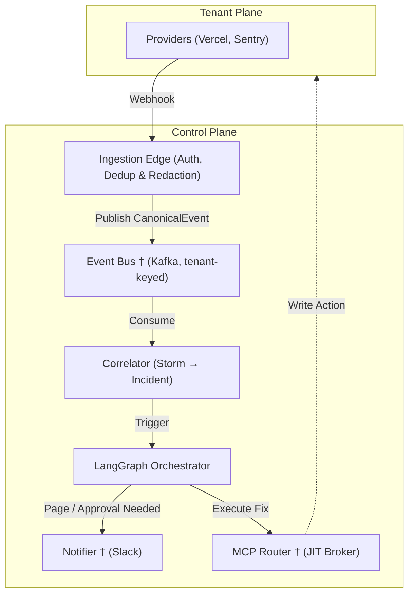
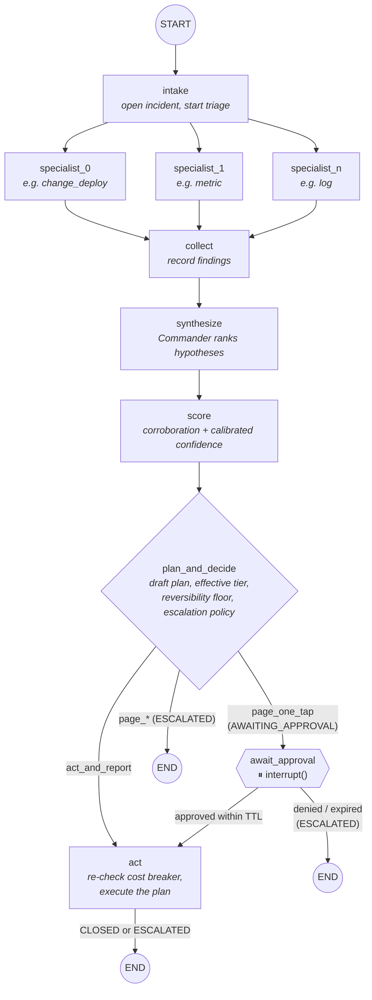

# Sentinel

> **Agentic on-call SRE for solo founders and tiny teams: ingests provider alerts, investigates with specialist LLM agents, diagnoses the root cause, and drafts (or, when trusted, executes) the fix.**

> [!IMPORTANT]
> **Sentinel is a tested prototype of the decision core, not a deployable service.** The incident graph, safety policy, confidence scoring, redaction, and agent tool loop are real and covered by tests. Everything that touches the outside world — Kafka, Vault, Slack, provider read APIs, action execution, an HTTP server — sits behind an interface with an in-memory or no-op stand-in. See [Project Status](#project-status) for exactly what is and isn't built.

### Why this project?
For a solo founder or a small 2–4 person startup, there is no "on-call rotation"—when production breaks at 3 a.m., the founder is the rotation. Existing observability tools (PagerDuty, Datadog, Sentry) excel at raising alarms, but leave the actual triage to a sleep-deprived human. Sentinel aims to reverse this: by the time the founder is paged, it has already correlated the signals, diagnosed the issue, and drafted a remediation. You sleep; Sentinel triages.

---

## Table of Contents
1. [Project Status](#project-status)
2. [Overview](#overview)
3. [Key Features](#key-features)
4. [System Architecture](#system-architecture)
5. [Architectural Design](#architectural-design)
6. [Directory Structure](#directory-structure)
7. [API & Usage](#api--usage)

---

## Project Status

Every external dependency is an injected interface (a Python `Protocol`). That keeps the core testable offline, and it means each "planned" item below is an adapter to write, not a redesign.

### Implemented
| Area | What exists |
|------|-------------|
| Incident graph | LangGraph `StateGraph` with parallel specialist fan-out, conditional routing, a checkpointer, and a real `interrupt()` / `Command(resume=...)` approval step. |
| Escalation policy | Autonomy tiers T0–T3, one grant per (tenant, action type) looked up per decision and re-checked before acting, the reversibility floor, the cost breaker, and approval TTLs. |
| Action safety | Each plan gets a deterministic `action_id`. An action ledger makes execution at-most-once: a crash, retry, or duplicate approval replays the recorded result or escalates as "outcome unknown", never runs the write twice. The ID is also the provider idempotency key. |
| Approvals | A page carries `one_tap_action_id`; an approval must echo it and name an approver the tenant's approver directory allows. Bare `True`, stale or replayed taps, anonymous or unauthorized approvers, and late approvals are denials. |
| Incident tracking | A registry of each tenant's open incidents. Late alerts are correlated against open incidents first and attach to them instead of opening a duplicate. Every run reports `closed`, `escalated`, `awaiting_approval`, or `attached`, and `resume_incident` continues a paused one exactly once. |
| Confidence scoring | Corroboration counting (a specialist counts only if its own suspected cause matches the hypothesis and it cites evidence), competing-hypothesis penalty, temperature-scaling calibration fitted with a held-out ECE check. T3 is capped at approval unless the calibrator was fitted on ≥200 labelled incidents with held-out ECE ≤ 0.05. |
| Ingestion edge | Signature verification, dedup, normalization, and redaction for **Sentry** and **Vercel** webhooks. |
| Correlation | Groups a batch of events into incidents by fingerprint, commit SHA, or service within a time window. A Sentry error joins the Vercel deploy that shipped it: the commit SHA is read from Sentry's `release`, and a short SHA matches the full one. |
| LLM agents | Claude-backed specialists (single-call, or a bounded tool-use loop), the Incident Commander, and the Planner, via the Anthropic Messages API. Specialists see each event's redacted payload (stack trace, culprit), not just its title. |
| Remediation planner | `LLMPlanner` drafts a plan from the top hypothesis and the incident's signals. It may only pick a listed action type and a target the signals actually name; anything else becomes "no plan" and a page without a drafted fix. |
| Data layer | Postgres schema, row-level security policies, inbox/outbox tables, SHA-256 hash-chained audit log (SQLAlchemy + asyncpg). |
| MCP broker | Credential-brokering logic with the tenant ID fixed server-side, short-lived leases, and revoke-in-`finally`. |

### Not yet implemented
| Area | Current stand-in |
|------|------------------|
| Telemetry read APIs (logs, metrics, traces, deploys, errors) | The specialists' tools read the recorded observations (relevant and distractor) in the `golden/` YAML cases (`GoldenTelemetry`). No live `TelemetrySource` exists yet. |
| Action execution | Connector `_do_execute` returns success without calling the provider; no `ActionExecutor` is wired to the MCP broker. |
| Event bus | `InMemoryEventBus` (no Kafka client). |
| Dedup store | `InMemoryDedupStore` (no Redis). |
| Credential vault | `VaultClient` interface only (no HashiCorp Vault client). |
| Notifications | `ConsoleNotifier` prints the page (no Slack/SMS). |
| HTTP service | No server to receive webhooks or the one-tap approval callback; `resume_incident` is ready for that endpoint to call. Approver *authentication* (e.g. verifying the Slack user) belongs there too. |
| Event consumer | The pipeline handles whatever batch it is given; no Kafka consumer feeds it continuously. |
| Durable state | The action ledger and incident registry have in-memory implementations only, and the approver directory is just a `(tenant_id, approver) → allowed?` callable with no backing store. A graph that accepts approvals refuses to start without an explicit checkpointer, but the Postgres checkpointer isn't wired in. |
| Service discovery | Connectors stamp the service from the integration's config (`config["service"]`); there is no automatic discovery, so an unconfigured integration's events can't be grouped by service. |
| Calibration data | The golden library has **5** labelled cases, so no calibrator can meet the bar and T3 grants act only after approval. |

---

## Overview

Sentinel is designed as a multi-tenant SaaS that acts as an autonomous Site Reliability Engineer.

### At a glance
| Aspect | Details |
|--------|---------|
| **Core Problem** | High MTTR (Mean Time To Recovery) and engineer burnout due to manual incident triage. |
| **Solution** | LLM agents that investigate an incident from several angles, then a commander that synthesizes a root cause and a planner that drafts a fix. |
| **Data Plane** | Designed for Kafka ingestion and PostgreSQL durable state; runs today on in-memory implementations of the same interfaces. |
| **AI Layer** | LangGraph for stateful orchestration; Anthropic Claude for the agents. |
| **Security** | Edge-side redaction before anything persists or reaches the model; tenant-scoped grants and credentials. |

When a provider (e.g., Vercel, Sentry) fires a webhook, Sentinel verifies and redacts the payload at the edge before publishing it to the event bus. A correlator groups these signals into an incident. The orchestrator then dispatches specialist agents (Log, Metric, Trace, Change/Deploy, Error) to investigate. Depending on the tenant's configured "Autonomy Tier," Sentinel either executes the fix or pages the user for a one-tap approval.

---

## Key Features

### 1. Graduated Autonomy Ladder (T0–T3)
**How it works:** Tenants explicitly opt in to automation per action type (`T0`: Observe, `T1`: Suggest, `T2`: Approve-to-act, `T3`: Autonomous). A grant applies only to its own tenant and action type, only while active, and drops to `T0` while the tenant is over its cost ceiling. It is checked again right before acting, so a revocation during an approval wait takes effect. An approval is bound to the exact action it was shown, and each action runs at most once.
**Why it exists:** AI tools modifying production infrastructure require immense trust. Sentinel never mutates state without explicit permission, and `T3` acts only on reversible actions at high confidence.

### 2. Edge-Side Redaction
**How it works:** Secrets and PII are stripped from every persisted field of a provider payload (title, labels, and the serialized body) before it is published.
**Why it exists:** Sensitive tenant data should never persist in Sentinel's control plane or reach the LLM's context window.

### 3. Confidence Calibration
**How it works:** The commander's likelihood is blended with how many specialists independently corroborate it and how many rival hypotheses are close behind, then passed through a temperature-scaling map fitted by minimizing negative log-likelihood. Calibration quality is measured as Expected Calibration Error (ECE).
**Why it exists:** LLMs are overconfident. The confidence band gates autonomous action, so it has to mean something.
**Status:** The fitting and measurement code is complete, and a calibrator records how many labelled incidents it was fitted on and its held-out ECE. Until one clears the bar (≥200 cases, ECE ≤ 0.05), T3 is treated as T2. With 5 golden cases, that is the case today.

### 4. JIT Credential Brokering
**How it works:** An MCP router asks a vault for a short-lived credential scoped to a single action. The tenant ID that selects the credential comes from the server-side broker, never from LLM-influenced arguments, and the lease is revoked in a `finally` block.
**Why it exists:** Prevents the confused-deputy problem (one tenant's incident using another tenant's credentials) and limits what a compromised worker can reach.
**Status:** Broker logic is implemented and tested against fakes; there is no Vault client or real MCP server yet.

### 5. Tamper-Evident Audit Logging
**How it works:** Every decision, approval, and action is appended to a SHA-256 hash chain (`SHA-256(seq ‖ prev_hash ‖ row)`).
**Why it exists:** Gives tenants a verifiable, append-only history of what the AI read and executed.

---

## System Architecture

Target architecture. Components marked † are interfaces with in-memory stand-ins today (see [Project Status](#project-status)).



### Components
- **Ingestion Edge:** Signature verification, deduplication, normalization, and redaction. Outputs a clean `CanonicalEvent`.
- **Correlator:** Joins events by shared fingerprint, commit SHA, or service within a time window, collapsing alert storms into a single incident.
- **LangGraph Orchestrator:** The durable state machine. Dispatches the five specialist agents (Log, Metric, Trace, Change/Deploy, Error), the Incident Commander, and the Planner. Suspends and resumes for human approval.
- **MCP Router:** Brokers short-lived, tenant-scoped credentials for infrastructure writes.

### Request / Data Flow
1. **Webhook Reception:** Sentry sends an error payload.
2. **Edge Processing:** The edge verifies the signature, deduplicates the delivery, normalizes it to a `CanonicalEvent`, and strips secrets.
3. **Queueing:** The event is published to the tenant's partition of the event bus.
4. **Correlation:** The correlator links the Sentry error to a recent Vercel deploy via the shared commit SHA.
5. **Investigation:** LangGraph runs the specialist agents in parallel, each confined to its own domain's tool.
6. **Synthesis & Scoring:** The Incident Commander ranks root-cause hypotheses and the top one gets a calibrated confidence band.
7. **Execution/Escalation:** If confidence is high, the action is reversible, and the tenant granted `T3`, the fix is executed. Otherwise the founder is paged with the diagnosis and drafted fix for one-tap approval.

### LangGraph State Graph

The orchestrator is a LangGraph `StateGraph` over `IncidentGraphState`, assembled in `src/sentinel/graph/build.py` and compiled with a checkpointer so a run can suspend at the approval interrupt and resume later.



| Node | Responsibility |
|------|----------------|
| `intake` | Emits `incident.opened` and `triage.started`. |
| `specialist_i` | One node per injected specialist, run in parallel; each appends a finding (failures are contained by `safe_investigate`). |
| `collect` | Fan-in point; emits a `specialist.finding` event per finding in a stable role order. |
| `synthesize` | The Incident Commander turns findings into ranked hypotheses. |
| `score` | Blends the top hypothesis' likelihood with independent corroboration and competing hypotheses, then calibrates it into a confidence band. |
| `plan_and_decide` | Planner drafts a remediation; the grant is narrowed to an effective tier (tenant, action type, cost breaker) and the escalation policy picks: act, request approval, or page and escalate. |
| `await_approval` | Suspends with `interrupt()` until a human responds; approvals older than the TTL count as denials. |
| `act` | Re-checks the cost breaker, executes the action, and closes the incident on success or escalates with the fix attached if it failed or rolled back. |

### Agents and Tools

| Agent | Role | Tool |
|-------|------|------|
| Log specialist | Application and edge logs | `search_logs` |
| Metric specialist | Latency, saturation, pool usage, error rates | `query_metrics` |
| Trace specialist | Distributed traces and span patterns | `search_traces` |
| Change/Deploy specialist | Deploys, releases, config changes | `list_recent_deploys` |
| Error specialist | Grouped exceptions from error tracking | `list_error_groups` |
| Incident Commander | Synthesizes findings into ranked hypotheses | — |
| Planner | Drafts a remediation for the top hypothesis, targeting only resources the signals name; never executes | — |

Tools are plain `Tool` dataclasses (`src/sentinel/tools/toolset.py`), not LangChain `@tool` functions: specialists call Claude directly through the Anthropic Messages API and run their own bounded tool-use loop. Each specialist is handed only its own domain's tool, and only observations a tool actually returned can be cited as evidence. A tool's data comes from an injected `TelemetrySource`; today that is `GoldenTelemetry`, which replays recorded cases.

---

## Architectural Design

### Hexagonal Architecture (Ports and Adapters)
- **What:** External systems (Postgres, Anthropic Claude, provider APIs, the event bus, the vault, notifications) are abstracted behind injected interfaces.
- **Why:** The core orchestration and escalation logic runs completely offline.
- **Benefit:** The test suite runs deterministically with in-memory fakes, and production adapters can be added without touching the core.

### Multi-Tenancy via Row-Level Security (RLS)
- **What:** PostgreSQL 16 RLS policies require every query to run with a `tenant_id` context.
- **Why:** Prevents cross-tenant data leakage at the lowest possible layer.
- **Benefit:** Application-level bugs (like a missing `WHERE` clause) fail closed.

### Inbox / Outbox Pattern
- **What:** Webhooks are inserted into a unique-constrained `webhook_inbox` and mapped to an `event_outbox` in a single SQL transaction, to be drained to the event bus by a worker.
- **Why:** Providers aggressively retry webhooks on timeouts.
- **Benefit:** A retried delivery cannot create a duplicate incident.

### Event Sourcing
- **What:** Incident state is not updated in place; it is projected from an immutable stream of state-change events.
- **Why:** Makes an incident's timeline reproducible and aligns with the tamper-evident audit log.

---

## Directory Structure

```text
sentinel/
├── src/
│   └── sentinel/
│       ├── agents/          # Claude-backed specialists, commander, token metering
│       ├── billing/         # Usage metering and the per-tenant cost breaker
│       ├── connectors/      # Provider adapters (Sentry, Vercel)
│       ├── contracts/       # Pydantic v2 domain schemas (CanonicalEvent, etc.)
│       ├── data/            # Postgres session, RLS policies, inbox/outbox, audit
│       ├── edge/            # Webhook ingestion, redaction, event bus, pipeline
│       ├── eval/            # Golden incident loader, judge, calibration/ECE
│       ├── graph/           # LangGraph state, nodes, and graph assembly
│       ├── incidents/       # Incident lifecycle events and projection
│       ├── mcp/             # MCP router and JIT credential broker
│       ├── notify/          # Page rendering and delivery interface
│       ├── orchestrator/    # Agent interfaces, fail-safe guards, linear runner
│       ├── safety/          # Reversibility floor
│       ├── tools/           # Specialist tools and telemetry sources
│       ├── demo.py          # Offline terminal demo
│       └── realrun.py       # One incident through real Claude
├── golden/                  # Labelled incident scenarios (YAML)
├── tests/
├── pyproject.toml
└── README.md
```

---

## API & Usage

### Running the System Offline
The core runs entirely offline using fakes, so you can simulate an end-to-end 3 a.m. incident without API keys.

```bash
# Set up the environment
python3 -m venv .venv
./.venv/bin/pip install 'pydantic>=2,<3' 'langgraph>=1,<2' 'anthropic>=0.40,<1' 'sqlalchemy[asyncio]>=2,<3' asyncpg pyyaml pytest ruff mypy types-PyYAML

# Run the offline demo
PYTHONPATH=src ./.venv/bin/python -m sentinel.demo
```

### Running with Claude Inference
To route the agents through real Claude models (spends a few cents per run):

```bash
cp .env.example .env
# Set ANTHROPIC_API_KEY and SENTINEL_USE_LLM=1 in .env
PYTHONPATH=src ./.venv/bin/python -m sentinel.realrun            # agents answer from the alert alone
PYTHONPATH=src ./.venv/bin/python -m sentinel.realrun --tools    # specialists investigate with their tools
```

### Testing & Quality Gates
The project uses strict typing (`mypy --strict`) and ruff. Database-backed tests skip if a local PostgreSQL 16 instance is not reachable.

```bash
./.venv/bin/ruff check .
./.venv/bin/mypy
./.venv/bin/pytest -v
```
