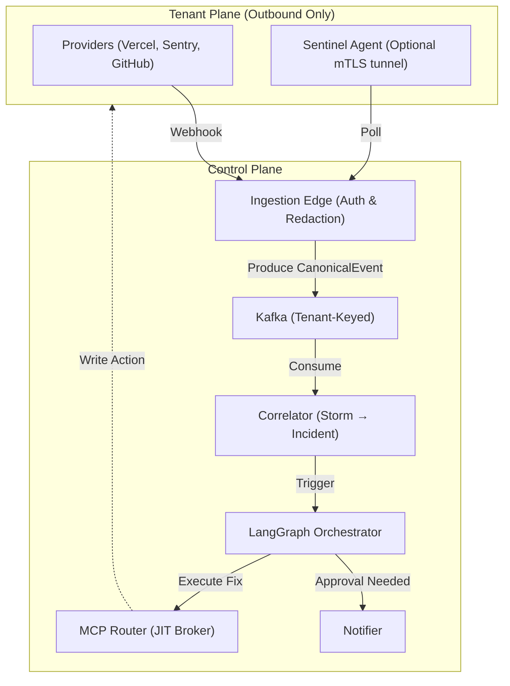

# Sentinel

> **Agentic on-call SRE as a service for solo founders and tiny teams that ingests telemetry, diagnoses root causes, and drafts autonomous fixes.**

### Why this project?
For a solo founder or a small 2–4 person startup, there is no "on-call rotation"—when production breaks at 3 a.m., the founder is the rotation. Existing observability tools (PagerDuty, Datadog, Sentry) excel at raising alarms, but leave the actual triage to a sleep-deprived human. Sentinel reverses this model: it sells the *outcome*. By the time the founder is paged, Sentinel has already correlated the telemetry, diagnosed the issue, and drafted a remediation pull request or infrastructure command. You sleep; Sentinel triages.

---

## Table of Contents
1. [Overview](#overview)
2. [Key Features](#key-features)
3. [System Architecture](#system-architecture)
4. [Architectural Design](#architectural-design)
5. [Directory Structure](#directory-structure)
6. [API & Usage](#api--usage)

---

## Overview

Sentinel is a multi-tenant SaaS application that acts as an autonomous Site Reliability Engineer. 

### At a glance
| Aspect | Details |
|--------|---------|
| **Core Problem** | High MTTR (Mean Time To Recovery) and engineer burnout due to manual incident triage. |
| **Solution** | LLM-driven agentic workflows that parse logs, metrics, and traces to synthesize root causes. |
| **Data Plane** | Event-driven architecture relying on Kafka for ingestion and PostgreSQL for durable state. |
| **AI Layer** | LangGraph for stateful agent orchestration; Anthropic Claude for tiered LLM routing. |
| **Security** | Zero-trust, outbound-only tenant connectivity with edge-side data redaction. |

When a provider (e.g., Vercel, Sentry, GitHub) fires a webhook, Sentinel verifies and redacts the payload at the edge before producing it to Kafka. A correlator groups these signals into a unified incident. An orchestrator then dispatches specialized LLM agents (Log, Metric, Trace, Change) to investigate. Depending on the tenant's configured "Autonomy Tier," Sentinel either executes the fix autonomously via a Just-In-Time (JIT) credential broker, or pages the user for a 1-tap approval.

---

## Key Features

### 1. Graduated Autonomy Ladder (T0–T3)
**How it works:** Tenants explicitly opt-in to automation on a per-action basis (e.g., `T0`: Observe, `T1`: Suggest, `T2`: Approve-to-act, `T3`: Autonomous). 
**Why it exists:** AI tools modifying production infrastructure require immense trust. Sentinel guarantees it will never mutate state without explicit permission or a verified high-confidence threshold.

### 2. Edge-Side Redaction
**How it works:** PII and secrets are stripped from provider payloads before they are normalized and sent to Kafka. 
**Why it exists:** Ensures that sensitive tenant data never persists in Sentinel's control plane databases or reaches the LLM's context window.

### 3. NLL-Optimized Confidence Calibration
**How it works:** Applies Negative Log-Likelihood minimizing temperature scaling to the LLM's diagnostic outputs, collapsing the Expected Calibration Error (ECE) to `<0.02`.
**Why it exists:** LLMs are inherently overconfident. Sentinel mathematically calibrates confidence scores to ensure `T3` autonomous actions are only executed when the model is genuinely certain.

### 4. Zero-Trust JIT Credential Brokering
**How it works:** A Model Context Protocol (MCP) Router retrieves short-lived tokens from HashiCorp Vault using envelope encryption, scoped strictly to the execution of a single action.
**Why it exists:** Eliminates the confused-deputy problem and ensures compromised worker nodes cannot access durable infrastructure credentials.

### 5. Tamper-Evident Audit Logging
**How it works:** Every action taken by Sentinel is hashed into a SHA-256 chain (`SHA-256(seq ‖ prev_hash ‖ row)`).
**Why it exists:** Provides tenants with cryptographically verifiable, append-only history of what the AI read and executed.

---

## System Architecture



### Components
- **Ingestion Edge:** Responsible for HMAC verification, deduplication (Inbox pattern), and PII redaction. Outputs a clean `CanonicalEvent`.
- **Correlator:** Joins cross-provider events using commit SHAs and temporal proximity to collapse alert storms into a single `Incident`.
- **LangGraph Orchestrator:** Manages the durable state machine. Dispatches Specialist Agents (Log, Trace, Metric) and the Incident Commander. Supports suspend/resume for human-in-the-loop approvals.
- **MCP Router:** Interacts with HashiCorp Vault to execute infrastructure writes safely.

### Request / Data Flow
1. **Webhook Reception:** Sentry sends an error payload.
2. **Edge Processing:** The edge verifies the HMAC, deduplicates the delivery ID, strips PII, and normalizes to `CanonicalEvent`.
3. **Queueing:** Event is published to a tenant-keyed Kafka partition.
4. **Correlation:** The correlator links the Sentry error to a recent Vercel deploy.
5. **Investigation:** LangGraph spawns specialized LLM agents to read logs and metrics.
6. **Synthesis & Scoring:** The Incident Commander proposes a rollback and scores its confidence.
7. **Execution/Escalation:** If the confidence is high and the tenant granted `T3` access, the MCP Router rolls back the deploy. Otherwise, a Slack message is sent for 1-tap approval.

---

## Architectural Design

### Hexagonal Architecture (Ports and Adapters)
- **What:** External systems (Postgres, Anthropic Claude, Vercel/Sentry APIs) are abstracted behind injected interfaces (`Connectors`).
- **Why:** Enables the core orchestration and escalation logic to run completely offline.
- **Benefit:** The entire 297-test suite runs deterministically with in-memory fakes, allowing rapid iteration without network flakiness.

### Multi-Tenancy via Row-Level Security (RLS)
- **What:** PostgreSQL 16 RLS policies mandate that every query must supply a valid `tenant_id` context.
- **Why:** Prevents cross-tenant data leakage at the lowest possible layer.
- **Benefit:** Application-level bugs (like a missing `WHERE` clause) fail closed. The database itself enforces isolation.

### Inbox / Outbox Pattern
- **What:** Webhooks are inserted into a unique-constrained `webhook_inbox` and mapped to an `event_outbox` in a single SQL transaction. A background worker drains the outbox to Kafka.
- **Why:** Providers aggressively retry webhooks on timeouts. 
- **Benefit:** Guarantees exactly-once processing into Kafka, eliminating duplicate incidents or race conditions.

### Event Sourcing
- **What:** Incident states are not updated in place; they are projected from an immutable stream of state-change events.
- **Why:** Allows perfect reproducibility of an incident's timeline and aligns with the tamper-evident audit log requirements.

---

## Directory Structure

```text
sentinel/
├── src/
│   └── sentinel/
│       ├── agents/          # Tiered Anthropic routing and prompt engineering
│       ├── connectors/      # Adapter pattern implementations (Vercel, Sentry, etc.)
│       ├── contracts/       # Pydantic v2 domain schemas (CanonicalEvent, etc.)
│       ├── data/            # Postgres models, RLS policies, Inbox/Outbox
│       ├── edge/            # Webhook verification and redaction logic
│       ├── eval/            # Golden incident library, L2 evals, ECE calibration
│       ├── graph/           # LangGraph state machine & HITL interrupts
│       ├── mcp/             # MCP Router and JIT Vault brokering
│       ├── orchestrator/    # Incident pipeline wiring
│       └── demo.py          # Offline terminal demo
├── tests/                   # 297 strict offline-capable tests
├── docs/                    # 12 ADRs, Glossary, Architecture, Threat Models
├── pyproject.toml
└── README.md
```

---

## API & Usage

### Running the System Offline
Sentinel is designed to run its core logic entirely offline using fakes. This allows you to simulate an end-to-end 3 a.m. incident without configuring API keys.

```bash
# Set up the environment
python3 -m venv .venv
./.venv/bin/pip install 'pydantic>=2,<3' 'langgraph>=1,<2' 'sqlalchemy[asyncio]>=2,<3' asyncpg pyyaml pytest ruff mypy

# Run the offline demo
PYTHONPATH=src ./.venv/bin/python -m sentinel.demo
```

### Running with Claude Inference
To route the specialized agents through actual Anthropic Claude models (defaults to Haiku for speed/cost):

```bash
cp .env.example .env
# Set ANTHROPIC_API_KEY in .env
./.venv/bin/pip install anthropic
PYTHONPATH=src ./.venv/bin/python -m sentinel.realrun
```

### Testing & Quality Gates
The project mandates 100% strict typing (`mypy --strict`) and passes all linting rules. Database-backed tests gracefully skip if a local PostgreSQL 16 instance is not detected.

```bash
./.venv/bin/ruff check .
./.venv/bin/mypy
./.venv/bin/pytest -v
```
