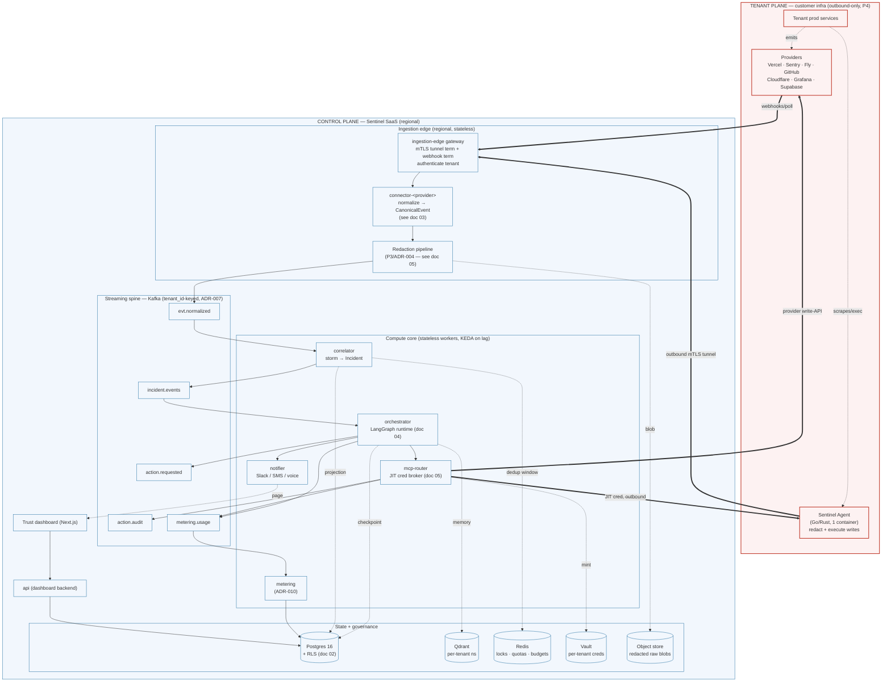
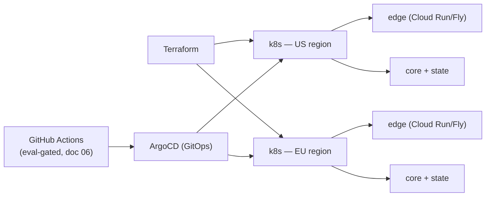

# 01 — System Architecture & Data Flow

*The system map: a control plane that never reaches into a tenant's network, a tenant plane that only ever dials out, and a single canonical event that carries an incident from a provider webhook to either an auto-remediation or a page with the fix already attached.*

This document is the map. It draws the planes, the trust boundary, the streaming spine, and the end-to-end path of one incident, then hands depth to its siblings: the data model and RLS to `02-data-model-and-isolation.md`, connector internals to `03-connectors-and-integrations.md`, the LangGraph incident graph to `04-agent-orchestration.md`, redaction and credential brokering to `05-security-and-trust.md`, and CI/CD to `06-evaluation-and-observability.md`. It defines no new terminology that those docs do not need; it reuses doc 00 verbatim.

---

## 1. Two planes, one boundary

Sentinel is split into a **control plane** (Sentinel's multi-tenant SaaS) and the **tenant plane** (the customer's own infrastructure), per the doc 00 glossary. The line between them is the trust boundary, and the single most important architectural fact about it is its direction: **connectivity is outbound-only from the tenant plane (P4, ADR-002).** The control plane *never* opens a socket into a tenant network. Provider data is pulled via least-privilege OAuth read-keys; the optional Sentinel Agent *dials out* over mTLS and holds the connection open. There is no inbound port to firewall, no bastion to harden, no IP to allow-list. This is what makes "open prod to a startup" a non-objection (C3) and what shrinks the attack surface into a tenant to zero (C1).

The control plane is internally partitioned into three tiers: the **ingestion edge** (regional, stateless, lives closest to the boundary), the **stream + compute core** (Kafka, correlator, orchestrator, MCP router, notifier), and the **state + governance plane** (Postgres 16 + RLS, Qdrant, Redis, Vault, metering/billing, the dashboard `api`). Per-tenant isolation is enforced as defense in depth across three independent layers — DB (RLS, ADR-001), memory (Qdrant per-tenant namespaces), and credentials (JIT-brokered, ADR-005) — so a bug in any one layer cannot cross tenants (P2). The depth of each lives in docs 02 and 05; here we only place them.

### Component topology



Every **bold edge crossing the boundary originates in the tenant plane** (agent dials out) or is a *pull* the control plane initiates against a provider's public API. No arrow ever lands on an inbound port inside `TP`. The MCP router's writes reach the tenant plane only by riding the agent's already-open outbound tunnel, or via a provider's write API to which the tenant granted a scoped key — never by Sentinel opening a fresh connection inward.

---

## 2. Two integration modes

A tenant connects in one of two ways; both are outbound-only (ADR-002), and they are additive, not exclusive. Internals are doc 03's lane (connector adapters) and doc 05's (credential brokering); here is the *what each unlocks* contract.

| | **Agentless** (default) | **Sentinel Agent** |
|---|---|---|
| Mechanism | Read-only, least-privilege OAuth tokens / API keys to PaaS + observability providers | Single Go/Rust container the tenant deploys; dials out over mTLS, opens **no inbound ports** |
| Onboarding | OAuth click-through, minutes (C3) | One `docker run` / DaemonSet + a bootstrap token, still minutes |
| Reach | Whatever the provider's read API exposes: alerts, logs, metrics, deploys, errors, traces | Anything inside the network the tenant points it at: in-cluster logs/metrics, private services |
| Writes | Only via a provider's own write API **+** an explicit `AutonomyGrant` (e.g. trigger a Vercel rollback) | Executes approved, allow-listed, reversible write actions in-cluster (restart, scale, apply) |
| Data exposure | Minimized by provider scope (C2) | Minimized by **edge redaction before forwarding** (P3); agent strips at source too |
| Credential at rest | Stored encrypted in Vault, JIT-brokered per call (P9, ADR-005) | mTLS client identity only; no long-lived tenant prod creds live in the agent (P9) |

The agentless path is the 10-minute on-ramp and the moat-builder (the connector library, doc 03). The agent is the depth/write upgrade a tenant adopts as it climbs the autonomy ladder (doc 00 §6) — most write tiers (T2/T3) on in-cluster actions require it, because a provider read-key cannot, by design, restart your pod. Both modes feed the *same* `CanonicalEvent` stream; everything downstream is mode-agnostic (ADR-009).

---

## 3. The ingestion edge

The edge is the only component that lives at the trust boundary, and it is deliberately thin and stateless so it can be replicated regionally and scaled horizontally without coordination. The `ingestion-edge` gateway (Cloud Run / Fly, per doc 00 §7) does four things and then gets out of the way:

1. **Terminate** the agent's outbound mTLS tunnel *and* provider webhooks at a regional endpoint close to the tenant.
2. **Authenticate** the tenant — mTLS client-cert identity for the agent; HMAC-signed webhook secrets (per-`integration_id`) for providers — and stamp the resolved `tenant_id` onto the request. Nothing proceeds without an authenticated `ten_…`.
3. **Hand off to redaction** — layered regex + entropy + small-classifier stripping that runs *before persistence* (P3, ADR-004). The durable stores never see a secret. Internals, detector tuning, and the over-redaction/recall trade-off are doc 05's; the architectural rule is absolute: **nothing reaches Kafka un-redacted.** Only `body_redacted` and `redaction_meta` survive; the redacted raw blob (if retained) lands in object storage and is referenced by `raw_ref`.
4. **Normalize and produce** — the matching `connector-<provider>` adapter maps the source into a `CanonicalEvent` (doc 00 §5.1) and produces it to `evt.normalized`, keyed by `tenant_id`.

Ordering matters: **authenticate → redact → normalize → produce.** Redaction precedes the connector's structural mapping so that even fields a connector copies verbatim are already clean. The edge holds no incident state; if an edge pod dies mid-request the agent retries on its open tunnel and the webhook provider redelivers, so at-least-once delivery is preserved and deduplicated downstream by `fingerprint`.

---

## 4. The streaming spine

Kafka is the backbone, and **every topic is partitioned by `tenant_id`** (doc 00 §4, ADR-007). This single decision buys ordering-per-tenant, replay, and the substrate for noisy-neighbor isolation. The canonical topics:

| Topic | Producer → Consumer | Carries | Notes |
|---|---|---|---|
| `evt.normalized` | edge → correlator | `CanonicalEvent` | The firehose. Replayable for golden-incident eval (doc 06). |
| `incident.events` | correlator, orchestrator → orchestrator, api | Incident lifecycle events (doc 00 §5.3) | **Append-only source of truth** for incidents (ADR-011); the `incidents` row is a projection. |
| `action.requested` | orchestrator → mcp-router | `ActionRequest` (doc 00 §5.4) | Write intents awaiting brokering/approval. |
| `action.audit` | mcp-router → api, metering | Immutable action state-changes | Every `ActionRequest` transition; the audit spine (ADR-005). |
| `metering.usage` | orchestrator, mcp-router → metering | Per-call LLM/tool/incident usage | Idempotent metering (ADR-010); feeds billing (doc 07). |

Residency forces a regional prefix where required: `eu.evt.normalized` lives in the EU cluster and never replicates to US (§9). Replay is first-class — because `evt.normalized` and `incident.events` are durable and ordered per tenant, a stateless worker can rebuild any incident from the event log (ADR-011) and the eval harness can re-run a real incident from `evt.normalized` against a new model (ADR-012, doc 06).

### Noisy-neighbor isolation (ADR-007)

A whale tenant emitting 500 incidents/day must never starve a tenant with one (ADR-010's motivating case). Three mechanisms compose:

- **Per-tenant fair-share scheduling.** Consumers do not drain a partition greedily; a fair-share scheduler round-robins work across active `tenant_id`s so no single tenant monopolizes a worker's loop.
- **Per-tenant quotas + circuit breaker.** Redis holds per-tenant in-flight-incident counts and cost budgets; the metering circuit breaker (ADR-010) degrades a tenant to **T0 + page** when its monthly ceiling trips, capping both spend *and* autonomous-action blast radius (cost as a safety control).
- **KEDA autoscaling on consumer lag.** Correlator and orchestrator replicas scale on Kafka consumer-group lag, so aggregate load adds capacity rather than queueing behind one tenant. A persistent partition-skew whale is handled by graduation to **silo** (ADR-001) or sub-keying its partition.

```yaml
# KEDA ScaledObject — orchestrator scales on consumer lag (illustrative)
apiVersion: keda.sh/v1alpha1
kind: ScaledObject
metadata:
  name: orchestrator
spec:
  scaleTargetRef:
    name: orchestrator
  minReplicaCount: 2          # always warm for fast incident pickup
  maxReplicaCount: 40
  cooldownPeriod: 120
  triggers:
    - type: kafka
      metadata:
        bootstrapServers: kafka:9092
        consumerGroup: orchestrator
        topic: incident.events
        lagThreshold: "50"     # add a replica per ~50 backlogged events
        offsetResetPolicy: latest
```

---

## 5. Placement of the core workers

The compute core is three stateless services plus the notifier, all replicated and all resumable. Their internals belong to siblings; their *placement and contracts* belong here.

- **`correlator`** consumes `evt.normalized`, collapses storms of related events into a single `Incident` using per-tenant dedup windows (Redis), topology, and learned baselines, and emits the opening `incident.events` event. It writes a projection row to Postgres. *(Correlation algorithm: not this doc.)*
- **`orchestrator`** consumes `incident.events`, and for each new incident spawns one **tenant-scoped incident graph** in the LangGraph runtime (ADR-006). The Commander dispatches specialists, the Planner drafts remediation, and the escalation matrix (doc 00 §6) decides the outcome. Graph state is checkpointed to Postgres so any replica can resume any incident (§7). Write intents become `ActionRequest`s on `action.requested`; pages go to the notifier. *(The graph itself: doc 04.)*
- **`mcp-router`** consumes `action.requested`, mints a short-lived scoped JIT credential from Vault per tool call, injects it, executes via the right MCP server (provider write-API or the tenant's agent tunnel), never logs the credential, and writes every transition to `action.audit`. It makes cross-tenant tool access *physically impossible* (ADR-005). *(Brokering internals: doc 05.)*
- **`notifier`** turns escalations into Slack / SMS / voice pages carrying the full diagnosis + drafted fix (doc 00 §6), and surfaces one-tap T2 approvals back into the orchestrator's HITL interrupt.

A clean rule keeps the lanes honest: the orchestrator *decides*, the MCP router *acts*, and the router is the **only** component that ever holds a tenant credential or touches the tenant plane to write — the LLM agents never do (P9, ADR-005).

### Control-plane services at a glance

Every deployable, what it owns, what scales it, and whether it holds durable state. The rule that makes scaling a capacity problem (§7): **all compute is stateless; durable state lives only in the state plane** (Postgres/Qdrant/Redis/Vault/object store), which is doc 02's and doc 05's lane.

| Service | Responsibility | Scaling trigger | State |
|---|---|---|---|
| `ingestion-edge` | Terminate tunnels + webhooks, authenticate, redact (doc 05), normalize, produce | Regional request rate (HPA) | Stateless |
| `connector-<provider>` | Provider adapter: normalize signals, drive provider write-APIs (doc 03) | Poll schedule + webhook volume | Stateless |
| `correlator` | Collapse event storms into one `Incident` | Kafka lag on `evt.normalized` (KEDA) | Stateless (dedup window in Redis, projection in PG) |
| `orchestrator` | Run the per-incident LangGraph; decide escalation (doc 04) | Kafka lag on `incident.events` (KEDA) | Stateless (durable checkpoint in PG, ADR-006) |
| `mcp-router` | Broker JIT creds, execute tool calls, write `action.audit` (doc 05) | Tool-call rate; active-active across AZs | Stateless (secrets in Vault, held for ms) |
| `notifier` | Pages (Slack/SMS/voice); surface one-tap T2 approvals | Page volume | Stateless |
| `metering` | Consume `metering.usage`, write `usage_meter`, drive the cost breaker (doc 07) | Kafka lag on `metering.usage` (KEDA) | Stateless (counters in Redis, rows in PG) |
| `billing` | Aggregate usage → Stripe (doc 07) | Periodic/cron | Stateless |
| `onboarding` | OAuth flows, service discovery, synthetic dry-run, region pinning | Request rate | Stateless |
| `api` | Dashboard backend; resolves `app.tenant_id` from the session (RLS, doc 02) | Request rate (HPA) | Stateless |

---

## 6. End-to-end incident dataflow

The path from a provider webhook (or agent push) to either an autonomous remediation or a human page, with the diagnosis already attached:

```mermaid
sequenceDiagram
  autonumber
  participant P as Provider / Agent (tenant plane)
  participant E as ingestion-edge + redaction
  participant K as Kafka (tenant_id-keyed)
  participant C as correlator
  participant O as orchestrator (LangGraph)
  participant M as mcp-router (+Vault)
  participant N as notifier
  participant H as Human (founder)
  participant D as Trust dashboard

  P->>E: webhook / mTLS push (raw telemetry)
  E->>E: authenticate tenant → redact (P3/ADR-004) → normalize
  E->>K: produce CanonicalEvent → evt.normalized (key=tenant_id)
  K->>C: consume (fair-share, ADR-007)
  C->>C: dedup by fingerprint + correlate storm → Incident (OPEN)
  C->>K: incident.events: OPEN
  K->>O: consume incident.events
  O->>O: spawn tenant-scoped graph; checkpoint (ADR-006) → TRIAGING
  O->>M: specialists call provider read-tools (logs/metrics/traces)
  M->>M: mint JIT cred from Vault, inject, never log (ADR-005)
  M-->>O: redacted tool results
  O->>O: Commander synthesizes root cause → DIAGNOSED + calibrated confidence (P6)
  O->>K: metering.usage (LLM/tool calls, ADR-010)

  alt HIGH confidence + reversible + grant ≥ T3
    O->>K: action.requested (ActionRequest)
    K->>M: consume
    M->>P: execute reversible write (agent tunnel / provider write-API)
    M->>K: action.audit (executing → succeeded)
    M-->>O: result
    O->>O: REMEDIATING → MONITORING → RESOLVED
    O->>N: report (acted autonomously)
    N->>D: update resolution; no page
  else grant = T2 (approve-to-act)
    O->>N: page + one-tap approval + drafted fix
    N->>H: SMS/Slack: approve?
    H-->>O: approve (resolves HITL interrupt)
    O->>K: action.requested
    K->>M: execute reversible write → action.audit
    M-->>O: result → REMEDIATING → RESOLVED
  else grant ≤ T1, LOW confidence, or irreversible
    O->>O: ESCALATED
    O->>N: page with diagnosis + evidence chain + competing hypotheses + drafted fix
    N->>H: page (human acts; ~15s to approve vs. start from zero)
  end

  O->>K: incident.events: RESOLVED → CLOSED (Scribe writes postmortem → Qdrant)
  D->>D: trust metrics (auto-resolution %, page count, MTTD)
```

The branch is exactly doc 00 §6's escalation matrix — `HIGH` + reversible + grant ≥ T3 acts and reports; T2 pages with one-tap approval; anything irreversible, `LOW`-confidence, or grant ≤ T1 pages with the full investigation attached and **never** acts. The page is never a naked alert; it always carries suspected root cause, the evidence chain, competing hypotheses, and a drafted remediation. **This branch is the product.**

---

## 7. Horizontal scaling & resumability

The whole core is stateless-worker-with-durable-state, which makes scaling a capacity problem, not a coordination problem:

- **Edge scales regionally and independently.** No shared state, so add pods per region behind the regional endpoint; tunnel and webhook load spreads by tenant geography.
- **Correlator and orchestrator scale on Kafka lag** with per-tenant fair-share (§4, ADR-007). KEDA adds replicas as `incident.events`/`evt.normalized` lag grows.
- **Any worker resumes any incident from checkpoint.** Because incidents are event-sourced (ADR-011) and the LangGraph state is checkpointed to Postgres (ADR-006), a killed orchestrator pod loses nothing: another replica rehydrates the graph from its last checkpoint and continues — even resuming a graph that was *paused on a human-approval interrupt*. There is no sticky session, no in-memory incident that dies with a pod.
- **Whales graduate.** A tenant whose partition skews load moves from **pool** to **silo** (ADR-001), getting dedicated capacity without changing a line of application code.

---

## 8. Deployment topology

Sentinel runs on managed Kubernetes (one cluster per region), delivered by GitOps: **Terraform** provisions infra; **GitHub Actions → ArgoCD** reconciles manifests (doc 00 §7). The edge runs on Cloud Run / Fly for fast regional tunnel termination; the core, state, and governance services run in-cluster. Releases are eval-gated and canaried — the mechanics (golden-incident regression gates, progressive rollout) are doc 06's lane; this doc only asserts the shape: **GitOps, regionally replicated, no snowflake servers.**



---

## 9. Regional topology & data residency

Sentinel is regionally partitioned (US, EU to start) with **hard data residency**: an EU tenant's telemetry terminates at the EU edge, redacts in-region, produces to `eu.*` Kafka topics, persists in the EU Postgres/Qdrant, and is processed by the EU core. There is **no cross-region replication of tenant data** — a tenant is pinned to a home region at onboarding (doc 00's `onboarding` service) and its `tenant_id` partitions live only there. The control plane's *global* surfaces (Stripe billing, the marketing site, the auth front door) are region-agnostic and hold no tenant telemetry. Residency is enforced structurally by the topic prefix and the per-region cluster, not by a runtime flag, so a misrouted event cannot land in the wrong region's Kafka — there is no broker there to accept it. This satisfies C2's "minimize what we can see, where regulators require it" without a separate compliance subsystem.

---

## Open questions & risks

- **Edge redaction latency vs. incident MTTD.** Layered redaction (regex + entropy + classifier) sits on the critical path of *every* event before it reaches Kafka. If the small classifier adds tens of ms per event under storm load, it could become the edge's bottleneck and inflate time-to-diagnosis — the very metric on the trust dashboard. The async-batch-vs-inline trade-off is doc 05's to resolve, but the architectural risk is owned here.
- **Partition skew for whales before graduation.** `tenant_id` keying means a single noisy tenant pins to one partition. Fair-share scheduling protects *consumers*, but a true firehose can still saturate one partition's throughput before the silo-graduation (ADR-001) trigger fires. We need a concrete sub-keying scheme (`tenant_id:service`?) and an automatic skew-detection threshold, not a manual graduation decision.
- **Cross-region tenants.** A startup with EU customers and a US team violates the clean single-home-region model. Do we forbid it, force a region choice, or build a (costly, residency-fraught) dual-home mode? Unresolved; pushes on doc 00's onboarding assumptions.
- **MCP router as a single point of write-failure.** It is the only path to the tenant plane for writes and the sole credential broker (ADR-005). Its HA story (active-active across AZs, graceful degradation to T0 + page if Vault is unreachable) is doc 05's depth, but if it is down, *no* tenant can auto-remediate — a correlated blast radius across all tenants that contradicts our per-tenant isolation posture.
- **Agent version skew.** Tenants run the Sentinel Agent we ship, but they upgrade on their own schedule. A write-action contract change in the MCP router must remain backward-compatible with months-old agents in the field, or an auto-remediation could fail mid-incident. We have no stated agent-versioning/compat policy yet.
- **Exactly-once vs. at-least-once on `action.requested`.** Kafka gives at-least-once; a redelivered `ActionRequest` for a *reversible* action is usually safe but not free (a double restart is a brief extra blip — arguably an outage we caused, C1). Idempotency keys on `action_id` at the router need to be specified precisely; today it is asserted, not designed.
