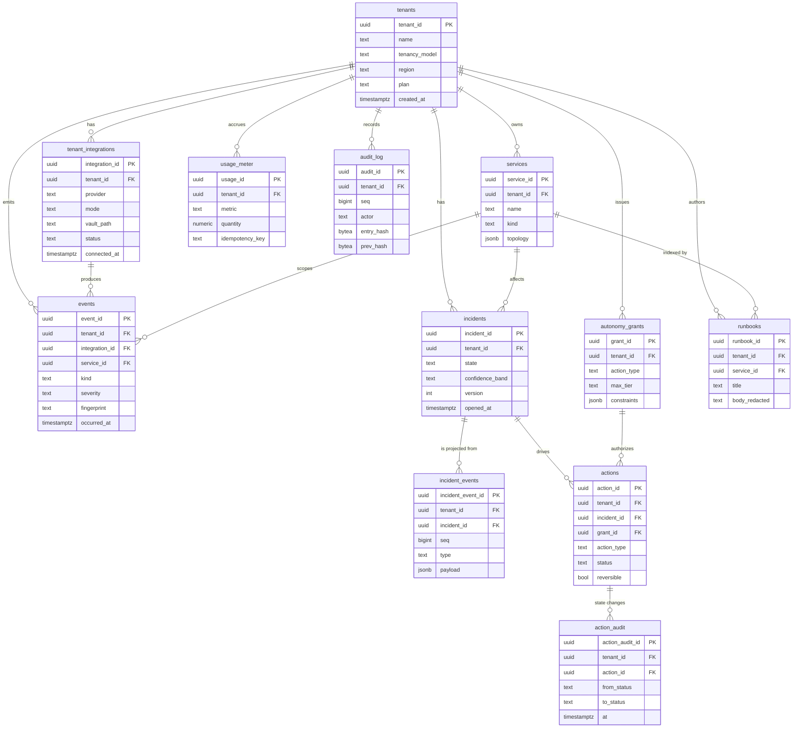

# 02 — Data Model, Multi-Tenancy & Isolation
*The persisted schema and the three-layer isolation story: pool-first Postgres with RLS as a database guarantee, event-sourced incidents, and per-tenant Qdrant/Redis namespacing — engineered so a single application bug cannot leak tenant A into tenant B.*

This document owns the durable data model and the isolation contract. It is the concrete realization of **ADR-001** (RLS, pool-first/silo-on-graduation), **ADR-011** (event-sourced incidents), and the storage half of **P1** (multi-tenancy from byte one) and **P2** (isolation as defense in depth). Every table here uses the canonical field names from doc 00 §5 verbatim. Where state is *in flight* rather than at rest, this doc stops at the persistence boundary: it stores the LangGraph checkpoint blob and the incident event store, but `04-agent-orchestration.md` owns the LangGraph state *shape*. It defines the `audit_log` table but `05-security-and-trust.md` owns the hash-chain *mechanism* that makes it tamper-evident. It defines `usage_meter` but `07-billing-and-unit-economics.md` owns the billing *logic*.

---

## 1. Tenancy models: pool, bridge, silo

Three canonical models exist (doc 00 §3), and Sentinel uses all three across a tenant's lifecycle.

- **Pool** — one shared Postgres database; every tenant-scoped table carries `tenant_id` and is governed by Row-Level Security. Cheapest per tenant, fastest to onboard (C3), the default.
- **Bridge** — still one shared database cluster, but a tenant gets its own Postgres **schema** (its own copy of the table set). A migration/transition state; reduces shared-buffer and index contention before a full move.
- **Silo** — a dedicated Postgres database (or, at the largest scale, a dedicated instance) for one tenant. Maximum blast-radius reduction and the answer to data-residency or contractual isolation demands.

**Sentinel is pool-first, silo-on-graduation (ADR-001).** A solo founder must be productive in minutes (C3); spinning up a database per trial signup is both slow and a margin disaster. So byte one is pool. We *earn the right* to spend on a silo only when a tenant's size, compliance posture, or load justifies it. RLS is the load-bearing safety mechanism in pool mode — the thing that makes "shared database" acceptable against C1/C2 — and it is the centerpiece of §3.

The three models are not three codepaths. The schema is identical in all three; only the **connection routing** differs. Pool tenants resolve to the shared DSN; bridge tenants get `SET search_path` to their schema on top of the shared DSN; silo tenants resolve to a dedicated DSN. The application's data-access layer is oblivious — it always `SET LOCAL app.tenant_id` and lets RLS (pool/bridge) or physical separation (silo) do the rest. This means **RLS stays enabled even in silo**: defense in depth (P2) does not get weaker because we moved a tenant; a misconfigured DSN pointing at the wrong silo still cannot read across the boundary.

### 1.1 Graduation decision table

A tenant graduates when **any** trigger fires. Graduation is one-way under normal operation (we do not demote silo→pool automatically).

| Trigger | Threshold (pool→bridge) | Threshold (bridge→silo) | Why it matters | Constraint |
|---|---|---|---|---|
| **Size — event volume** | > 5M persisted `events`/30d or > 50 GB tenant footprint | > 25M `events`/30d or > 250 GB | Index/buffer contention degrades *other* tenants | C1 (noisy neighbor), margins |
| **Size — incident rate** | > 200 incidents/30d sustained | > 1,000 incidents/30d | Hot `incident_events` partitions create lock pressure | C1 |
| **Compliance / residency** | Contractual "no shared DB" or data-residency clause | Same, hard requirement | Some buyers require physical isolation; RLS alone won't satisfy procurement | C2 |
| **Noisy neighbor (measured)** | p99 query latency attributable to one tenant > 2× pool median for 24h | Persists after bridge move | Protects the SLO of every co-tenant | C1 (ADR-007 sibling at the DB layer) |
| **Security blast-radius** | Tenant flagged high-value / targeted | Active threat or breach posture | Shrink the radius of any single-tenant compromise | C2 |
| **Plan / commercial** | Enterprise tier purchased | Dedicated-infra SKU | Isolation sold as a product feature | margins |

### 1.2 Graduation mechanics

Because incidents are event-sourced (ADR-011) and every table is keyed by `tenant_id`, graduation is a **filtered logical copy**, not a schema rewrite:

1. **Provision** the target (new schema for bridge, new database for silo) by applying the identical migration set.
2. **Backfill** under RLS: a one-shot job runs with `app.tenant_id` set to the graduating tenant and `COPY (SELECT … )` exports exactly that tenant's rows table-by-table; RLS guarantees the export cannot accidentally include a neighbor. Append-only tables (`incident_events`, `action_audit`, `audit_log`, `events`) copy cleanly because they never mutate; projections (`incidents`) are **rebuilt from the copied event store** at the destination rather than copied, which doubles as a correctness check (§4.4).
3. **Dual-write / catch-up** during a short window: new Kafka-sourced writes go to both old and new; consumer offsets (`tenant_id`-keyed, ADR-007) make this exactly-once per tenant.
4. **Cutover** by flipping the tenant→DSN mapping (a row in a small global routing table, §5.6), draining in-flight incident graphs at a checkpoint boundary (the orchestrator pauses on a LangGraph interrupt — doc 04).
5. **Verify & retire**: assert source/destination row counts and a projection-hash match per table, then mark source rows for tombstoning. We retain the source for a 7-day rollback window before purge.

The `audit_log` hash-chain (doc 05) must remain verifiable across the move: the chain is per-tenant, so the copied chain re-verifies end-to-end at the destination with no re-hashing.

---

## 2. The relational model



### 2.1 Schema (real DDL)

Every tenant-scoped table opens with `tenant_id uuid NOT NULL` (doc 00 §4). IDs are k-sortable ULIDs stored as `uuid` (doc 00 §4); we generate them in the app, not the DB, so the prefix-rendered string (`inc_…`, `evt_…`) and the stored 128-bit value stay in lockstep. Timestamps are `timestamptz`, UTC, `*_at`.

```sql
-- Global (NOT tenant-scoped): the only table outside RLS. Holds routing + plan.
CREATE TABLE tenants (
    tenant_id      uuid PRIMARY KEY,
    name           text NOT NULL,
    tenancy_model  text NOT NULL DEFAULT 'pool'
                     CHECK (tenancy_model IN ('pool','bridge','silo')),
    region         text NOT NULL DEFAULT 'us',           -- residency / topic prefix
    plan           text NOT NULL DEFAULT 'trial',
    cost_ceiling_usd numeric(10,2) NOT NULL DEFAULT 50.00, -- ADR-010 hard ceiling
    status         text NOT NULL DEFAULT 'active'
                     CHECK (status IN ('active','suspended','closed')),
    created_at     timestamptz NOT NULL DEFAULT now()
);

CREATE TABLE tenant_integrations (
    integration_id uuid PRIMARY KEY,                      -- int_…
    tenant_id      uuid NOT NULL REFERENCES tenants(tenant_id),
    provider       text NOT NULL,                         -- 'sentry','vercel','fly',…
    mode           text NOT NULL CHECK (mode IN ('agentless','agent')),
    vault_path     text NOT NULL,    -- secret/data/tenants/<tid>/integrations/<provider>
    scopes         text[] NOT NULL DEFAULT '{}',          -- least-privilege (P9)
    status         text NOT NULL DEFAULT 'connected'
                     CHECK (status IN ('connected','degraded','revoked')),
    connected_at   timestamptz NOT NULL DEFAULT now(),
    UNIQUE (tenant_id, provider, integration_id)
);
CREATE INDEX ix_integrations_tenant ON tenant_integrations (tenant_id, provider);

CREATE TABLE services (
    service_id     uuid PRIMARY KEY,                      -- svc_…
    tenant_id      uuid NOT NULL REFERENCES tenants(tenant_id),
    name           text NOT NULL,
    kind           text NOT NULL DEFAULT 'web'
                     CHECK (kind IN ('web','worker','cron','db','edge','external')),
    topology       jsonb NOT NULL DEFAULT '{}',           -- upstream/downstream edges
    discovered_at  timestamptz NOT NULL DEFAULT now(),
    UNIQUE (tenant_id, name)
);
CREATE INDEX ix_services_tenant ON services (tenant_id);

-- Persisted CanonicalEvent (doc 00 §5.1). Partitioned — see §6.
CREATE TABLE events (
    event_id       uuid NOT NULL,                         -- evt_…
    tenant_id      uuid NOT NULL,
    integration_id uuid NOT NULL,
    source         text NOT NULL,                         -- provider enum
    kind           text NOT NULL
                     CHECK (kind IN ('alert','log','metric','deploy','error','trace','ping')),
    service_id     uuid,                                  -- svc_…, resolved via discovery
    severity       text NOT NULL
                     CHECK (severity IN ('debug','info','warning','error','critical')),
    title          text NOT NULL,
    body_redacted  text NOT NULL,                         -- POST-redaction only (ADR-004, P3)
    fingerprint    text NOT NULL,                         -- stable dedup hash
    labels         jsonb NOT NULL DEFAULT '{}',
    redaction_meta jsonb NOT NULL DEFAULT '{}',           -- counts/types stripped (ADR-004)
    raw_ref        text,                                  -- pointer to redacted blob; nullable
    occurred_at    timestamptz NOT NULL,
    received_at    timestamptz NOT NULL DEFAULT now(),
    PRIMARY KEY (tenant_id, occurred_at, event_id)        -- PK carries partition keys
) PARTITION BY LIST (tenant_id);                          -- sub-partitioned by range(occurred_at), §6

-- Incident PROJECTION (ADR-011). Source of truth is incident_events.
CREATE TABLE incidents (
    incident_id     uuid PRIMARY KEY,                     -- inc_…
    tenant_id       uuid NOT NULL REFERENCES tenants(tenant_id),
    primary_service_id uuid REFERENCES services(service_id),
    state           text NOT NULL DEFAULT 'OPEN'
                      CHECK (state IN ('OPEN','TRIAGING','DIAGNOSED','AWAITING_APPROVAL',
                                       'REMEDIATING','MONITORING','ESCALATED','RESOLVED','CLOSED')),
    confidence_band text CHECK (confidence_band IN ('LOW','MEDIUM','HIGH')),
    title           text,
    root_cause      text,                                 -- redacted hypothesis summary
    checkpoint_ref  text,                                 -- LangGraph checkpoint blob ptr (doc 04 owns shape)
    version         int NOT NULL DEFAULT 0,               -- = last applied incident_events.seq
    opened_at       timestamptz NOT NULL DEFAULT now(),
    closed_at       timestamptz,
    UNIQUE (tenant_id, incident_id)
);
CREATE INDEX ix_incidents_tenant_state ON incidents (tenant_id, state)
    WHERE state NOT IN ('RESOLVED','CLOSED');             -- hot working set

-- Append-only event store for incidents (ADR-011, P8). NEVER updated/deleted.
CREATE TABLE incident_events (
    incident_event_id uuid NOT NULL,
    tenant_id         uuid NOT NULL,
    incident_id       uuid NOT NULL,
    seq               bigint NOT NULL,                    -- monotonic per incident
    type              text NOT NULL,                      -- see §4.1 event vocabulary
    payload           jsonb NOT NULL DEFAULT '{}',        -- redacted
    actor             text NOT NULL,                      -- 'commander','planner','human:<id>','system'
    occurred_at       timestamptz NOT NULL DEFAULT now(),
    PRIMARY KEY (tenant_id, incident_id, seq)             -- per-incident ordering, no gaps
);

CREATE TABLE actions (
    action_id     uuid PRIMARY KEY,                       -- act_…
    tenant_id     uuid NOT NULL REFERENCES tenants(tenant_id),
    incident_id   uuid NOT NULL REFERENCES incidents(incident_id),
    grant_id      uuid REFERENCES autonomy_grants(grant_id),
    action_type   text NOT NULL,                          -- 'deploy.rollback','process.restart',…
    target        jsonb NOT NULL,                         -- service/resource
    params        jsonb NOT NULL DEFAULT '{}',
    reversible    boolean NOT NULL,
    proposed_tier text NOT NULL CHECK (proposed_tier IN ('T0','T1','T2','T3')),
    required_tier text NOT NULL CHECK (required_tier IN ('T0','T1','T2','T3')),
    status        text NOT NULL DEFAULT 'proposed'
                    CHECK (status IN ('proposed','awaiting_approval','approved',
                                      'executing','succeeded','failed','rolled_back')),
    approved_by   text,
    executed_at   timestamptz,
    rollback_ref  text,
    created_at    timestamptz NOT NULL DEFAULT now()
);
CREATE INDEX ix_actions_incident ON actions (tenant_id, incident_id);

-- Immutable per-state-change record for every ActionRequest (doc 00 §5.4).
CREATE TABLE action_audit (
    action_audit_id uuid PRIMARY KEY,
    tenant_id       uuid NOT NULL REFERENCES tenants(tenant_id),
    action_id       uuid NOT NULL REFERENCES actions(action_id),
    from_status     text,
    to_status       text NOT NULL,
    reason          text,
    actor           text NOT NULL,
    at              timestamptz NOT NULL DEFAULT now()
);
CREATE INDEX ix_action_audit_action ON action_audit (tenant_id, action_id, at);

CREATE TABLE autonomy_grants (
    grant_id     uuid PRIMARY KEY,                        -- grant_…
    tenant_id    uuid NOT NULL REFERENCES tenants(tenant_id),
    action_type  text NOT NULL,
    max_tier     text NOT NULL DEFAULT 'T0'
                   CHECK (max_tier IN ('T0','T1','T2','T3')),
    constraints  jsonb NOT NULL DEFAULT '{}',             -- allow-listed svcs, max replicas, windows
    granted_by   text NOT NULL,
    granted_at   timestamptz NOT NULL DEFAULT now(),
    revoked_at   timestamptz
);
-- At most one ACTIVE grant per (tenant, action_type):
CREATE UNIQUE INDEX uq_active_grant
    ON autonomy_grants (tenant_id, action_type)
    WHERE revoked_at IS NULL;

-- Tamper-evident audit log. THIS DOC owns the table; doc 05 owns the hash-chain mechanism.
CREATE TABLE audit_log (
    audit_id    uuid PRIMARY KEY,
    tenant_id   uuid NOT NULL REFERENCES tenants(tenant_id),
    seq         bigint NOT NULL,                          -- per-tenant monotonic
    actor       text NOT NULL,
    action      text NOT NULL,                            -- verb, e.g. 'grant.created'
    target      text,
    detail      jsonb NOT NULL DEFAULT '{}',              -- redacted
    entry_hash  bytea NOT NULL,                           -- H(seq||prev_hash||canonical(row)) — doc 05
    prev_hash   bytea NOT NULL,                           -- chain link; genesis = 32 zero bytes
    at          timestamptz NOT NULL DEFAULT now(),
    UNIQUE (tenant_id, seq)
);

-- Usage events for billing. THIS DOC owns the table; doc 07 owns billing logic.
CREATE TABLE usage_meter (
    usage_id        uuid PRIMARY KEY,
    tenant_id       uuid NOT NULL REFERENCES tenants(tenant_id),
    incident_id     uuid,                                 -- nullable: not all usage is incident-bound
    metric          text NOT NULL
                      CHECK (metric IN ('llm_tokens_in','llm_tokens_out','tool_call',
                                        'incident','event_ingested','action_executed')),
    quantity        numeric(18,4) NOT NULL,
    unit_cost_usd   numeric(12,6),                        -- snapshot at accrual (doc 07 reprices)
    model           text,                                 -- LLM routing tier, ADR-008
    idempotency_key text NOT NULL,                        -- ADR-010: retries never double-charge
    occurred_at     timestamptz NOT NULL DEFAULT now(),
    UNIQUE (tenant_id, idempotency_key)                   -- idempotent metering (ADR-010)
);
CREATE INDEX ix_usage_tenant_time ON usage_meter (tenant_id, occurred_at);

CREATE TABLE runbooks (
    runbook_id    uuid PRIMARY KEY,
    tenant_id     uuid NOT NULL REFERENCES tenants(tenant_id),
    service_id    uuid REFERENCES services(service_id),
    title         text NOT NULL,
    body_redacted text NOT NULL,                          -- redacted at edge if imported (P3)
    source        text NOT NULL DEFAULT 'scribe'          -- 'scribe' | 'human' | 'imported'
                    CHECK (source IN ('scribe','human','imported')),
    embedding_ref text,                                   -- Qdrant point id (per-tenant collection, §7)
    created_at    timestamptz NOT NULL DEFAULT now(),
    updated_at    timestamptz NOT NULL DEFAULT now()
);
CREATE INDEX ix_runbooks_tenant_service ON runbooks (tenant_id, service_id);
```

Two deliberate choices. First, **`events`, `incident_events`, and `action_audit` carry `tenant_id` in their primary key**, not just as a column — this makes the partition/ordering key explicit and lets RLS short-circuit on the leading index column. Second, **append-only tables omit `ON UPDATE`/`ON DELETE` cascades and we additionally forbid those verbs in policy** (§3.4): event-sourcing (P8) is meaningless if history can be rewritten.

> **Two further tenant-scoped tables live with the ingestion edge, not here.** `webhook_inbox` and `event_outbox` (the inbox/outbox idempotency pair, defined in `03-connectors-and-integrations.md` §3) are operational tables of the `ingestion-edge`/`connector-<provider>` services. They carry `tenant_id`, are RLS-governed exactly like the tables above, and graduate with a tenant (§1.2), but their shape is owned by doc 03 because their lifecycle is the connector's, not the incident domain's. They are listed here only so this schema-of-record is complete.

---

## 3. Row-Level Security — the centerpiece

RLS is *why* pool mode is safe (ADR-001). The promise is concrete: **even a buggy or adversarial query that "forgets" its `WHERE tenant_id = …` clause, or supplies a forged one, returns zero cross-tenant rows** — because the database itself appends the tenant predicate to every statement. This is defense in depth (P2): the application's own checks can be wrong, and isolation still holds.

### 3.1 The two roles

```sql
-- The role the application connects as. It can read/write data but CANNOT bypass RLS.
CREATE ROLE sentinel_app NOLOGIN NOBYPASSRLS;
GRANT sentinel_app TO sentinel_runtime;   -- the actual login role used by the pool

-- A separate migration role that owns the tables. Table owners bypass RLS by default,
-- so the app NEVER logs in as the owner, and we FORCE RLS so even the owner is bound (§3.4).
CREATE ROLE sentinel_owner NOLOGIN;
```

The single most important line in this document is **`NOBYPASSRLS`** on the role the application actually uses. A superuser or a `BYPASSRLS` role would render every policy below cosmetic.

### 3.2 The per-request session variable (GUC)

Isolation keys off a custom session GUC, `app.tenant_id`, set per request:

```sql
-- Declared at server start (postgresql.conf) so the GUC is recognized:
--   sentinel.tenant_id = ''        # placeholder; actual var is app.tenant_id
-- Custom GUCs require a namespace; we use `app.*`. No SET requires superuser.
```

Policies read it via `current_setting('app.tenant_id', true)`. The `true` ("missing_ok") flag makes an *unset* GUC return `NULL` rather than erroring — and a `NULL` tenant must match **nothing**, so a connection that forgot to set the GUC is fail-closed, not fail-open.

### 3.3 Enabling RLS and the policies

```sql
-- Enable + FORCE on every tenant-scoped table. FORCE binds even the table owner.
ALTER TABLE tenant_integrations ENABLE ROW LEVEL SECURITY;
ALTER TABLE tenant_integrations FORCE ROW LEVEL SECURITY;
ALTER TABLE services            ENABLE ROW LEVEL SECURITY;
ALTER TABLE services            FORCE ROW LEVEL SECURITY;
ALTER TABLE events              ENABLE ROW LEVEL SECURITY;
ALTER TABLE events              FORCE ROW LEVEL SECURITY;
ALTER TABLE incidents           ENABLE ROW LEVEL SECURITY;
ALTER TABLE incidents           FORCE ROW LEVEL SECURITY;
ALTER TABLE incident_events     ENABLE ROW LEVEL SECURITY;
ALTER TABLE incident_events     FORCE ROW LEVEL SECURITY;
ALTER TABLE actions             ENABLE ROW LEVEL SECURITY;
ALTER TABLE actions             FORCE ROW LEVEL SECURITY;
ALTER TABLE action_audit        ENABLE ROW LEVEL SECURITY;
ALTER TABLE action_audit        FORCE ROW LEVEL SECURITY;
ALTER TABLE autonomy_grants     ENABLE ROW LEVEL SECURITY;
ALTER TABLE autonomy_grants     FORCE ROW LEVEL SECURITY;
ALTER TABLE audit_log           ENABLE ROW LEVEL SECURITY;
ALTER TABLE audit_log           FORCE ROW LEVEL SECURITY;
ALTER TABLE usage_meter         ENABLE ROW LEVEL SECURITY;
ALTER TABLE usage_meter         FORCE ROW LEVEL SECURITY;
ALTER TABLE runbooks            ENABLE ROW LEVEL SECURITY;
ALTER TABLE runbooks            FORCE ROW LEVEL SECURITY;

-- Canonical policy, applied identically to every tenant-scoped table.
-- USING governs visibility (SELECT/UPDATE/DELETE); WITH CHECK governs writes (INSERT/UPDATE):
-- you can neither SEE nor WRITE a row whose tenant_id != the session's tenant.
CREATE POLICY tenant_isolation ON events
    USING      (tenant_id = current_setting('app.tenant_id', true)::uuid)
    WITH CHECK (tenant_id = current_setting('app.tenant_id', true)::uuid);
-- … identical CREATE POLICY tenant_isolation ON <table> for every table above.

-- Grant the app role only the verbs it needs:
GRANT SELECT, INSERT          ON events, incident_events, action_audit, audit_log TO sentinel_app;  -- append-only
GRANT SELECT, INSERT, UPDATE  ON incidents, actions, autonomy_grants, services,
                                 tenant_integrations, runbooks                    TO sentinel_app;
GRANT SELECT, INSERT          ON usage_meter TO sentinel_app;
-- NOTE: no DELETE granted on append-only tables; combined with FORCE RLS this is belt-and-suspenders.
```

Two subtleties worth calling out. The `WITH CHECK` clause is what stops a **write-side** cross-tenant attack: without it, RLS would let you `INSERT` a row stamped with someone else's `tenant_id`. And `FORCE ROW LEVEL SECURITY` is what stops the owner-bypass footgun — by default the table owner is exempt from its own policies, which would quietly defeat the whole scheme during a migration job that ran as owner.

### 3.4 Why RLS beats app-layer checks (P2)

An application-layer "always filter by tenant" rule is *one* check, in *one* place, that a single forgotten `.filter()`, a raw SQL string, a new endpoint, a clever ORM lazy-load, or a SQL-injection foothold can defeat. RLS moves the check **below** all of that, into the engine, where every statement on every connection is subject to it regardless of how the SQL was constructed. The two layers are independent — exactly the property P2 demands ("a bug in any one layer is not sufficient to cross tenants"). App-layer scoping still exists (it's faster and gives better errors), but it is the *convenience* layer; RLS is the *guarantee* layer. ADR-001's mandatory CI test (§8) exists to keep that guarantee honest on every commit.

### 3.5 Setting the GUC per request (SQLAlchemy)

The GUC is set with `SET LOCAL`, which scopes it to the **current transaction** and auto-resets on commit/rollback — critical when connections are pooled, because a leaked GUC would be a cross-tenant leak. We bind it to the SQLAlchemy session lifecycle:

```python
# data/session.py  — Python 3.12, SQLAlchemy 2.x, asyncpg.
from contextlib import asynccontextmanager
from sqlalchemy import text
from sqlalchemy.ext.asyncio import AsyncSession, async_sessionmaker

SessionFactory = async_sessionmaker(expire_on_commit=False)

@asynccontextmanager
async def tenant_session(tenant_id: str):
    """Open a transaction whose every statement is RLS-scoped to `tenant_id`.

    SET LOCAL ties the GUC to THIS transaction; on commit/rollback it is gone,
    so a pooled connection cannot carry one tenant's scope into another's request.
    """
    async with SessionFactory() as session:
        async with session.begin():                      # one tx == one tenant scope
            # parameterized: set_config is injection-safe even with a hostile tenant_id string
            await session.execute(
                text("SELECT set_config('app.tenant_id', :tid, true)"),  # true => LOCAL
                {"tid": tenant_id},
            )
            yield session
        # commit here resets app.tenant_id automatically
```

Every request handler, every Kafka consumer, every incident-graph node acquires its DB session through `tenant_session(tenant_id)` and never touches a raw connection. The `tenant_id` flows from the authenticated request (dashboard) or from the Kafka message key (consumers; ADR-007 partitions by `tenant_id`, so the worker already knows whose message it is). `set_config(..., true)` is the function form of `SET LOCAL` and is parameter-safe — a maliciously crafted `tenant_id` is a value, never SQL.

---

## 4. Event-sourced incidents (ADR-011)

`incident_events` is the append-only source of truth; the `incidents` row is a **projection** rebuilt by folding events in `seq` order (P8). This buys us audit (every state change is a durable fact), restart-survival (the projection is reconstructable), and replayable evals (the golden-incident library — doc 06 — replays event streams).

### 4.1 Event vocabulary

Each `incident_events.type` plus a redacted `payload`. The lifecycle in doc 00 §5.3 (`OPEN → TRIAGING → DIAGNOSED → {AWAITING_APPROVAL | REMEDIATING | ESCALATED} → RESOLVED → CLOSED`, optional `MONITORING` after `REMEDIATING`) is expressed entirely as folded events:

| `type` | Emitted by | Effect on projection |
|---|---|---|
| `incident.opened` | correlator | create row, `state=OPEN`, set `primary_service_id` |
| `triage.started` | commander | `state=TRIAGING` |
| `specialist.finding` | specialist | append to evidence; no state change |
| `hypothesis.formed` | commander | set `root_cause`, `confidence_band` |
| `incident.diagnosed` | commander | `state=DIAGNOSED` |
| `approval.requested` | commander | `state=AWAITING_APPROVAL` |
| `approval.granted` / `approval.denied` | `human:<id>` | → `REMEDIATING` / `ESCALATED` |
| `remediation.started` | planner | `state=REMEDIATING` |
| `monitoring.started` | commander | `state=MONITORING` |
| `incident.escalated` | commander | `state=ESCALATED` (human paged w/ diagnosis + fix) |
| `incident.resolved` | commander/human | `state=RESOLVED`, set `closed_at` candidate |
| `incident.closed` | system | `state=CLOSED` |
| `checkpoint.saved` | orchestrator | set `checkpoint_ref` (blob ptr; shape owned by doc 04) |

`action.*` lifecycle facts live in `action_audit`, not here, to keep the incident stream about *the incident* and the action stream about *the write*. The two join on `incident_id`.

### 4.2 Append (the only write path)

```python
async def append_incident_event(session, *, tenant_id, incident_id, type_, payload, actor):
    """Atomically append the next seq for an incident and apply it to the projection.
    RLS already scopes the session; the (tenant_id, incident_id, seq) PK guarantees
    gap-free per-incident ordering and rejects concurrent double-appends."""
    seq = (await session.execute(text("""
        SELECT COALESCE(MAX(seq), 0) + 1
        FROM incident_events
        WHERE incident_id = :iid
        FOR UPDATE
    """), {"iid": incident_id})).scalar_one()

    await session.execute(text("""
        INSERT INTO incident_events
            (incident_event_id, tenant_id, incident_id, seq, type, payload, actor)
        VALUES (:eid, :tid, :iid, :seq, :type, :payload, :actor)
    """), {"eid": new_ulid("evt"), "tid": tenant_id, "iid": incident_id,
           "seq": seq, "type": type_, "payload": payload, "actor": actor})

    apply_event_to_projection(session, incident_id, seq, type_, payload)  # §4.3
```

The append and the projection update happen in **one transaction** under one `app.tenant_id` scope, so the projection can never drift from the log within a committed unit of work. The `incidents.version` column tracks the last applied `seq`, giving us optimistic concurrency: a stale writer's `UPDATE … WHERE version = :expected` fails and retries.

### 4.3 Projection

`apply_event_to_projection` is a pure function of `(current_projection, event) → new_projection` — a `match` over `type` setting `state`/`confidence_band`/`root_cause` per the table in §4.1, then `UPDATE incidents SET …, version = :seq WHERE incident_id = :iid AND version = :seq - 1`. Because it is pure and ordered, the same fold applied to the same events always yields the same projection — the foundation of replay.

### 4.4 Replay / rebuild

```python
async def rebuild_incident(session, incident_id):
    """Reconstruct the projection from scratch. Used after a bug in projection logic,
    on graduation (§1.2), and as the correctness check in CI. RLS scopes the read."""
    await session.execute(text("DELETE FROM incidents WHERE incident_id = :iid"),
                          {"iid": incident_id})  # projection only; event store untouched
    rows = await session.execute(text("""
        SELECT seq, type, payload FROM incident_events
        WHERE incident_id = :iid ORDER BY seq ASC
    """), {"iid": incident_id})
    proj = None
    for seq, type_, payload in rows:
        proj = fold(proj, seq, type_, payload)
    await upsert_projection(session, incident_id, proj)
    return proj
```

Rebuild is safe because it deletes only the *projection*, never the event store (the append-only table has no `DELETE` grant for the app role anyway — §3.3). A nightly job rebuilds a sample of incidents into a scratch table and diffs against the live projection; any mismatch is a projection-logic bug and pages us.

---

## 5. Scaling, partitioning & the supporting stores

### 5.1 Partitioning `events` (by tenant + time)

`events` is the highest-volume table (alert/log/metric/deploy/error/trace/ping). We partition **`LIST (tenant_id)` at the top level, then `RANGE (occurred_at)` monthly** underneath. Tenant-first partitioning is what makes graduation cheap (a tenant's data is already physically clustered — §1.2) and lets us `DETACH` a graduating tenant's partitions instead of row-by-row export when sizes are large. Time sub-partitioning gives cheap retention: dropping a month is a `DROP TABLE`, not a mass `DELETE`, and keeps the hot working set (recent events for open incidents) in small, well-indexed partitions.

```sql
-- Top level is created with the table (§2.1). Per active tenant, one LIST partition,
-- itself range-partitioned by month:
CREATE TABLE events_ten_01hzx9 PARTITION OF events
    FOR VALUES IN ('01HZX9...')                          -- the tenant's uuid
    PARTITION BY RANGE (occurred_at);

CREATE TABLE events_ten_01hzx9_2026_06 PARTITION OF events_ten_01hzx9
    FOR VALUES FROM ('2026-06-01') TO ('2026-07-01');

CREATE INDEX ON events_ten_01hzx9_2026_06 (service_id, occurred_at);
CREATE INDEX ON events_ten_01hzx9_2026_06 (fingerprint);   -- correlator dedup lookups
```

A scheduled job pre-creates next month's sub-partitions and creates a tenant's LIST partition lazily on first event. Default behavior for an unrecognized tenant is a `DEFAULT` partition that alarms (it should never receive rows in steady state). RLS applies through the partition hierarchy — policies on the parent are inherited — so partitioning never weakens isolation. For very high-cardinality tenant counts in pool, we cap LIST partitions and route the long tail through a hash-subpartitioned catch-all; whales graduate (§1) before they become a partition-count problem.

### 5.2 Qdrant: per-tenant isolation

Tenant memory (postmortems, resolved-incident embeddings, runbook chunks — `runbooks.embedding_ref`) lives in Qdrant. Two options:

| Option | Isolation | Cost | Cross-tenant leak risk |
|---|---|---|---|
| **Collection-per-tenant** (chosen) | Physical: a query names a collection; another tenant's vectors are simply not in scope | Higher per-collection overhead | A forgotten payload filter leaks **nothing** — wrong collection = no data |
| Shared collection + `tenant_id` payload filter | Logical only: every search must include `must: [{key: tenant_id}]` | Cheaper, one index | A forgotten/forged filter leaks **everyone's** nearest neighbors |

We choose **collection-per-tenant** (P2). It mirrors the RLS argument exactly: the shared-collection model makes correctness depend on never forgetting a filter — the same single-point-of-failure RLS exists to eliminate. Collection naming is `mem_<tenant_id>`; provisioning happens at onboarding alongside the tenant row. On graduation to silo we move the collection to the tenant's dedicated Qdrant namespace; the per-collection model makes that a clean copy. The marginal cost of extra collections is real but bounded, and far cheaper than a cross-tenant memory leak — which would expose one founder's redacted incident *patterns* to another. (Even leaked, vectors are over redacted text per ADR-004/P3, but P2 means we don't rely on that.)

### 5.3 Redis: locks, budgets, rate limits

Redis is ephemeral coordination, never a source of truth, and every key is tenant-prefixed (P1). Conventions:

| Purpose | Key pattern | Type / semantics |
|---|---|---|
| **Incident lock** (one incident, one worker) | `lock:{tenant_id}:incident:{incident_id}` | `SET … NX PX <ttl>` (Redlock-style); holder renews; expiry frees a dead worker |
| **Per-tenant cost budget** (ADR-010 input to doc 07) | `budget:{tenant_id}:month:{yyyymm}` | counter incremented on each `usage_meter` accrual; read by the circuit breaker |
| **Cost circuit-breaker state** | `breaker:{tenant_id}` | `open`/`closed`; `open` ⇒ degrade to T0 + page (ADR-010) |
| **Tenant rate limit** (ingestion fair-share, ADR-007) | `ratelimit:{tenant_id}:{window}` | token bucket; protects co-tenants from a storm |
| **Tool-call rate limit** | `ratelimit:{tenant_id}:tool:{provider}` | token bucket per provider; avoids tripping a tenant's own provider quotas |

The incident lock is what enforces **exactly one worker per incident** so two consumers of the same `tenant_id` partition can't both drive the same incident graph. Locks are advisory and TTL-bounded: if a worker dies mid-incident, the lock expires and another worker resumes from the last LangGraph checkpoint (`incidents.checkpoint_ref`) — the durable state lives in Postgres, never in Redis, so a Redis flush loses coordination but never loses an incident.

---

## 6. The cross-tenant isolation test (mandatory, ADR-001)

ADR-001 mandates a CI test proving tenant A cannot read tenant B — including via a *forged* filter. It runs against a real Postgres with the policies of §3 applied and the app connected as `sentinel_app` (NOBYPASSRLS). It is a merge gate.

```python
# tests/isolation/test_rls_cross_tenant.py
import pytest
from sqlalchemy import text
from data.session import tenant_session

A = "01HZXAAAAAAAAAAAAAAAAAAAAA"   # ten_A
B = "01HZXBBBBBBBBBBBBBBBBBBBBB"   # ten_B

@pytest.fixture
async def two_tenants(db):
    # Seed one incident per tenant AS THAT TENANT (writes also pass through RLS WITH CHECK).
    async with tenant_session(A) as s:
        await s.execute(text("INSERT INTO incidents (incident_id, tenant_id, state) "
                             "VALUES (:i, :t, 'OPEN')"),
                        {"i": "01HZINCAAAAAAAAAAAAAAAAAAA", "t": A})
    async with tenant_session(B) as s:
        await s.execute(text("INSERT INTO incidents (incident_id, tenant_id, state) "
                             "VALUES (:i, :t, 'OPEN')"),
                        {"i": "01HZINCBBBBBBBBBBBBBBBBBBB", "t": B})

async def test_a_cannot_select_b(two_tenants):
    """Scoped to A, a plain SELECT returns ONLY A's rows."""
    async with tenant_session(A) as s:
        rows = (await s.execute(text("SELECT tenant_id FROM incidents"))).scalars().all()
    assert rows, "A must see its own row"
    assert all(str(r) == A for r in rows), "A saw a foreign tenant's row — RLS BREACH"

async def test_forged_filter_is_powerless(two_tenants):
    """Even an EXPLICIT, crafted WHERE tenant_id = B returns nothing while scoped to A.
    RLS ANDs its own predicate onto ours; the forged filter cannot widen visibility."""
    async with tenant_session(A) as s:
        rows = (await s.execute(
            text("SELECT * FROM incidents WHERE tenant_id = :b"), {"b": B}
        )).all()
    assert rows == [], "Forged tenant_id filter leaked B's data — RLS BREACH"

async def test_cannot_insert_for_another_tenant(two_tenants):
    """WITH CHECK blocks stamping a row with someone else's tenant_id."""
    async with tenant_session(A) as s:
        with pytest.raises(Exception):   # asyncpg raises CheckViolation / policy error
            await s.execute(text("INSERT INTO incidents (incident_id, tenant_id, state) "
                                 "VALUES (:i, :b, 'OPEN')"),
                            {"i": "01HZINCXXXXXXXXXXXXXXXXXXX", "b": B})

async def test_missing_guc_is_fail_closed(db):
    """A connection that NEVER set app.tenant_id sees NOTHING (NULL matches nothing)."""
    from data.session import SessionFactory
    async with SessionFactory() as s:           # deliberately NOT via tenant_session()
        async with s.begin():
            rows = (await s.execute(text("SELECT * FROM incidents"))).all()
    assert rows == [], "Unset app.tenant_id was fail-OPEN — must be fail-closed"

async def test_app_role_has_no_bypass(db):
    """Guard the guarantee itself: the runtime role must not be able to bypass RLS."""
    async with SessionFactory() as s:
        bypass = (await s.execute(text(
            "SELECT rolbypassrls FROM pg_roles WHERE rolname = current_user"
        ))).scalar_one()
    assert bypass is False, "Runtime role has BYPASSRLS — every policy is cosmetic"
```

The decisive case is `test_forged_filter_is_powerless`: an attacker (or a bug) that *knows* B's `tenant_id` and writes the explicit predicate still gets nothing, because Postgres ANDs the policy's `tenant_id = current_setting('app.tenant_id')` onto whatever predicate the query supplies. Visibility can only ever *narrow*. `test_app_role_has_no_bypass` guards the guarantee at its root — it fails loudly if someone ever grants the runtime role `BYPASSRLS`, which would silently void every other test.

---

## Open questions & risks

- **Partition count vs. pool density.** `LIST (tenant_id)` partitioning is graduation-friendly but Postgres planning degrades past a few thousand partitions. We assume whales graduate (§1) before that bites, but the exact pool-density ceiling — and the hash-subpartitioned long-tail fallback — needs a load test, not a guess.
- **GUC-per-transaction overhead.** `set_config('app.tenant_id', …, true)` on every transaction is a real (small) cost and forces transaction-scoped sessions everywhere. Under very high incident-graph node fan-out this could add up; we should benchmark `SET LOCAL` overhead vs. a prepared-statement-bound approach.
- **Dual-write window correctness during graduation.** Step 3 of §1.2 leans on exactly-once per-tenant Kafka offsets; a partial cutover failure could split an incident's event stream across old and new stores. The reconciliation/rollback procedure here is sketched, not proven, and needs a chaos test.
- **`audit_log` chain across graduation.** The chain is per-tenant and re-verifies after a copy (§1.2), but doc 05 owns the hash mechanism — we need a shared contract test that the copied chain verifies byte-for-byte at the destination, owned jointly.
- **Qdrant collection ceiling.** Collection-per-tenant (P2) trades cost for safety; Qdrant's practical limit on collections per node, and when memory pressure forces an earlier-than-DB silo graduation, is unquantified.
- **Cross-store consistency on tenant deletion / right-to-erasure.** Deleting a tenant must atomically purge Postgres partitions, the Qdrant collection, Redis keys, and object-storage `raw_ref` blobs. Today these are separate systems with no distributed transaction; a deletion saga with verification is required and not yet designed (touches doc 05).
