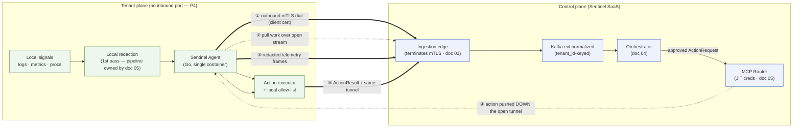

# 03 — Connector Layer & Integration Modes

*The moat: a uniform `Connector` adapter every provider implements, a capability model that turns "read signals" and "write actions" into first-class data, and an outbound-only Sentinel Agent that dials home over mTLS so a tenant never opens a port.*

This document owns two things: the **connector layer** (how Sentinel ingests signals from and acts upon a tenant's stack) and the **Sentinel Agent transport** (how the optional tenant-side container reaches us). It assumes the reader has internalized the constitution — `00-glossary-and-decisions.md` — and uses its vocabulary verbatim: the `CanonicalEvent` envelope (§5.1), the `ActionRequest` shape (§5.4), identifier prefixes (`ten_`/`int_`/`evt_`/`svc_`), autonomy tiers `T0`–`T3` (§6), and ADR-002/003/004/005/009/010. It produces the `CanonicalEvent` that the rest of the system consumes; everything downstream speaks only canonical (ADR-009).

Three constraints govern every decision here. **C1** — never cause an outage; reads are safe, writes are allow-listed/reversible/approval-gated. **C2** — minimize what we can see; agentless by default, least-privilege scopes, redact at the edge *before* persistence (P3, P4). **C3** — onboard in minutes; the connector library + agentless OAuth path is *how C3 is won*. Adding the 25th provider must be writing one adapter, not changing the system (ADR-009).

Lane boundaries: redaction internals and credential brokering belong to `05-security-and-trust.md` (this doc forwards *already-redacted* data and names where redaction happens; it does not implement the detectors). The MCP Router that injects JIT credentials into write calls belongs to `05-security-and-trust.md` and the policy that gates those calls to `04-agent-orchestration.md`. Where the ingestion edge physically sits is `01-architecture.md`. The `tenant_integrations` table (one row per connected provider instance, keyed `int_…`) is owned by `02-data-model-and-isolation.md`; we reference it, we don't define it.

---

## 1. The adapter pattern at scale

A connector is the *whole* integration for one provider; an adapter is the `normalize()` code inside it (glossary §3). Heterogeneity is the enemy: Sentry speaks issue/event JSON, Vercel speaks deployment lifecycle, Grafana speaks alert rules, UptimeRobot speaks pings. If each leaked its shape into correlation or orchestration, every new provider would be a system change. So we invert it: every provider implements one **`Connector`** Protocol, and the only thing it must promise the rest of Sentinel is a stream of `CanonicalEvent` and a declared set of capabilities.

Two design rules make this scale to dozens of providers without the abstraction rotting:

1. **Capabilities are data, not code paths.** A connector *declares* what signals it reads and what `action_type`s it can write via a `ConnectorCapabilities` model. The orchestrator (doc 04) never asks "is this Vercel?" — it asks "does the connector bound to `int_…` advertise `deploy.rollback`?" Adding a write action is adding an entry to a capability set plus an `execute()` branch, gated by the same `AutonomyGrant` machinery for every provider (ADR-003).
2. **Ingestion and action are separated.** The read path (`subscribe`/`poll` → `normalize`) and the write path (`execute`) are different methods with different trust levels. Reads run in agentless mode with read-only tokens (C2). Writes require either a provider write-API + explicit grant, or the Sentinel Agent (ADR-002). A connector may be read-only forever and still be first-class.

### 1.1 The `Connector` Protocol (canonical interface)

This is the contract. It is a `typing.Protocol` (structural — connectors don't inherit, they conform; testing with fakes is trivial) plus an `abc.ABC` base that supplies the shared idempotency/rate-limit plumbing so no adapter re-implements it. New in this document and referenced by doc 04 (which calls `execute`) and doc 01 (which references the two modes): the name **`Connector`**, the **`ConnectorCapabilities`** model, and the **`SignalType`/`ActionType`** enums.

```python
from __future__ import annotations

from abc import ABC, abstractmethod
from datetime import datetime
from enum import StrEnum
from typing import Protocol, runtime_checkable

from pydantic import BaseModel, Field

# ── Canonical enums (kind values from CanonicalEvent §5.1) ────────────────────
class SignalType(StrEnum):
    ALERT = "alert"
    LOG = "log"
    METRIC = "metric"
    DEPLOY = "deploy"
    ERROR = "error"
    TRACE = "trace"
    PING = "ping"


class ActionType(StrEnum):
    """Write action types. Mirror AutonomyGrant.action_type (glossary §5.2)."""
    DEPLOY_ROLLBACK = "deploy.rollback"
    DEPLOY_REDEPLOY = "deploy.redeploy"
    PROCESS_RESTART = "process.restart"
    SERVICE_SCALE = "service.scale"
    SERVICE_PAUSE = "service.pause"
    CONFIG_SET_ENV = "config.set_env"
    DB_FAILOVER = "db.failover"
    FEATURE_FLAG_TOGGLE = "feature_flag.toggle"


class IntegrationMethod(StrEnum):
    WEBHOOK = "webhook"      # provider pushes; we verify + dedup at the edge
    POLL = "poll"            # we pull on a rate-limited schedule
    AGENT = "agent"          # delivered via the Sentinel Agent tunnel


# ── Capability model (the heart of the moat) ─────────────────────────────────
class WriteCapability(BaseModel):
    action_type: ActionType
    reversible: bool                       # feeds ActionRequest.reversible (§5.4); irreversible ⇒ always page
    requires_agent: bool = False           # True if only the Sentinel Agent can perform it
    min_tier_hint: str = "T2"              # connector's recommended floor; policy (doc 04) is authoritative
    idempotent: bool = True                # safe to retry without duplicate effect


class ConnectorCapabilities(BaseModel):
    provider: str                          # matches CanonicalEvent.source enum
    reads: frozenset[SignalType]
    writes: tuple[WriteCapability, ...] = ()
    methods: frozenset[IntegrationMethod]
    oauth_scopes: tuple[str, ...] = ()     # least-privilege scopes requested (C2); see §4

    def supports_write(self, at: ActionType) -> WriteCapability | None:
        return next((w for w in self.writes if w.action_type == at), None)


# ── Inputs the connector receives ────────────────────────────────────────────
class IntegrationContext(BaseModel):
    """Per-tenant binding. Hydrated from tenant_integrations (doc 02)."""
    tenant_id: str                         # ten_…
    integration_id: str                    # int_…
    provider: str
    # NB: no raw secret here. Credentials are brokered JIT (P9, ADR-005);
    # the connector receives a short-lived handle, never a durable key.
    vault_ref: str                         # secret/data/tenants/<tid>/integrations/<provider>
    config: dict[str, str] = Field(default_factory=dict)


class RawSignal(BaseModel):
    """What the edge hands the adapter: a verified, idempotency-checked payload."""
    integration_id: str
    method: IntegrationMethod
    payload: dict                          # provider-native JSON
    headers: dict[str, str] = Field(default_factory=dict)
    received_at: datetime


class HealthStatus(BaseModel):
    healthy: bool
    detail: str = ""
    token_expires_at: datetime | None = None   # surfaces refresh urgency (§4)


# ── The contract ─────────────────────────────────────────────────────────────
@runtime_checkable
class Connector(Protocol):
    capabilities: ConnectorCapabilities

    async def verify_webhook(self, raw: RawSignal, ctx: IntegrationContext) -> bool:
        """Validate provider signature/HMAC before anything else touches the payload."""
        ...

    async def normalize(self, raw: RawSignal, ctx: IntegrationContext) -> list["CanonicalEvent"]:
        """Provider-native payload → 0..N CanonicalEvents. The adapter. NO network I/O.
        Emits body_redacted='' as a placeholder; the edge redaction stage (doc 05)
        fills body_redacted + redaction_meta before the event is produced to Kafka."""
        ...

    async def healthcheck(self, ctx: IntegrationContext) -> HealthStatus:
        """Cheap liveness/credential-validity probe. Powers the trust dashboard + alerts."""
        ...

    async def execute(self, action: "ActionRequest", ctx: IntegrationContext) -> "ActionResult":
        """Perform a write. MUST be a no-op (raise CapabilityError) unless
        self.capabilities.supports_write(action.action_type) is truthy AND the
        MCP Router (doc 05) has injected a scoped JIT credential for this call."""
        ...


class PollingConnector(Protocol):
    """Optional mixin for poll-mode providers (no webhook)."""
    async def poll(self, ctx: IntegrationContext, cursor: str | None) -> tuple[list[RawSignal], str | None]:
        """Return new signals + an opaque next-cursor. Rate-limited by §5's bucket."""
        ...


class ConnectorBase(ABC):
    """Shared plumbing: idempotency (§3), rate-limit budgeting (§5), retry/jitter.
    Concrete connectors inherit this so adapters stay tiny and uniform."""
    capabilities: ConnectorCapabilities

    @abstractmethod
    async def normalize(self, raw: RawSignal, ctx: IntegrationContext) -> list["CanonicalEvent"]: ...

    async def execute(self, action: "ActionRequest", ctx: IntegrationContext) -> "ActionResult":
        cap = self.capabilities.supports_write(ActionType(action.action_type))
        if cap is None:
            raise CapabilityError(f"{self.capabilities.provider} cannot {action.action_type}")
        return await self._do_execute(action, ctx, cap)
```

`normalize()` is deliberately **pure** — payload in, events out, no I/O. That makes mapping fidelity a unit-test surface per connector (ADR-009 consequence: "mapping fidelity is a per-connector test surface"): record a real provider payload, assert the exact `CanonicalEvent`. The `body_redacted` field is left empty by the adapter and filled by the edge redaction stage (doc 05) *before* the event reaches Kafka — the connector never persists raw bodies (P3, ADR-004).

---

## 2. Per-provider catalog

The indie stack, mapped. "Read" = signal types ingested; "Write" = `action_type`s the connector can perform (agentless via provider API, or `[agent]` if it requires the Sentinel Agent). Every write is still gated by an `AutonomyGrant` (§6, ADR-003) regardless of capability.

| Provider | Signal types (`kind`) | Method | Read | Write capability | Notable quirks |
|---|---|---|---|---|---|
| **Sentry** | error, alert | Webhook (Integration Platform) + OAuth | ✅ | — (read-only) | HMAC in `sentry-hook-signature`; resend on non-2xx; `release` nullable; level→severity is lossy (`fatal`→critical) |
| **Vercel** | deploy, log | Webhook + OAuth | ✅ | `deploy.rollback`, `deploy.redeploy` | `x-vercel-signature` (HMAC-SHA1 over raw body); `target` may be null (preview); promotion is the real "rollback" |
| **GitHub** | deploy, alert | Webhook (App) + OAuth | ✅ | `deploy.redeploy` (re-run workflow), revert-PR | `X-Hub-Signature-256`; `X-GitHub-Delivery` is a *perfect* dedup key; app-install token expires hourly |
| **Fly.io** | log, metric, deploy, ping | Poll (GraphQL/Machines API) + token | ✅ | `process.restart`, `service.scale`, `deploy.rollback` `[agent]` | No first-class webhooks → poll; Machines API is the write surface; regional |
| **Railway** | deploy, log, metric | Webhook + Poll (GraphQL) | ✅ | `deploy.rollback`, `service.scale` | Webhooks coarse → augment via GraphQL poll; project/service/env triad in IDs |
| **Render** | deploy, log, alert | Webhook + Poll (REST) | ✅ | `deploy.rollback`, `process.restart` | Rollback = redeploy a prior deploy id; rate-limited REST; `serviceId` is the join key |
| **Supabase** | log, metric, alert | Poll (Management API) | ✅ | `db.failover` `[agent]` | Postgres-centric; writes are sensitive → agent-only + `T0` default; project-ref scoping |
| **Neon** | metric, alert, deploy | Poll (API) + webhook (limited) | ✅ | `db.failover` (branch swap) `[agent]` | Branching model: "rollback" = point a branch; compute autosuspend skews metrics |
| **Cloudflare** | log, metric, alert | Poll (Logpush/Analytics) + OAuth | ✅ | `config.set_env` (WAF/DNS) `[agent]`, `feature_flag.toggle` | Account-scoped tokens; Logpush is batch not stream; huge volume → aggressive redaction |
| **Grafana Cloud** | alert, metric | Webhook (contact point) + OAuth | ✅ | — (read-only) | Alertmanager payload (`alerts[]`); `groupKey` is the natural fingerprint; firing/resolved pairs |
| **UptimeRobot** | ping, alert | Webhook | ✅ | — | Tiny payload; up/down transitions; coarse 5-min cadence on free tier |
| **BetterStack** | ping, alert, log | Webhook + OAuth | ✅ | — | Heartbeat + uptime; richer than UptimeRobot; incident objects map cleanly to alerts |

Patterns worth naming: **databases (Supabase/Neon) default to read-only and agent-only for writes** — a DB failover is the highest-blast-radius action we contemplate, so its capability sets `requires_agent=True` and `min_tier_hint` is irrelevant because the default grant is `T0` (observe) until a tenant deliberately climbs. **Poll-only providers (Fly, Supabase, Neon)** lack webhooks, so they ride §5's token bucket on a schedule. **The cleanest dedup keys are provider-supplied** (`X-GitHub-Delivery`, Vercel `id`, Grafana `groupKey`); where absent we synthesize one (§3).

---

## 3. Webhook idempotency: inbox / outbox / replay

Providers retry. Sentry resends on any non-2xx; Vercel and GitHub redeliver on timeout or 5xx. A naïve webhook handler that processed every POST would manufacture duplicate `CanonicalEvent`s — duplicate incidents, duplicate pages, and at worst (if a write were ever triggered twice) a C1 violation. So the edge is built on the **inbox/outbox** pattern with a deterministic idempotency key.

**Inbox.** Every inbound delivery is recorded in a tenant-scoped `webhook_inbox` table (`(integration_id, idempotency_key)` unique). The unit-of-work is: *insert inbox row → normalize → produce to Kafka*, committed atomically. If the same key arrives again, the unique-constraint insert fails fast and we return `200 OK` without reprocessing — the provider stops retrying, and we never double-emit. Inbox rows expire after the longest provider retry window (we keep 7 days).

**Outbox.** `normalize()` does not write to Kafka directly. It writes the resulting `CanonicalEvent`s into a transactional `event_outbox` row *in the same DB transaction as the inbox insert*. A separate relay drains the outbox to Kafka (`evt.normalized`, partitioned by `tenant_id` per glossary §4). This guarantees **exactly-once-into-Kafka relative to the inbox decision** even if the process crashes between "accept webhook" and "produce event" — the canonical at-least-once-delivery + idempotent-consumer story, made transactional. (Metering is independently idempotent per ADR-010, so a relay retry never double-charges.)

**The idempotency key.** Prefer the provider's own delivery id; fall back to a content hash. This is the load-bearing logic:

```python
import hashlib

# Provider-supplied delivery ids we trust as globally unique per integration.
_NATIVE_KEYS = {
    "github":  lambda r: r.headers.get("x-github-delivery"),
    "vercel":  lambda r: r.payload.get("id"),               # webhook delivery id
    "grafana": lambda r: r.payload.get("groupKey"),         # alert group is stable
}

def idempotency_key(raw: RawSignal, provider: str) -> str:
    native = _NATIVE_KEYS.get(provider)
    if native and (k := native(raw)):
        return f"{provider}:{k}"
    # Fallback: stable hash of the semantically-identifying subset of the payload.
    # MUST exclude volatile fields (receipt timestamps, our received_at) or
    # legitimate retries would hash differently and slip through as "new".
    ident = canonical_identity_subset(raw.payload, provider)   # per-connector projection
    digest = hashlib.sha256(_stable_json(ident).encode()).hexdigest()[:32]
    return f"{provider}:h:{digest}"


async def accept_webhook(raw: RawSignal, ctx: IntegrationContext, conn: Connector) -> int:
    if not await conn.verify_webhook(raw, ctx):     # signature first — reject forgeries
        return 401
    key = idempotency_key(raw, ctx.provider)
    async with db.transaction():                    # inbox + outbox, one commit
        inserted = await inbox_insert(ctx.integration_id, key)   # ON CONFLICT DO NOTHING
        if not inserted:
            return 200                               # duplicate → ack, do nothing
        events = await conn.normalize(raw, ctx)      # pure; no I/O
        await outbox_enqueue(events)                 # relay drains → evt.normalized
    return 202
```

**Replay** falls out for free. Because the inbox key is deterministic and the outbox is durable, re-feeding a stored raw payload (e.g. when adding a new `normalize()` field) is *safe* — the inbox dedups true duplicates, and an explicit `replay=true` flag bypasses the inbox for intentional reprocessing onto a shadow topic. This is the same primitive doc 06 uses to replay the golden incident library; ADR-011's event-sourced incidents make the downstream side replayable, and the inbox/outbox makes the *ingestion* side replayable.

---

## 4. OAuth token lifecycle (agentless mode)

Agentless mode (the C3 default, ADR-002) authenticates with the narrowest credential a provider offers. The lifecycle is owned here for *connector behavior*; the actual minting/injection of per-call JIT credentials is the MCP Router's job (doc 05, ADR-005). The two layers compose: long-lived OAuth refresh tokens live encrypted in Vault; the router exchanges them for ephemeral access tokens scoped to a single tool call.

**Scope minimization (C2, P9).** Each connector declares `oauth_scopes` in its capabilities and we request *exactly those*. A read-only connector never asks for write scope; this is enforced in onboarding and asserted in CI. Examples: Sentry `org:read project:read event:read` (never `project:write`); GitHub App with `deployments:read, actions:read, contents:read` and *only* `contents:write, pull_requests:write` if the tenant opts into revert-PR drafting; Vercel `read` for ingest, `read-write` only when `deploy.rollback` is granted.

**Storage.** Refresh tokens (and any provider API keys) live only at `secret/data/tenants/<tenant_id>/integrations/<provider>` in Vault (glossary §4), envelope-encrypted, tenant-namespaced. `IntegrationContext` carries a `vault_ref`, never the secret itself — a connector handed a context cannot read another tenant's path because the ref is scoped per row in `tenant_integrations` (doc 02) and RLS-guarded (ADR-001).

**Refresh.** A background reconciler watches `token_expires_at` (surfaced by `healthcheck`) and refreshes ahead of expiry with jitter to avoid a thundering herd against the provider's token endpoint. Refresh failures degrade the integration to `unhealthy` and surface on the trust dashboard rather than silently dropping signals.

**Revocation.** Two directions, both first-class:
- *Tenant-initiated:* disconnecting an integration deletes the Vault secret and marks the `tenant_integrations` row revoked. The connector's next `execute`/`poll` fails closed (no credential to broker), webhooks are 401'd by signature failure, and any in-flight `ActionRequest` for that integration is cancelled.
- *Provider-initiated:* a `401/invalid_grant` on refresh is treated as revocation — we stop polling, mark unhealthy, and notify. We never retry a revoked grant in a loop (that would be impolite to the provider's auth service and could trip *their* abuse detection).

Because no durable tenant key ever lands in a worker (P9) and every call is brokered, the blast radius of a compromised connector worker is one short-lived scoped token (ADR-005 consequence) — not a tenant's standing credential.

---

## 5. Per-provider rate-limit budgeting (being a polite tenant of *their* APIs)

We are a guest in someone else's quota. A polling sweep that ignores Vercel's or GitHub's rate limits gets us 429'd — and a 429 storm on a tenant's account during an incident is exactly the kind of self-inflicted harm C1 forbids. So every outbound call is governed by a **token bucket keyed on `(provider × tenant_id)`**. Per-tenant keying means one noisy tenant's polling cannot exhaust the budget for another (the noisy-neighbor principle, mirroring ADR-007 on the Kafka side).

The bucket config is data, tuned per provider from their published limits with healthy headroom:

```yaml
# rate_limits.yaml — token-bucket budgets per (provider × tenant)
# Refill is sustained rate; burst is bucket capacity. We stay well under
# documented provider ceilings (headroom column) to remain a polite tenant.
defaults:
  jitter_ms: [50, 250]          # full-jitter added to every backoff
  backoff:                      # on 429 / 5xx: exponential, capped
    base_ms: 500
    factor: 2.0
    max_ms: 60000
    respect_retry_after: true   # honor provider Retry-After header verbatim

providers:
  github:
    refill_per_sec: 1.0         # ~3600/h vs documented 5000/h core → headroom
    burst: 20
    headroom_pct: 30
  vercel:
    refill_per_sec: 2.0
    burst: 30
  fly:                          # poll-mode, GraphQL is heavier
    refill_per_sec: 0.5
    burst: 8
  render:
    refill_per_sec: 0.3         # REST is tightly limited
    burst: 5
  cloudflare:
    refill_per_sec: 1.0
    burst: 15
  supabase:
    refill_per_sec: 0.3
    burst: 5
```

Implementation notes: the bucket lives in Redis (glossary §7 — "Cache / locks / budgets") so it's shared across connector workers; a Lua script does the atomic take-or-wait. On `429` we both back off *and* drain the local bucket (the provider just told us we over-spent). On repeated 429s for one integration we trip a per-integration circuit breaker to `degraded` and widen the poll interval — signals get slower, never lost, and we stop hammering. Webhook providers cost us nothing inbound, so the bucket primarily governs poll-mode and write calls; write calls (`execute`) draw from the *same* bucket, so a burst of rollbacks can't starve telemetry polling.

---

## 6. Schema normalization: two worked mappings

Two real payloads, mapped field-by-field into `CanonicalEvent` (§5.1). These are the kind of fixtures the per-connector tests pin.

### 6.1 Sentry issue/event webhook → `CanonicalEvent`

Inbound (trimmed to identifying fields):

```json
{
  "action": "triggered",
  "installation": { "uuid": "a8e4f1c2-..." },
  "data": {
    "event": {
      "event_id": "9f2c3a7b1e7d4f0a9c2b5d6e8f1a2b3c",
      "issue_id": "4827193",
      "level": "fatal",
      "title": "TypeError: Cannot read properties of undefined (reading 'id')",
      "culprit": "checkout.charge(payments/stripe.ts)",
      "project": "1234567",
      "platform": "javascript",
      "environment": "production",
      "release": "web@2026.6.12-a1b2c3d",
      "timestamp": 1749816000.123,
      "web_url": "https://acme.sentry.io/issues/4827193/events/9f2c3a7b.../",
      "tags": [["browser", "Chrome 137"], ["url", "https://acme.app/checkout"]],
      "exception": { "values": [ { "type": "TypeError", "value": "Cannot read ...", "stacktrace": { "frames": ["..."] } } ] }
    }
  }
}
```

Field-by-field mapping:

| `CanonicalEvent` field | Source | Transform |
|---|---|---|
| `event_id` | *generated* | new `evt_` ULID (Sentry's `event_id` → `labels["sentry.event_id"]`) |
| `tenant_id` | `IntegrationContext.tenant_id` | resolved from `installation.uuid` → `tenant_integrations` row |
| `integration_id` | `IntegrationContext.integration_id` | the `int_…` bound to this Sentry install |
| `source` | constant | `"sentry"` |
| `kind` | `data.event.exception` present | `"error"` (issue alerts with no exception → `"alert"`) |
| `service` | `data.event.project` + `environment` | resolved to `svc_…` via service discovery (doc 02); unresolved → null + label |
| `severity` | `data.event.level` | map: `fatal`→`critical`, `error`→`error`, `warning`→`warning`, `info`→`info`, `debug`→`debug` |
| `title` | `data.event.title` | passthrough |
| `body_redacted` | `exception` + `culprit` + `tags` | rendered, then **redacted at edge** (doc 05); stack frames are PII-risk → redaction fills this |
| `fingerprint` | `data.event.issue_id` | `sha256("sentry:issue:" + issue_id)` — Sentry already grouped it; we trust its issue id |
| `labels` | `platform`, `environment`, `release`, `culprit`, `tags[]` | flattened to string→string; `release` kept (drives the Change/Deploy specialist) |
| `occurred_at` | `data.event.timestamp` | epoch-seconds float → `timestamptz` UTC |
| `received_at` | edge clock | set at ingestion |
| `redaction_meta` | redaction stage | counts/types stripped from `body_redacted` (doc 05) |
| `raw_ref` | object storage | pointer to *redacted* raw blob; null if redaction policy says don't retain |

The notable judgment call: Sentry has already grouped events into an issue, so we adopt its `issue_id` as the dedup root rather than re-fingerprinting — re-clustering what Sentry clustered would fight the provider. `release` is preserved because it is the single most useful correlation key the Change/Deploy specialist (doc 04) has for "did a deploy cause this error spike?"

### 6.2 Vercel deploy webhook → `CanonicalEvent`

Inbound:

```json
{
  "type": "deployment.error",
  "id": "wh_d9f8e7c6b5a4",
  "createdAt": 1749816300000,
  "region": "iad1",
  "payload": {
    "deployment": { "id": "dpl_8Kd2...", "url": "acme-web-7x9.vercel.app", "name": "acme-web", "meta": { "githubCommitSha": "a1b2c3d", "githubCommitRef": "main" } },
    "project": { "id": "prj_4Qm1..." },
    "target": "production",
    "plan": "pro",
    "regions": ["iad1", "sfo1"],
    "links": { "deployment": "https://vercel.com/acme/acme-web/dpl_8Kd2...", "project": "https://vercel.com/acme/acme-web" }
  }
}
```

Field-by-field mapping:

| `CanonicalEvent` field | Source | Transform |
|---|---|---|
| `event_id` | *generated* | new `evt_` ULID |
| `tenant_id` | `IntegrationContext.tenant_id` | resolved via signature/install → `tenant_integrations` |
| `integration_id` | `IntegrationContext.integration_id` | the `int_…` for this Vercel project connection |
| `source` | constant | `"vercel"` |
| `kind` | constant | `"deploy"` |
| `service` | `payload.project.id` + `payload.target` | `prj_…`+target → `svc_…` (doc 02 discovery); preview target → low severity |
| `severity` | `type` | `deployment.error`→`error`; `succeeded/ready`→`info`; `canceled`→`warning`; `created`→`info` |
| `title` | `type` + `deployment.name` | e.g. `"Vercel deploy failed: acme-web (production)"` |
| `body_redacted` | `payload.deployment.meta`, `links` | rendered + edge-redacted (commit messages can leak secrets) |
| `fingerprint` | `deployment.id` + `type` | `sha256("vercel:" + deployment.id + ":" + type)` — one deploy lifecycle = one fingerprint family |
| `labels` | `target`, `region`, `regions`, `meta.githubCommitSha`, `meta.githubCommitRef`, `deployment.url` | flattened; **`commit_sha` is the cross-provider join** to the Sentry `release` and GitHub deploy |
| `occurred_at` | `createdAt` | epoch-millis → `timestamptz` UTC |
| `received_at` | edge clock | set at ingestion |
| `redaction_meta` | redaction stage | doc 05 |
| `raw_ref` | object storage | redacted blob pointer; nullable |

The keystone is `labels["commit_sha"] = meta.githubCommitSha`. That single label lets the correlator stitch a Vercel `deploy` event, a GitHub push, and a Sentry `release`-tagged `error` spike into *one* incident — the canonical-event design (ADR-009) paying off: provider-specific shapes vanish, a shared join key survives. `deployment.id` is also retained because it is exactly the handle the `deploy.rollback`/`deploy.redeploy` write action targets (§7) — diagnosis and remediation reference the same identifier.

---

## 7. The Sentinel Agent (transport)

For depth beyond what agentless OAuth exposes — tailing live container logs, executing a restart, reading process tables — a tenant optionally deploys the **Sentinel Agent**: one lightweight Go container (Rust is an acceptable alternative; the wire protocol is language-agnostic), sidecar or daemonset. It is distinct from the LLM "agents" (glossary §3); when ambiguous we write *Sentinel Agent*.

**Why outbound-only (P4, ADR-002, C1, C3).** "Open an inbound firewall port for a startup" is a deal-killer and an attack surface. The agent therefore **dials out** and Sentinel never connects *in*. Concretely: the agent opens a long-lived mTLS connection to the regional ingestion edge, authenticates with a client certificate, and then **pulls work** over that already-open channel (gRPC bidi stream / multiplexed tunnel). There is **no listening port** on the tenant side. This is also a C3 win — deployment is "run one container with a token," no networking ticket.

**What it does — two jobs, both with their internals living elsewhere:**
1. **Redact + forward telemetry.** The agent collects local signals (logs, process/host metrics), runs the *first pass* of redaction locally so raw secrets never leave the tenant network (P3 taken to its strongest form), and forwards `RawSignal`-shaped frames up the tunnel. The redaction *pipeline* — detectors, classifier, policy — is owned by `05-security-and-trust.md`; the agent invokes it, it does not define it.
2. **Execute approved actions.** When an `ActionRequest` (§5.4) is approved per the autonomy ladder, the orchestrator (doc 04) hands it to the MCP Router (doc 05), which routes the action *down the agent's already-open tunnel*. The agent performs the local operation (`process.restart`, etc.) and streams back an `ActionResult`. The agent enforces a local allow-list as defense-in-depth: even a malformed instruction can only invoke a pre-declared capability.



The critical property the diagram encodes: **the only connection-initiation arrow points from tenant → control plane** (①). Action delivery (④) travels *down a tunnel the agent already opened*, not via a fresh inbound connection — there is nothing to firewall, nothing to expose.

**Connection sketch (agent config + handshake):**

```yaml
# sentinel-agent.yaml — mounted into the single container
agent:
  tenant_id: "ten_01HZX9..."           # baked at install
  edge_endpoint: "edge.eu.sentinel.run:8443"   # regional; residency-aware (doc 01)
  mtls:
    client_cert: "/etc/sentinel/agent.crt"     # short-lived; rotated via SPIFFE-style renewal
    client_key:  "/etc/sentinel/agent.key"
    ca_bundle:   "/etc/sentinel/ca.pem"         # pins the edge's CA
    rotate_before_expiry: "12h"
  transport:
    mode: "grpc-bidi"                  # one stream: telemetry up, work down
    keepalive_sec: 20
    reconnect_backoff: { base_ms: 500, max_ms: 30000, jitter: true }
    max_inflight_actions: 4
  redaction:
    local_pass: true                   # 1st-pass redaction in-tenant (P3); policy from doc 05
  capabilities:                        # local allow-list (defense in depth)
    writes: ["process.restart", "service.scale"]   # MUST also be granted (AutonomyGrant)
  footprint:
    cpu: "50m"                         # idle target
    mem: "64Mi"
    image_mb: 25                       # static Go binary, distroless
```

```go
// connect() — the agent dials OUT and keeps the stream open. No ListenAndServe anywhere.
func (a *Agent) connect(ctx context.Context) error {
    creds := credentials.NewTLS(&tls.Config{
        Certificates: []tls.Certificate{a.clientCert}, // mTLS: we present a client cert
        RootCAs:      a.caPool,                          // and pin the edge CA
        MinVersion:   tls.VersionTLS13,
    })
    conn, err := grpc.DialContext(ctx, a.edgeEndpoint, // OUTBOUND dial — P4
        grpc.WithTransportCredentials(creds),
        grpc.WithKeepaliveParams(keepalive.ClientParameters{Time: 20 * time.Second}),
    )
    if err != nil { return err } // caller retries with jittered backoff
    stream, err := pb.NewTunnelClient(conn).Open(ctx) // bidi: send telemetry, recv work
    if err != nil { return err }
    go a.pumpTelemetry(stream) // ↑ redacted frames
    return a.handleWork(stream) // ↓ approved ActionRequests → local allow-listed executor
}
```

The footprint target — ~25 MB distroless image, 50m CPU / 64 MiB idle — keeps the agent cheap enough to run as a daemonset on a hobby-tier cluster (C3). A static Go binary has no runtime to patch and a minimal CVE surface, which matters because this container sits inside the tenant's prod network (C1/C2 hygiene).

---

## 8. Decision guide: agentless vs. agent

| Dimension | **Agentless** (OAuth/webhook) | **Sentinel Agent** |
|---|---|---|
| Onboarding (C3) | Minutes — click OAuth, paste a read key | Run one container + token (still fast, but a deploy step) |
| Attack surface (C2) | None inbound; provider-scoped tokens | None inbound (outbound dial); container in tenant net |
| Signal depth | What the provider's API/webhook exposes | Live logs, host/process metrics, anything local |
| Write actions (C1) | Only via provider write-APIs (`deploy.rollback`) | `process.restart`, `service.scale`, DB failover `[agent]` |
| Redaction locus (P3) | At the ingestion edge (doc 05) | First pass *in-tenant*, before bytes leave |
| Best for | Sentry-/Vercel-only stacks; trial start; the 80% | Self-hosted/containerized prod; deep write autonomy |

**The rule:** start every tenant agentless — it wins C3 and is the lowest-trust ask. Recommend the agent only when (a) the tenant runs containers we can't reach via a managed PaaS API, (b) they want write `action_type`s no provider API exposes, or (c) they want redaction to happen *before* telemetry leaves their network for compliance. Most solo founders on Vercel + Sentry + Supabase never need it; the agent is the graduation path for teams whose trust (and infra complexity) has grown — the same "earn trust incrementally" arc as the autonomy ladder (§6).

---

## Open questions & risks

- **Fingerprint authority across providers.** We adopt Sentry's `issue_id` and synthesize fingerprints elsewhere, then rely on `labels["commit_sha"]` for cross-provider stitching. If a tenant's commit SHA isn't propagated to every provider (e.g. a manual Fly deploy), correlation degrades to time-window heuristics. The correlator (doc 01) must declare its fallback; this doc should pin which providers reliably carry the join key.
- **Local redaction parity (P3 vs. agent footprint).** Running the *full* redaction classifier in a 64 MiB Go container is at odds with the small-classifier approach in doc 05 (likely a Python/ML stage). Either the agent does regex+entropy only and the edge does the ML pass on still-tenant-scoped data, or we ship a distilled model. Needs a joint decision with doc 05; the boundary is currently hand-waved as "first pass."
- **Poll-mode freshness vs. politeness.** Fly/Supabase/Neon have no webhooks, so MTTD is bounded by the poll interval — and §5's budget *widens* that interval under 429 pressure, exactly when an incident may be unfolding. We may need adaptive polling (tighten on anomaly signal from another connector) without violating the provider's quota.
- **Provider webhook schema drift.** `normalize()` is pinned by fixtures, but providers change payloads without notice (Vercel and Sentry both have). A drift detector (unknown-field alarm + a canary integration in CI replaying live samples) is implied but not yet specified here or in doc 06.
- **Agent certificate rotation under partition.** The agent rotates its mTLS cert before expiry, but a tenant network partition longer than the cert lifetime locks it out until manual re-bootstrap. SPIFFE-style renewal needs a defined offline-grace and a re-enrollment story; today it's a single `rotate_before_expiry` knob.
- **Write idempotency across the tunnel.** §3 makes ingestion exactly-once; the *action* path needs the same rigor — an `ActionRequest` retried after a tunnel reconnect must not double-execute a non-idempotent write. `WriteCapability.idempotent` flags it, but the dedup mechanism on the agent side (action-id ledger) is owned jointly with doc 04 and not yet drawn.
