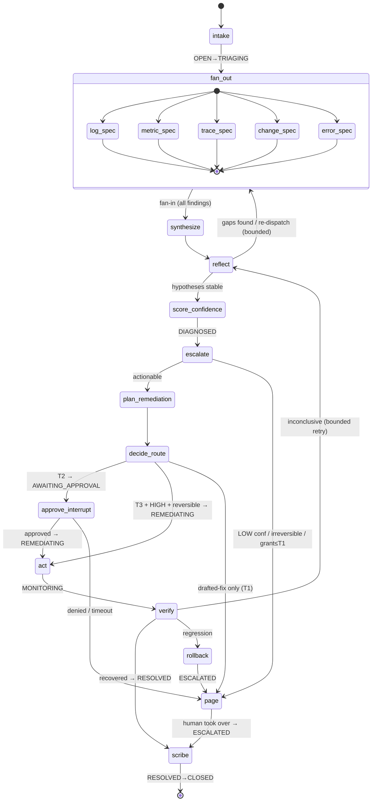
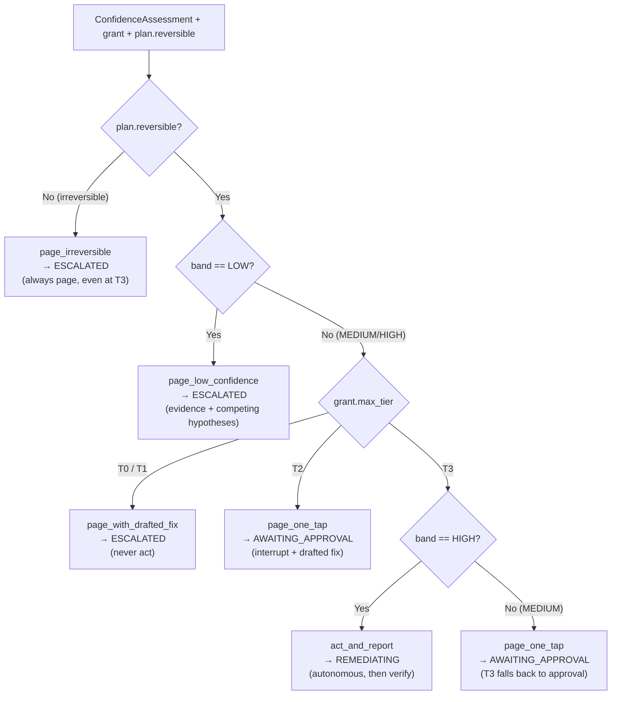

# 04 — Agent Orchestration & Graduated Autonomy

*The LangGraph brain: a tenant-bound incident graph that diagnoses, scores calibrated confidence, and applies the §6 escalation matrix to either act-and-report or page a human with the fix already drafted — never causing an outage (C1).*

This document owns three things and defers everything else: **(1)** the incident graph (its `IncidentState`, nodes, and edges), **(2)** the inter-agent contracts (the Pydantic v2 models the specialists, Commander, and Planner exchange), and **(3)** the graduated-escalation engine (the §6 matrix as executable policy). Tool-call credential brokering lives in `05-security-and-trust.md`; the persisted incident event store + checkpointer table live in `02-data-model-and-isolation.md`; confidence *calibration* and how agents are evaluated live in `06-evaluation-and-observability.md`; connector tool capabilities live in `03-connectors-and-integrations.md`; the cost of model tiers lives in `07-billing-and-unit-economics.md`. This doc cites the constitution (`00-glossary-and-decisions.md`) for every shared term and never relitigates an ADR.

---

## 1. What the orchestrator is

The **Orchestrator** (control-plane service `orchestrator`, §00.6) is the LangGraph runtime. When the **Correlator** collapses an event storm into a single **Incident** (`inc_…`), it emits an `incident.events` record that the orchestrator consumes and turns into exactly one **incident graph** — a checkpointed LangGraph execution keyed by `thread_id = incident_id`. Per **ADR-006**, each incident *is* a long-running, resumable graph: it survives worker restarts (P8), pauses cleanly for human approval via LangGraph `interrupt`, and resumes from a Postgres-backed checkpoint on any stateless worker.

Three properties are non-negotiable and shape every design choice below:

- **Tenant-bound by construction (P1, P2).** Every graph instance is constructed with a frozen `tenant_id` and a `ToolBroker` handle scoped to that tenant. A graph can *only* reach that tenant's tools, memory (Qdrant namespace), and JIT credentials — there is no code path to another tenant's resources. The graph never holds a durable credential; every tool call is brokered through the MCP Router (ADR-005, doc 05).
- **Safety is the default control flow (C1).** The graph is read-heavy. The *only* nodes that can mutate a tenant's infrastructure are `act` and `rollback`, and both are downstream of the escalation policy (§7). If the policy is uncertain, the structurally guaranteed outcome is **page a human**, not act.
- **Calibrated confidence gates everything autonomous (P6, ADR-008).** No write is ever gated on a raw model probability. The number that feeds the escalation policy is a *calibrated* score produced by the method in doc 06.

---

## 2. The incident graph

### 2.1 State machine (mapped to the §00.5.3 lifecycle)

The graph's nodes drive the canonical **Incident lifecycle**: `OPEN → TRIAGING → DIAGNOSED → {AWAITING_APPROVAL | REMEDIATING | ESCALATED} → RESOLVED → CLOSED`, with the optional `MONITORING` state between `REMEDIATING` and `RESOLVED`. Every node that changes lifecycle state appends an event to `incident.events` (P8, ADR-011) before returning — the live `IncidentState` is a projection of that log, and the checkpoint is the durable replay anchor.



### 2.2 Node-by-node

| Node | Lifecycle effect | Inputs | Outputs (into `IncidentState`) | Model tier (ADR-008) |
|---|---|---|---|---|
| `intake` | `OPEN → TRIAGING` | Incident, its `CanonicalEvent`s, tenant baselines, prior similar incidents (Qdrant) | `IncidentBrief`, recalled `prior_incident_ids`, fan-out plan | Strong (Commander) |
| `fan_out` | — (within `TRIAGING`) | `IncidentBrief` + per-specialist tasking | dispatches 5 specialists in parallel | — (router) |
| `log_spec` / `metric_spec` / `trace_spec` / `change_spec` / `error_spec` | — | scoped slice of the brief + that domain's tools | one `SpecialistFinding` each | Cheap |
| `synthesize` | — | all `SpecialistFinding`s | ranked `list[Hypothesis]` with cross-specialist corroboration | Strong (Commander) |
| `reflect` | — | hypotheses + findings | `ReflectionResult`: evidence gaps, re-dispatch asks, or "stable" | Strong (Commander) |
| `score_confidence` | `→ DIAGNOSED` | top hypothesis + corroboration graph | `calibrated_confidence`, `confidence_band` | Strong + calibrator (doc 06) |
| `escalate` | branches | band × grant × reversibility | `EscalationDecision` | pure Python (§7) |
| `plan_remediation` | — | top hypothesis + repo/connector read | `RemediationPlan` (diff / command / PR link) | Strong (Planner) |
| `decide_route` | `→ {AWAITING_APPROVAL | REMEDIATING}` | `EscalationDecision` + `RemediationPlan` | routes to `approve_interrupt` / `act` / `page` | pure Python |
| `approve_interrupt` | `AWAITING_APPROVAL` | page payload | **LangGraph `interrupt`** → resumes with human decision | — (HITL) |
| `act` | `→ REMEDIATING` | approved/auto-approved `ActionRequest` | `ActionResult` via `ToolBroker` | — (tool) |
| `verify` | `REMEDIATING → MONITORING` | post-action telemetry vs. recovery predicate | `VerificationResult` | Cheap + Strong tiebreak |
| `rollback` | `→ ESCALATED` | `ActionRequest.rollback_ref` | reverses the action, then pages | — (tool) |
| `page` | `→ ESCALATED` | full page payload | dispatches notifier (Slack/SMS/voice) | — (notifier) |
| `scribe` | `RESOLVED → CLOSED` | full incident trace | postmortem + Qdrant memory upsert | Cheap |

**Intake.** The Commander reads the correlated incident, pulls the tenant's learned baselines and the *k* most similar prior incidents from the tenant's Qdrant namespace (memory is tenant-scoped, P2), and produces an `IncidentBrief` plus a tasking plan for the five specialists. It transitions `OPEN → TRIAGING`.

**Fan-out / fan-in.** `fan_out` dispatches all five specialists *in parallel* — LangGraph runs them as concurrent branches that write into disjoint reducer-merged slices of state (`findings`, keyed by specialist role, so there are no write conflicts). Each specialist is a cheap-tier LLM agent confined to its domain's tools; it returns exactly one `SpecialistFinding`. `synthesize` is the fan-in barrier: it does not run until all five have returned (or hit their per-specialist deadline and returned a `degraded` finding).

**Synthesize → reflect.** The Commander correlates findings into a ranked `list[Hypothesis]`, explicitly recording which specialists' evidence supports or contradicts each. `reflect` is a bounded self-critique loop (max 2 iterations, tracked in `reflection_rounds`): if a leading hypothesis hinges on evidence no specialist actually gathered, it re-dispatches a *targeted* fan-out (e.g. "Trace: confirm DB pool exhaustion on `svc_…` in the 90s before the alert"). When hypotheses are stable or the loop budget is spent, it proceeds.

**Score confidence.** Produces the *calibrated* `calibrated_confidence` and its `confidence_band` (`LOW`/`MEDIUM`/`HIGH` per §00.6). Detailed in §6.

**Escalate → plan → route.** `escalate` runs the pure-Python policy (§7). If the outcome involves any action, `plan_remediation` drafts the fix (§8). `decide_route` then sends control to `approve_interrupt` (T2), `act` (T3 autonomous), or `page` (T1 / drafted-fix-only).

**Act → verify → {scribe | rollback}.** `act` executes the approved `ActionRequest` through the `ToolBroker`, recording every transition as an `action.audit` record (§00.5.4). `verify` watches the tenant's telemetry against an explicit recovery predicate for a bounded window (`MONITORING`): on recovery → `scribe` (`RESOLVED`); on regression → `rollback` (reverse via `rollback_ref`, then `ESCALATED`); if inconclusive and budget remains → back to `reflect`.

**Page.** Terminal-ish: assembles the full page payload (§9), dispatches it via the notifier, sets `ESCALATED`, and parks the graph. The graph remains resumable — if the human approves a drafted fix from the page, the same thread resumes into `act`.

**Scribe.** Writes the postmortem, upserts the resolved incident (root cause, what worked, calibrated-confidence-vs-outcome) into the tenant's Qdrant memory for future intake recall, and transitions `RESOLVED → CLOSED`.

---

## 3. The agents

Roles are fixed by §00.3. One **Incident Commander** orchestrates; five **specialists** fan out; one **Planner** drafts fixes; one **Scribe** closes out. Every agent is tenant-bound (§1).

| Agent | Tier | Reads (via doc 05 broker) | Emits | Job |
|---|---|---|---|---|
| **Commander** | Strong | the whole `IncidentState` | `IncidentBrief`, `Hypothesis[]`, `ReflectionResult`, drives `escalate` | Dispatch, synthesize, reflect, own the escalation decision. |
| **Log specialist** | Cheap | redacted log search (`body_redacted` only — C2/P3) | `SpecialistFinding` | Find error signatures, surges, first-occurrence timing. |
| **Metric specialist** | Cheap | metric queries, tenant baselines | `SpecialistFinding` | Anomalies vs. baseline; saturation (CPU/mem/pool/latency). |
| **Trace specialist** | Cheap | distributed traces / spans | `SpecialistFinding` | Locate the failing hop, fan-out amplification, slow dependency. |
| **Change/Deploy specialist** | Cheap | deploy events, commits, PRs, feature flags (`03`) | `SpecialistFinding` | Correlate onset with the most recent change. Usually the smoking gun. |
| **Error-tracking specialist** | Cheap | Sentry-class issue groups, regression flags | `SpecialistFinding` | New/spiking exception groups, release-tagged regressions. |
| **Planner** | Strong | repo read via connector, runbooks | `RemediationPlan` | Draft the diff/command/PR. Never executes. |
| **Scribe** | Cheap | full trace | postmortem + memory upsert | Write it down; teach the tenant's memory. |

**Why tiered (ADR-008).** Specialists are narrow, high-volume, and structured — a cheap model with a tight output contract handles them well, and there are five per incident. The Commander and Planner do open-ended reasoning where capability pays for itself. Routing is **per-tenant configurable** (a premium tenant may pin a stronger specialist model); the resolved model id is recorded per call for metering. Cost implications and the price of each tier are owned by `07-billing-and-unit-economics.md`; the safety-relevant consequence is that the per-tenant cost circuit breaker (ADR-010) degrades a tenant to **T0 + page** when its ceiling trips — cost is a blast-radius control, not just a margin lever.

---

## 4. Inter-agent contracts (Pydantic v2)

Agents communicate **only** through validated Pydantic v2 models — never free text. This is what makes the multi-agent system debuggable, evaluable (doc 06 scores against these shapes), persistable (doc 02 stores them in `incident.events`), and brokerable (doc 05 reads `tool_calls` to scope credentials). Every field name reuses §00.5 verbatim where one exists. **Validation is enforced on every hop**: a specialist returns structured output bound to its model; on a `ValidationError` the Commander retries that specialist once with the validator error appended to the prompt, then falls back to a `degraded` finding rather than crashing the graph (C1 — a malformed sub-agent must never take the incident down).

```python
from __future__ import annotations
from datetime import datetime
from enum import StrEnum
from typing import Annotated, Literal
from pydantic import BaseModel, Field, ConfigDict


# ---- shared vocabulary (mirrors 00-glossary §6) ----
class ConfidenceBand(StrEnum):
    LOW = "LOW"        # < 0.5
    MEDIUM = "MEDIUM"  # 0.5 ≤ x < 0.8
    HIGH = "HIGH"      # ≥ 0.8

class AutonomyTier(StrEnum):
    T0 = "T0"; T1 = "T1"; T2 = "T2"; T3 = "T3"

SpecialistRole = Literal["log", "metric", "trace", "change_deploy", "error"]

Confidence = Annotated[float, Field(ge=0.0, le=1.0)]


class EvidenceRef(BaseModel):
    """A pointer to redacted evidence — never raw secrets (C2/P3)."""
    model_config = ConfigDict(frozen=True)
    event_id: str | None = None            # evt_… that anchors this
    kind: Literal["log", "metric", "trace", "deploy", "error", "alert"]
    summary: str = Field(max_length=400)   # redacted, human-readable
    raw_ref: str | None = None             # object-store pointer (redacted blob)
    observed_at: datetime


class SpecialistFinding(BaseModel):
    """Output of every specialist. One per role per (re)dispatch."""
    model_config = ConfigDict(extra="forbid")
    incident_id: str
    role: SpecialistRole
    status: Literal["ok", "degraded", "no_signal"] = "ok"  # degraded = partial/timeout
    summary: str = Field(max_length=1_000)
    signals: list[str] = Field(default_factory=list)        # discrete observations
    evidence: list[EvidenceRef] = Field(default_factory=list)
    suspected_cause: str | None = None
    self_confidence: Confidence = 0.0     # raw self-assessment — NOT used for autonomy
    tool_calls: list[str] = Field(default_factory=list)     # for doc 05 audit + doc 07 metering


class Hypothesis(BaseModel):
    """A candidate root cause, synthesized by the Commander."""
    model_config = ConfigDict(extra="forbid")
    hypothesis_id: str
    statement: str = Field(max_length=600)
    supporting_roles: list[SpecialistRole] = Field(default_factory=list)
    contradicting_roles: list[SpecialistRole] = Field(default_factory=list)
    evidence: list[EvidenceRef] = Field(default_factory=list)
    raw_likelihood: Confidence = 0.0      # pre-calibration; calibrated in score_confidence


class ConfidenceAssessment(BaseModel):
    """Output of score_confidence — the ONLY confidence the policy may read."""
    model_config = ConfigDict(frozen=True)
    incident_id: str
    top_hypothesis_id: str
    calibrated_confidence: Confidence     # post-calibration (P6, doc 06)
    band: ConfidenceBand
    corroboration_count: int = Field(ge=0)   # # of independent specialists agreeing
    n_competing: int = Field(ge=0)           # rival hypotheses within margin
    calibrator_version: str               # which calibration map produced this


class RemediationPlan(BaseModel):
    """Planner output. The 'fix' attached to every page or executed at T2/T3."""
    model_config = ConfigDict(extra="forbid")
    incident_id: str
    action_type: str                      # e.g. deploy.rollback, process.restart (§5.4)
    target: str                           # svc_… / resource
    params: dict[str, object] = Field(default_factory=dict)
    reversible: bool                      # drives the §6 matrix
    summary: str = Field(max_length=600)
    diff: str | None = None               # unified diff, redacted
    pr_url: str | None = None             # opened draft PR (T1/T2/T3)
    command: str | None = None            # suggested command (T1)
    rollback_ref: str | None = None       # how act() would reverse this
    estimated_blast_radius: Literal["single_service", "shared", "global"]


class EscalationDecision(BaseModel):
    """Output of the policy in §7. Pure function of its inputs."""
    model_config = ConfigDict(frozen=True)
    incident_id: str
    outcome: Literal[
        "act_and_report",         # T3 autonomous
        "page_one_tap",           # T2 approval + drafted fix
        "page_with_drafted_fix",  # T1 / always-page
        "page_irreversible",      # irreversible → always page
        "page_low_confidence",    # LOW band → page with competing hypotheses
    ]
    target_state: Literal["AWAITING_APPROVAL", "REMEDIATING", "ESCALATED"]
    band: ConfidenceBand
    granted_tier: AutonomyTier
    reversible: bool
    rationale: str = Field(max_length=600)   # auditable "why"


class PagePayload(BaseModel):
    """What a human receives. The 15-second-approval artifact."""
    model_config = ConfigDict(frozen=True)
    incident_id: str
    tenant_id: str
    suspected_root_cause: str
    confidence: ConfidenceAssessment
    evidence_chain: list[EvidenceRef]
    competing_hypotheses: list[Hypothesis]
    drafted_remediation: RemediationPlan | None
    one_tap_action_id: str | None = None     # act_… resumable on approve
    outcome: str                             # mirrors EscalationDecision.outcome
```

These models are the canonical inter-agent contracts the brief asks for: **`SpecialistFinding`**, **`Hypothesis`**, **`ConfidenceAssessment`**, **`RemediationPlan`**, **`EscalationDecision`**, **`PagePayload`** (plus the shared `EvidenceRef`). Doc 06 evaluates agents against these shapes; doc 02 persists them as `incident.events` payloads; doc 05 reads `tool_calls` to scope and audit JIT credentials.

---

## 5. The `IncidentState` schema

`IncidentState` is the graph's working memory — a `TypedDict` with LangGraph reducers so parallel specialist branches merge without write conflicts. It is *not* the source of truth: `incident.events` is (ADR-011). State is a projection, checkpointed after every node (§10) so a restart rehydrates it exactly.

```python
from typing import Annotated, TypedDict
from operator import add
from langgraph.graph.message import add_messages


def merge_findings(
    left: dict[str, SpecialistFinding], right: dict[str, SpecialistFinding]
) -> dict[str, SpecialistFinding]:
    """Reducer: specialist branches write disjoint role keys → no conflicts."""
    return {**left, **right}


class IncidentState(TypedDict, total=False):
    # immutable identity — set at construction, never mutated (P1)
    incident_id: str
    tenant_id: str

    # intake
    brief: dict                       # IncidentBrief.model_dump()
    canonical_event_ids: list[str]    # evt_…
    prior_incident_ids: list[str]     # Qdrant recall (tenant-scoped memory)

    # fan-out / fan-in (reducer-merged across parallel branches)
    findings: Annotated[dict[str, SpecialistFinding], merge_findings]

    # synthesis & reflection
    hypotheses: list[Hypothesis]
    reflection_rounds: Annotated[int, add]    # bounded self-critique counter
    redispatch_targets: list[SpecialistRole]

    # scoring & policy
    assessment: ConfidenceAssessment | None
    grant: AutonomyGrant | None               # resolved (tenant × action_type), §5.2
    decision: EscalationDecision | None

    # remediation & verification
    plan: RemediationPlan | None
    action_request: dict | None               # ActionRequest.model_dump(), §5.4
    action_result: dict | None
    verification: dict | None

    # human-in-the-loop
    page_payload: dict | None                 # PagePayload.model_dump()
    human_decision: Literal["approved", "denied"] | None

    # lifecycle (mirrors §5.3) + LLM transcript
    lifecycle_state: str                      # OPEN…CLOSED
    messages: Annotated[list, add_messages]

    # governance
    llm_cost_cents: Annotated[int, add]       # metered per node (doc 07)
    budget_exhausted: bool                    # ADR-010 circuit breaker tripped
```

A few deliberate choices: `tenant_id`/`incident_id` are written once at construction and treated as immutable identity (P1). `findings` uses a custom reducer so the five parallel specialist branches each write their own role key without clobbering siblings. `reflection_rounds` and `llm_cost_cents` use additive reducers so they accumulate correctly across retries. `grant` is the resolved `AutonomyGrant` for *this* `(tenant × action_type)`, fetched once the action type is known — it is the second axis of the escalation policy.

---

## 6. Confidence model & calibration (P6, ADR-008)

The escalation policy reads exactly one number — `ConfidenceAssessment.calibrated_confidence` — and it is **never** a raw model probability. This is the hard line of P6: "confidence is calibrated, not vibes."

**How the score is produced (the inputs).** `score_confidence` combines three concrete signals into a single raw likelihood, then *maps that raw likelihood through a calibration function*:

1. **Structured self-assessment.** The Commander emits `Hypothesis.raw_likelihood` for the top hypothesis — its own estimate, explicitly NOT trusted as-is.
2. **Cross-specialist corroboration.** How many *independent* specialists' evidence supports the top hypothesis (`supporting_roles`), net of contradictions (`contradicting_roles`). Independent agreement from the Log, Metric, and Change specialists is far stronger than one specialist's loud opinion — corroboration is the single most predictive input, which is why the system fans out before it scores.
3. **Hypothesis separation.** `n_competing` — how many rival hypotheses sit within a likelihood margin of the leader. Two near-tied hypotheses cap confidence regardless of self-assessment.

**Calibration (owned by doc 06).** The raw blend is passed through a calibration map (isotonic regression / Platt scaling) **fitted on the golden incident library** so that "the model said 0.8" actually means "≈80% of such cases were correct." `calibrator_version` records which fitted map was applied, so a recalibration is auditable and a past decision is reproducible. The *method, fitting procedure, and per-model calibration curves live in `06-evaluation-and-observability.md`* — this doc consumes the calibrated number; doc 06 guarantees its meaning. The banding (`LOW` < 0.5 ≤ `MEDIUM` < 0.8 ≤ `HIGH`) is the canonical §00.6 cut.

The consequence for safety: because the band is calibrated, the §7 policy's "HIGH-confidence autonomous action" genuinely corresponds to a measured ≥80% historical correctness — autonomy is gated on a number that *means something*, satisfying C1.

---

## 7. The graduated-escalation engine ★

This is the product. The §00.6 escalation matrix is implemented as a **pure, deterministic, side-effect-free function** of three inputs — calibrated confidence band × `AutonomyGrant.max_tier` × `ActionRequest.reversible`. Purity is a design requirement, not an accident: it is unit-testable against the golden library (doc 06), trivially auditable, and immune to LLM nondeterminism — the *diagnosis* is probabilistic, but the *decision to touch prod is not*.

The ordering of the rules encodes the safety priority of C1. The two hard stops — **irreversible** and **LOW confidence** — are evaluated *first*, before any tier check, so that no amount of granted autonomy can override them. Only after both guards pass does the tier ladder apply.

### 7.1 Decision flow (§00.6 matrix)



Note the deliberate behavior at the bottom-right: a **T3** grant with only **MEDIUM** confidence does *not* act autonomously — it falls back to one-tap approval. T3's autonomy is reserved for the `HIGH` band, matching the §00.6 row "HIGH + reversible + grant ≥ T3 → act autonomously." MEDIUM is exactly the regime where a human's 15-second tap is cheap insurance against C1.

### 7.2 The policy function (real Python)

```python
from dataclasses import dataclass


@dataclass(frozen=True)
class PolicyInputs:
    incident_id: str
    band: ConfidenceBand          # from ConfidenceAssessment (calibrated, P6)
    max_tier: AutonomyTier        # from AutonomyGrant for this (tenant × action_type)
    reversible: bool              # from RemediationPlan / ActionRequest (§5.4)
    n_competing: int              # rival hypotheses within margin (for rationale)


def decide_escalation(i: PolicyInputs) -> EscalationDecision:
    """Implements the §00.6 escalation matrix. Pure, deterministic, total.

    Invariant (C1): the two hard stops — irreversible and LOW confidence —
    are checked BEFORE any tier logic, so no granted tier can override them.
    Every (band × tier × reversible) input maps to exactly one outcome.
    """

    def out(outcome, state, why) -> EscalationDecision:
        return EscalationDecision(
            incident_id=i.incident_id, outcome=outcome, target_state=state,
            band=i.band, granted_tier=i.max_tier, reversible=i.reversible,
            rationale=why,
        )

    # ---- Hard stop 1: irreversible actions ALWAYS page (even at T3). C1. ----
    if not i.reversible:
        return out(
            "page_irreversible", "ESCALATED",
            "Action is irreversible; policy forbids autonomous execution at any tier.",
        )

    # ---- Hard stop 2: LOW calibrated confidence ALWAYS pages. C1, P6. ----
    if i.band is ConfidenceBand.LOW:
        return out(
            "page_low_confidence", "ESCALATED",
            f"Calibrated confidence is LOW with {i.n_competing} competing hypotheses; "
            f"presenting evidence to a human instead of acting.",
        )

    # ---- Tier ladder (only reachable for reversible + MEDIUM/HIGH). §00.6. ----
    if i.max_tier in (AutonomyTier.T0, AutonomyTier.T1):
        # Observe / Suggest: draft the fix, never execute.
        return out(
            "page_with_drafted_fix", "ESCALATED",
            f"Grant is {i.max_tier} (no execution authority); paging with drafted fix.",
        )

    if i.max_tier is AutonomyTier.T2:
        # Approve-to-act: one-tap human approval, fix pre-drafted.
        return out(
            "page_one_tap", "AWAITING_APPROVAL",
            "Grant is T2; reversible fix ready for one-tap approval.",
        )

    # max_tier == T3 (Autonomous), reversible, MEDIUM or HIGH.
    if i.band is ConfidenceBand.HIGH:
        return out(
            "act_and_report", "REMEDIATING",
            "T3 + HIGH calibrated confidence + reversible: acting autonomously, will verify and report.",
        )

    # T3 but only MEDIUM confidence → fall back to one-tap approval.
    return out(
        "page_one_tap", "AWAITING_APPROVAL",
        "T3 grant but confidence only MEDIUM; falling back to one-tap human approval.",
    )
```

### 7.3 Worked rows (matches §00.6 exactly)

| `band` | `max_tier` | `reversible` | `outcome` | `target_state` |
|---|---|---|---|---|
| HIGH | T3 | true | `act_and_report` | `REMEDIATING` |
| MEDIUM | T3 | true | `page_one_tap` | `AWAITING_APPROVAL` |
| HIGH / MEDIUM | T2 | true | `page_one_tap` | `AWAITING_APPROVAL` |
| HIGH / MEDIUM | T0 / T1 | true | `page_with_drafted_fix` | `ESCALATED` |
| any | any | **false** | `page_irreversible` | `ESCALATED` |
| **LOW** | any | true | `page_low_confidence` | `ESCALATED` |

Two safety properties fall straight out of the structure. **(1)** No autonomous write is possible unless `reversible AND band==HIGH AND max_tier==T3` — every other path pages. **(2)** Cost exhaustion (ADR-010) is handled *upstream* by forcing `max_tier := T0`, which this function then routes to `page_with_drafted_fix` — degradation is graceful and the engine needs no special case. The function is `total`: every input combination returns exactly one decision, and doc 06 asserts that with an exhaustive parameterized test over the `band × tier × reversible` cube.

---

## 8. Planner & fix-drafting

When `escalate` yields any actionable outcome, `plan_remediation` runs the **Planner** (strong tier). It does not act; it *drafts*, producing a `RemediationPlan`. Concretely:

- **Read the repo via the connector (doc 03).** The Planner reads the relevant source over the tenant's read-scoped Git connector — through the MCP Router with JIT credentials (doc 05), never a stored key (P9). It correlates the top hypothesis (e.g. "deploy `abc123` introduced an N+1 that exhausted the DB pool") with the offending code or config.
- **Propose the smallest reversible fix.** Preference order encodes C1: a **reversal of a recent change** (`deploy.rollback` — inherently reversible, `rollback_ref` is the prior release) > a **bounded config/scale change** (`service.scale`, reversible) > a **code patch** (a unified `diff` + an opened **draft PR** whose URL goes in `pr_url`). For T1 grants it may instead emit a copy-pasteable `command`.
- **Tag reversibility and blast radius honestly.** `reversible` and `estimated_blast_radius` are set by the Planner and consumed verbatim by the §7 policy. A schema migration or a destructive delete is marked `reversible=false` → the policy *guarantees* a page. The Planner cannot grant itself autonomy; it can only describe the action truthfully.

The drafted `RemediationPlan` is attached to *every* outcome — it is what makes the page a 15-second approval (§9) and what `act` executes after approval. Note the elegant consequence: at **T1** the same artifact is the *whole* product (a drafted fix a human runs); at **T3** it is auto-executed. The Planner's output is tier-agnostic; the policy decides its fate.

---

## 9. Human-in-the-loop as first-class state

HITL is not a callback bolted on — per **ADR-006** it is a graph state. When the policy routes to `approve_interrupt`, the node calls LangGraph's `interrupt`, which **checkpoints and suspends** the graph mid-execution. The incident sits in `AWAITING_APPROVAL`; no worker is held hostage (the graph is durable, §10), and the human can take seconds or hours.

The interrupt payload *is* the `PagePayload` (§4) and always carries the §00.6-mandated four things: **suspected root cause**, the **evidence chain** (`EvidenceRef[]`, redacted — C2), the **competing hypotheses**, and the **drafted remediation** (diff / PR link / command). The human approves or denies in ~15 seconds from Slack/SMS — they are reviewing a finished investigation, not starting one.

```python
from langgraph.types import interrupt, Command


def approve_interrupt(state: IncidentState) -> Command:
    """First-class HITL: suspend at a durable checkpoint, resume on human input."""
    payload = state["page_payload"]            # PagePayload.model_dump()

    # Suspends the graph here; the runtime persists the checkpoint (ADR-006, P8).
    # `decision` is supplied later via Command(resume=...) when the human taps.
    decision = interrupt({"type": "approval_request", "page": payload})

    if decision == "approved":
        # Resume into act() — same thread_id, full context intact.
        return Command(goto="act", update={"human_decision": "approved",
                                            "lifecycle_state": "REMEDIATING"})
    # Denied or timed out → escalate to a full page, never act.
    return Command(goto="page", update={"human_decision": "denied",
                                        "lifecycle_state": "ESCALATED"})
```

Resumption is just `graph.invoke(Command(resume="approved"), config={"configurable": {"thread_id": incident_id}})` — issued by the `api` service when the tenant taps "approve." Because `thread_id == incident_id`, *any* stateless orchestrator worker can serve the resume; the approving tap and the original diagnosis need not touch the same machine.

---

## 10. Durable checkpointing (ADR-006, P8)

Every node return is persisted by a **Postgres-backed checkpointer** (`langgraph.checkpoint.postgres`) keyed by `thread_id = incident_id`. If a worker dies mid-incident, KEDA reschedules the work and a fresh worker rehydrates the exact `IncidentState` from the last checkpoint and continues — no lost diagnosis, no duplicated writes, no human re-paged. This is the operational payoff of "incidents survive worker restarts."

```python
from langgraph.graph import StateGraph, START, END
from langgraph.checkpoint.postgres import PostgresSaver


def build_incident_graph(checkpointer: PostgresSaver):
    g = StateGraph(IncidentState)
    g.add_node("intake", intake)
    for role in ("log", "metric", "trace", "change", "error"):
        g.add_node(f"{role}_spec", make_specialist(role))   # cheap tier
    g.add_node("synthesize", synthesize)        # strong tier (Commander)
    g.add_node("reflect", reflect)
    g.add_node("score_confidence", score_confidence)
    g.add_node("escalate", escalate_node)       # wraps decide_escalation (§7)
    g.add_node("plan_remediation", plan_remediation)   # strong tier (Planner)
    g.add_node("decide_route", decide_route)
    g.add_node("approve_interrupt", approve_interrupt) # HITL (§9)
    g.add_node("act", act); g.add_node("verify", verify)
    g.add_node("rollback", rollback); g.add_node("page", page)
    g.add_node("scribe", scribe)

    g.add_edge(START, "intake")
    for role in ("log", "metric", "trace", "change", "error"):
        g.add_edge("intake", f"{role}_spec")    # parallel fan-out
        g.add_edge(f"{role}_spec", "synthesize") # fan-in barrier
    g.add_edge("synthesize", "reflect")
    g.add_conditional_edges("reflect", reflect_router,   # re-dispatch (bounded) or proceed
                            {"redispatch": "intake", "proceed": "score_confidence"})
    g.add_edge("score_confidence", "escalate")
    g.add_conditional_edges("escalate", escalation_router,
                            {"plan": "plan_remediation", "page": "page"})
    g.add_edge("plan_remediation", "decide_route")
    g.add_conditional_edges("decide_route", route_router,
                            {"approve": "approve_interrupt", "act": "act", "page": "page"})
    g.add_edge("approve_interrupt", "act")   # Command(goto=...) may divert to page
    g.add_conditional_edges("verify", verify_router,
                            {"resolved": "scribe", "regressed": "rollback",
                             "inconclusive": "reflect"})
    g.add_edge("rollback", "page")
    g.add_edge("page", "scribe")             # scribe writes ESCALATED postmortems too
    g.add_edge("scribe", END)

    # thread_id == incident_id → durable, resumable on any worker (P8)
    return g.compile(checkpointer=checkpointer, interrupt_before=["act"])
```

`interrupt_before=["act"]` is belt-and-suspenders alongside the explicit `approve_interrupt` node: it is a structural guarantee that nothing executes a write without the graph first passing through a durable checkpoint, where governance (the cost circuit breaker, a revoked grant) gets one last chance to veto. The checkpointer's table schema and its placement alongside the `incident.events` store are owned by `02-data-model-and-isolation.md`; the orchestrator merely points the `PostgresSaver` at it.

---

## 11. End-to-end (the happy autonomous path)

A `svc_api` latency alert storms in; the Correlator opens `inc_01HZ…`. **Intake** recalls two similar prior incidents from the tenant's memory and tasks five specialists. **Fan-out** runs them in parallel: the Change/Deploy specialist flags deploy `abc123` 40s before onset; the Metric specialist sees DB-pool saturation; the Trace specialist localizes the stall to a repository call; Log corroborates with connection-timeout signatures; Error-tracking shows a spiking `TimeoutError` group tagged to that release. **Synthesize** ranks "deploy `abc123` introduced a pool-exhausting query" first, supported by four of five specialists. **Reflect** finds no gap. **Score_confidence** blends high corroboration + low competition → raw 0.91 → calibrated **HIGH**. **Escalate** sees `band=HIGH`, the tenant's `deploy.rollback` grant is **T3**, and the plan is **reversible** → `act_and_report`. **Plan_remediation** drafts a `deploy.rollback` to the prior release (`rollback_ref` set, draft PR opened for the real fix). **Act** rolls back via the broker. **Verify** watches latency return to baseline (`MONITORING`) → recovery. **Scribe** writes the postmortem, upserts the lesson into memory, and closes the incident — `RESOLVED → CLOSED`. The founder gets a "resolved, here's what happened, here's the PR for the permanent fix" notification. Had the grant been T1, the identical investigation would have *paged* with the drafted PR attached — same brain, different rung of the ladder (the product, §00.6).

---

## Open questions & risks

- **Calibration drift across model tiers.** Calibration is per-model (ADR-008); a per-tenant model swap or a provider's silent model update can invalidate the fitted map, silently mis-banding confidence and weakening the C1 guarantee. Mitigation lives in doc 06 (continuous recalibration + `calibrator_version` pinning), but the *coupling* — autonomy depends on an externally-owned eval artifact staying fresh — is a standing risk this doc inherits.
- **Reflection-loop cost vs. C1 latency.** The bounded reflect loop trades tokens (doc 07) and minutes against diagnostic confidence. The cap (2 rounds) is a guess; too low risks under-corroborated HIGH bands (a false-confident autonomous act), too high burns budget and delays the page. The right bound is almost certainly tenant- and severity-dependent and needs tuning against the golden library.
- **Specialist `degraded` findings poisoning corroboration.** If a specialist times out and returns `degraded`, the corroboration count drops — which *should* lower confidence — but a coordinated degradation (e.g. the tenant's whole observability provider is down, which is often *correlated with* the incident) could systematically depress confidence exactly when speed matters. Whether to treat provider-outage-induced degradation specially is open.
- **`reversible` is a Planner judgment, and the policy trusts it absolutely.** The entire C1 guarantee for autonomous action rests on the Planner correctly tagging `reversible`. A mislabeled irreversible action (e.g. a "scale to 0" that drops in-flight state) would slip the hard stop. We likely need a *second*, rule-based reversibility classifier per `action_type` (independent of the LLM) that can only ever downgrade `reversible`, never upgrade it — owned jointly with doc 05's allow-list.
- **Re-dispatch via `intake` re-runs recall.** Routing reflection's re-dispatch back through `intake` (above) re-does memory recall and re-tasks all specialists, when only a targeted subset is needed; a dedicated `redispatch` node fanning out only `redispatch_targets` would be cheaper and is a likely refactor.
- **HITL timeout semantics.** An `interrupt` can sit indefinitely. We treat denial and timeout identically (`→ page/ESCALATED`), but a long-unanswered T2 approval on a degrading service may warrant auto-escalation to louder paging channels (SMS → voice) — an escalation-of-the-escalation policy not yet specified here.
