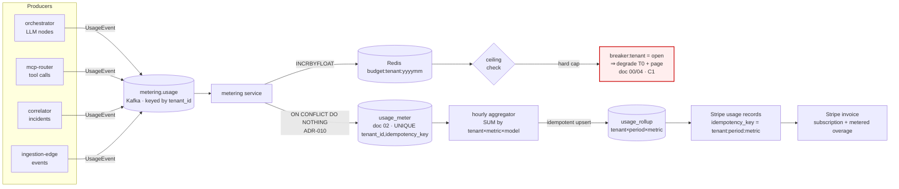

# 07 — Billing, Metering & Unit Economics

*Every LLM call, tool call, and incident is metered per tenant into `usage_meter` (doc 02), aggregated idempotently into Stripe, and bounded by a per-tenant cost circuit breaker that is also a safety control — and the gross margin that falls out is knowable, defensible, and protected against the dumpster-fire tenant.*

This document owns billing, metering, cost governance, and the unit-economics model. It is the concrete realization of **P7** ("everything metered, everything bounded") and **ADR-010** (per-tenant cost ceilings + idempotent metering as first-class governance). It depends on the data contracts already fixed by sibling docs and never relitigates them: doc 02 owns the `usage_meter` table, the `tenants.cost_ceiling_usd`/`plan` columns, and the `budget:`/`breaker:` Redis keys; doc 04 owns the tiered model routing (ADR-008) that *generates* the cost this document prices; doc 00 owns the autonomy tiers T0–T3 and the three constraints. Where this doc says "the breaker trips," doc 00/04 owns what "degrade to T0 + page" *means*; this doc owns *when* it fires and *why* that is cheap insurance.

The throughline is **C1 — never cause an outage.** The cost circuit breaker is not only a margin lever. A tenant whose prod emits 500 incidents a day must not be able to run unbounded autonomous actions against their own infrastructure on our dime; capping spend caps blast radius. Cost governance is a safety control wearing an accountant's hat (ADR-010, "cost is also a safety control").

---

## 1. What we meter, and why these dimensions

Sentinel's variable cost is almost entirely **LLM inference**; everything else (Postgres, Kafka, Redis, Qdrant, edge gateways) is a smaller, more predictable per-tenant base. So the metering schema is built to attribute inference precisely, then carry a few non-LLM dimensions for completeness and for usage-based pricing.

The `metric` enum on `usage_meter` (doc 02, verbatim) is exactly six values, and each exists for a reason:

| `metric` | What it counts | Why it is metered |
|---|---|---|
| `llm_tokens_in` | Prompt tokens, **by `model`** | The dominant COGS input. Split by model so cheap-specialist vs. strong-Commander spend is separable (ADR-008). |
| `llm_tokens_out` | Completion tokens, by `model` | Output is 5× input price on every tier — the single most expensive dimension. |
| `tool_call` | One MCP tool invocation (doc 05 broker) | Provider-API cost + the lever for tool-call rate limits; cheap but unbounded under a reflection storm. |
| `incident` | One incident opened | The natural usage-based billing unit a founder understands ("incidents handled"). |
| `event_ingested` | One `CanonicalEvent` persisted | Ingestion/storage cost; the high-volume floor a noisy tenant drives. |
| `action_executed` | One write action run (T2/T3) | Audit + the highest-blast-radius operation; metered so autonomy spend is visible. |

The two LLM rows are accompanied by the `model` column (doc 02: "LLM routing tier, ADR-008"), which records the **resolved model id** for that call — not the abstract tier. This is what makes per-tier COGS in §6 a query rather than a guess: `SUM(quantity * unit_cost_usd) WHERE metric='llm_tokens_out' GROUP BY model` tells us, per tenant, exactly how much went to the cheap specialists versus the strong Commander/Planner. Doc 04's `IncidentState.llm_cost_cents` accumulates the same spend in-flight via an additive reducer; `usage_meter` is the durable, queryable record of record.

Every row also snapshots `unit_cost_usd` at accrual time (doc 02: "snapshot at accrual; doc 07 reprices"). Prices change; invoices must not. Snapshotting the unit cost at the moment of accrual means a price-list change next quarter never rewrites last month's COGS or a tenant's overage. The aggregation pipeline (§3) reprices *future* usage by reading the current price list; historical rows are immutable.

---

## 2. The metering event (the shape on the wire)

Producers — the orchestrator (per LLM node), the MCP router (per tool call), the correlator (per incident), the ingestion edge (per event) — emit a `UsageEvent` onto the `metering.usage` Kafka topic, partition-keyed by `tenant_id` (doc 00 §4; ADR-007). The metering service consumes it and writes one `usage_meter` row, enforcing idempotency on insert.

The load-bearing field is `idempotency_key`. **ADR-010 requires that retries never double-charge.** Kafka is at-least-once; a worker can crash after producing and replay; a consumer can reprocess after a rebalance. None of that may inflate a tenant's bill. The key is deterministic — derived from the *source event*, not the wall clock — so a replay computes the same key and collides with the existing row.

```python
from __future__ import annotations
from datetime import datetime, timezone
from decimal import Decimal
from enum import StrEnum
from pydantic import BaseModel, ConfigDict, Field

class Metric(StrEnum):                       # mirrors usage_meter.metric (doc 02)
    LLM_TOKENS_IN   = "llm_tokens_in"
    LLM_TOKENS_OUT  = "llm_tokens_out"
    TOOL_CALL       = "tool_call"
    INCIDENT        = "incident"
    EVENT_INGESTED  = "event_ingested"
    ACTION_EXECUTED = "action_executed"

class UsageEvent(BaseModel):
    """Published to `metering.usage`; one row per event in `usage_meter`.
    Pydantic v2, Python 3.12. Field names reuse doc 00 §5 / doc 02 verbatim."""
    model_config = ConfigDict(extra="forbid", frozen=True)

    tenant_id:       str                      # ten_… — partition key (ADR-007)
    incident_id:     str | None = None        # inc_… ; null for non-incident usage
    metric:          Metric
    quantity:        Decimal = Field(gt=0, max_digits=18, decimal_places=4)
    model:           str | None = None        # resolved model id; REQUIRED iff metric is an llm_* metric
    unit_cost_usd:   Decimal | None = Field(default=None, max_digits=12, decimal_places=6)
    occurred_at:     datetime = Field(default_factory=lambda: datetime.now(timezone.utc))

    # ADR-010: deterministic — a replay recomputes the SAME key and dedupes on
    # UNIQUE(tenant_id, idempotency_key). Never a UUID, never time-based.
    idempotency_key: str

    @staticmethod
    def for_llm(*, tenant_id: str, incident_id: str, node: str, call_seq: int,
                metric: Metric, tokens: int, model: str) -> "UsageEvent":
        # e.g. "inc_01HZ…:synthesize:3:llm_tokens_out" — stable across retries
        key = f"{incident_id}:{node}:{call_seq}:{metric.value}"
        return UsageEvent(tenant_id=tenant_id, incident_id=incident_id,
                          metric=metric, quantity=Decimal(tokens), model=model,
                          idempotency_key=key)
```

The metering-service insert is the idempotency boundary:

```sql
INSERT INTO usage_meter (usage_id, tenant_id, incident_id, metric,
                         quantity, unit_cost_usd, model, idempotency_key, occurred_at)
VALUES ($1, $2, $3, $4, $5, $6, $7, $8, $9)
ON CONFLICT (tenant_id, idempotency_key) DO NOTHING;     -- ADR-010
```

`unit_cost_usd` is filled by the metering service at insert by looking the metric+model up in the current price list (§4), then snapshotted forever. On the same insert, the service increments the Redis budget counter and evaluates the breaker (§5) — both keyed by `tenant_id`, both derived from the row that just landed.

---

## 3. From raw usage to a Stripe invoice

Billing is a three-stage funnel: **raw rows → periodic aggregate → Stripe usage records.** Each stage is idempotent, so the pipeline is safe to re-run after any failure.



**Stage 1 — raw.** Already covered: idempotent rows in `usage_meter`.

**Stage 2 — aggregate.** An hourly job rolls raw rows into a `usage_rollup` keyed by `(tenant_id, period, metric)`, summing `quantity` and `quantity * unit_cost_usd` (the snapshotted COGS). The rollup is an idempotent upsert keyed on `(tenant_id, period, metric, last_usage_id_seen)` so re-running it over the same window converges rather than double-counts. The rollup is also what powers the gross-margin-per-tenant query in §7 — it is COGS, pre-computed.

**Stage 3 — Stripe.** Only the **billable, usage-priced** metrics cross into Stripe as usage records: `incident` (the Pro/Team unit) and, on overage, `llm_tokens_*` rolled into an "AI compute" line. We map each rollup bucket to a Stripe meter event with `identifier = f"{tenant_id}:{period}:{metric}"` — Stripe's own idempotency on event identifiers gives us a *second* dedupe layer on top of ADR-010, so a retried Stripe push is a no-op. Subscription fees (the flat plan price) are a standard Stripe subscription; usage rides on top as metered components on the same invoice. We never push token-level granularity to Stripe — it would be thousands of events per incident; we push the period rollup.

**Stripe wiring.** Each plan is a Stripe `Product` + recurring `Price` (the flat fee) plus metered `Price`s for overage, billed via the Stripe **Billing Meters** API. Test mode mirrors production one-to-one: the metering service holds a `STRIPE_MODE` flag, and CI runs the full pipeline against Stripe test keys with synthetic tenants — the golden incident library (doc 06) replayed through metering must produce the expected invoice to the cent before a price-list change ships.

---

## 4. The price list (cost attribution & repricing)

A single versioned table maps `(metric, model)` to a unit cost. The metering service reads it to fill `unit_cost_usd`; the aggregator never re-reads it (snapshots are immutable). Repricing = publishing a new price-list version; it affects only rows accrued after the change.

The **assumed** 2026 model prices below are plausible current-generation Anthropic list prices (cheap-tier ≈ a Haiku-class model; strong-tier ≈ a Sonnet-class workhorse with an Opus-class reserve). **They are assumptions for this model and are stated as such** — the architecture does not depend on the exact numbers, only on the ~3–5× spread between tiers that makes ADR-008's tiered routing the margin lever it is.

| `metric` | `model` (tier) | `unit_cost_usd` | Basis (assumption) |
|---|---|---|---|
| `llm_tokens_in` | cheap (specialists) | `0.000001` | $1.00 / Mtok in |
| `llm_tokens_out` | cheap (specialists) | `0.000005` | $5.00 / Mtok out |
| `llm_tokens_in` | strong (Commander/Planner) | `0.000003` | $3.00 / Mtok in |
| `llm_tokens_out` | strong (Commander/Planner) | `0.000015` | $15.00 / Mtok out |
| `llm_tokens_in` | premium reserve | `0.000005` | $5.00 / Mtok in (Opus-class) |
| `llm_tokens_out` | premium reserve | `0.000025` | $25.00 / Mtok out (Opus-class) |
| `tool_call` | — | `0.0002` | blended provider-API + broker overhead |
| `event_ingested` | — | `0.0000060` | ingestion + storage amortized |

Because the `model` column carries the *resolved* id (doc 02), cost attribution is exact and per-tenant: a premium tenant who pinned a stronger specialist model (doc 04 allows this) accrues at the premium row, and their gross margin reflects it automatically. There is no estimation step — spend is attributed to the tenant who caused it, at the price in force when they caused it.

---

## 5. Per-tenant cost ceilings + the circuit breaker (ADR-010)

Every tenant has a hard monthly ceiling in `tenants.cost_ceiling_usd` (doc 02, default $50.00). The breaker enforces it against two Redis keys owned by doc 02:

- `budget:{tenant_id}:month:{yyyymm}` — a counter incremented by `unit_cost_usd * quantity` on **every** `usage_meter` accrual.
- `breaker:{tenant_id}` — `open` | `closed`. **`open` ⇒ degrade the tenant to T0 (observe-only) + page** (doc 00/04 own the tier semantics).

There are **soft warning thresholds before the hard cap** so a tenant is never surprised: at 50% we note it on the Trust dashboard (doc 06), at 80% we send a heads-up, at 95% we warn that autonomy is about to be capped, and at 100% the breaker opens. The soft thresholds page the *tenant*; the hard cap changes Sentinel's *behavior*.

```python
from decimal import Decimal
from datetime import datetime, timezone

SOFT = (Decimal("0.50"), Decimal("0.80"), Decimal("0.95"))

async def accrue_and_check(redis, notifier, tenant_id: str,
                           ceiling_usd: Decimal, delta_usd: Decimal) -> bool:
    """Called on every usage_meter insert. Returns True if the breaker is OPEN
    (caller must then force T0 + page — C1: cost caps blast radius)."""
    yyyymm = datetime.now(timezone.utc).strftime("%Y%m")
    bkey   = f"budget:{tenant_id}:month:{yyyymm}"
    spent  = Decimal(str(await redis.incrbyfloat(bkey, float(delta_usd))))
    await redis.expire(bkey, 40 * 24 * 3600)   # self-cleaning, > 1 month

    frac = spent / ceiling_usd if ceiling_usd else Decimal(0)

    if frac >= 1:
        # Idempotent flip: SET NX so we page exactly once per open transition.
        if await redis.set(f"breaker:{tenant_id}", "open", nx=True):
            await notifier.page(tenant_id, reason="cost_ceiling_tripped",
                                 detail=f"${spent:.2f} / ${ceiling_usd:.2f} — degraded to T0")
        return True

    for t in SOFT:                              # warn once per threshold crossed
        if frac >= t and await redis.set(f"warn:{tenant_id}:{yyyymm}:{t}", "1", nx=True):
            await notifier.warn(tenant_id, pct=int(t * 100), spent=spent, ceiling=ceiling_usd)
    return False
```

Two design choices are load-bearing for C1. **First, the breaker is evaluated on the metering path, not on a timer** — the moment the accrual that crosses the ceiling lands, the next autonomy decision sees `breaker:{tenant_id} = open`. The escalation engine (doc 04 §7) reads it as a hard input alongside `IncidentState.budget_exhausted`: an open breaker forces the outcome to "page with drafted fix," never "act," regardless of grant or confidence. **Second, degrading to T0 is fail-safe.** When we are over budget we don't stop diagnosing — diagnosis is cheap and is the product's floor — we stop *writing to prod*. The tenant still gets a fully-diagnosed page; we simply refuse to spend more of our money executing autonomous actions against their infrastructure until they raise the ceiling or the month rolls over. Cost exhaustion and a stuck agent both converge on the same safe behavior: page a human with everything we know.

The breaker resets at month boundary (the `yyyymm` key rolls); a tenant can also raise `cost_ceiling_usd` (a plan upgrade does this automatically), which closes the breaker on next evaluation.

---

## 6. The unit-economics model (the centerpiece)

Here are the explicit, defensible assumptions and the worked COGS. **Everything below is an assumption stated as one;** the point is not the exact cents but that the model is *complete* and the margin is *robust* to plausible variation.

**Cost-per-incident assumptions (per ADR-008 tiered routing, doc 04 §3).** A typical incident runs: one Commander intake + synthesize + reflect + escalate (strong tier), five specialists in parallel (cheap tier), one Planner draft on the ~60% of incidents that reach a drafted fix (strong tier), one Scribe postmortem (cheap tier, batched). Token assumptions per incident:

| Agent | Tier | Calls/incident | Tokens in | Tokens out |
|---|---|---:|---:|---:|
| Commander (intake→synthesize→reflect→escalate) | strong | ~4 | 90,000 | 6,000 |
| 5 specialists (parallel, fan-out) | cheap | 5 | 120,000 | 7,500 |
| Planner (drafts fix, ~60% of incidents) | strong | ~1 | 25,000 | 4,000 |
| Scribe (postmortem, batched) | cheap | ~1 | 15,000 | 2,000 |

Applying the §4 price list (strong = $3/$15 per Mtok; cheap = $1/$5 per Mtok):

- **Strong-tier:** in `(90k+25k) = 115k tok × $3/Mtok = $0.345`; out `(6k+4k) = 10k × $15/Mtok = $0.150` → **$0.495**
- **Cheap-tier:** in `(120k+15k) = 135k tok × $1/Mtok = $0.135`; out `(7.5k+2k) = 9.5k × $5/Mtok = $0.0475` → **$0.1825**
- **Tool calls + ingestion:** ~12 tool calls × $0.0002 + amortized events ≈ **$0.01**

→ **Raw LLM cost ≈ $0.69/incident.** **Prompt caching on the shared system prompts (§8) cuts the strong-tier input — the largest line — by ~70% on cache hits**, and the specialist system prompts are identical across all five fan-out branches and across incidents, so cache reads (~0.1× input price) dominate after warm-up. Net **effective cost ≈ $0.45–$0.55/incident**; we model **$0.50/incident** as the planning number, with $0.69 as the un-cached worst case.

**Per-tenant COGS by plan.** Incidents/month and an infra base (Postgres RLS row + partition, Kafka share, Qdrant collection, Redis keys, edge — amortized) by plan:

| Plan | Price/mo | Incidents/mo (assumed) | LLM COGS @ $0.50 | Infra base | **Total COGS** | **Gross margin** | **GM %** |
|---|---:|---:|---:|---:|---:|---:|---:|
| **Free** | $0 | 8 (T0, 1 service, diagnose-and-page) | $4.00 | $1.50 | **$5.50** | **–$5.50** | — (CAC) |
| **Pro** | $49 | 40 | $20.00 | $4.00 | **$24.00** | **$25.00** | **51%** |
| **Team** | $149 | 120 | $60.00 | $9.00 | **$69.00** | **$80.00** | **54%** |
| **Team** | $199 | 160 | $80.00 | $11.00 | **$91.00** | **$108.00** | **54%** |

Two things to read off this table. **Gross margin sits in the low-50s%** across paid tiers at the modeled incident volume — healthy for an agentic product where inference *is* the cost of goods, and conservative because it assumes only partial cache hits. **Free is a deliberate CAC line:** T0-only, one service, diagnose-and-page (no autonomous spend, the cheapest possible mode), capped hard at the $50 ceiling so a free tenant can never cost more than a paid tenant's margin. Free's job is time-to-first-value (C3); it is funded by Pro/Team margin, and the ceiling guarantees its downside is bounded.

These pricing numbers are the canonical set doc 08 should cite: **Free $0 / Pro $49 / Team $149–$199**, gross margin **~51% (Pro) / ~54% (Team)**.

---

## 7. Where the margin risk is — the dumpster-fire tenant

The model above assumes typical incident volume. The risk is the **tenant whose prod is on fire** — 500 incidents/day, alert storms, a deploy loop that regresses every hour. ADR-010 exists for exactly this tenant, and the table makes the danger concrete: at $0.50/incident, 500 incidents/day is **$250/day → ~$7,500/month** of COGS against a $49 or $199 subscription. One bad tenant could erase the margin of dozens of healthy ones.

Three mechanisms contain this, in order of engagement:

1. **The hard ceiling caps the bleed.** A Pro tenant's `cost_ceiling_usd` is set at the plan's COGS budget (e.g. ~$40 for Pro, ~$120/$160 for Team — at or just above the modeled COGS line). The breaker opens the instant accrual crosses it. The dumpster-fire tenant costs us *at most their ceiling* — not $7,500 — because after the ceiling we degrade to T0 (diagnose-and-page, near-zero marginal cost) for the rest of the month. **Margin-per-tenant has a hard floor by construction.**
2. **Correlation collapses storms upstream.** The Correlator (doc 00/01) folds related events into one incident, so a 500-alert storm is often a handful of incidents, not 500 — the metered `incident` count is far below the raw event count. This is the cheapest defense: it reduces the numerator before metering even sees it.
3. **Per-tenant fair-share + tool-call rate limits** (ADR-007; `ratelimit:{tenant_id}:*` in doc 02) bound the *rate* of spend and protect co-tenants from the noisy neighbor, so one tenant's fire never starves another's incident handling.

The combined effect: gross margin per tenant is not just *knowable* (we can query it from `usage_rollup` — flat subscription minus summed COGS), it is *bounded below*. The worst a tenant can do to our P&L is capped at their ceiling, and the ceiling is set so that even a maxed-out tenant is break-even-to-positive within their plan. That is the defensible-unit-economics story: not "we hope tenants behave," but "the architecture makes misbehavior bounded, and the bound is a safety control (C1) before it is a margin control."

---

## 8. Cost-control levers

Four levers, in order of impact:

- **Tiered LLM routing (ADR-008) — the structural lever.** Five specialists per incident run on the cheap tier; only the Commander and Planner pay for the strong tier. The §6 split shows the strong tier is ~73% of LLM cost despite being ~5 of ~11 calls — putting the five high-volume, structured specialist calls on a model that is 3–5× cheaper is what makes the margin exist. Routing is per-tenant configurable (doc 04): a premium tenant can pin stronger models and is billed for it at the premium price-list row.
- **Prompt caching on shared system prompts.** The Commander, specialist, and Planner system prompts are large, stable, and identical across incidents and across the five parallel specialist branches. Caching them turns the largest cost line — strong-tier input tokens — into cache reads at ~0.1× the input price after a warm write (~1.25×). This is the difference between the $0.69 worst case and the $0.50 planning number, and it compounds: a busy tenant keeps the cache warm continuously.
- **Per-tenant budgets (§5).** Beyond the hard ceiling, the soft thresholds give tenants a feedback loop to self-moderate before we cap them, and the `budget:` counter is the real-time spend signal the breaker and the dashboard both read.
- **Scale-to-zero on idle tenants.** A tenant with no open incidents consumes no orchestrator workers (KEDA scales on Kafka consumer lag, ADR-007), no LLM spend, and only the resting cost of their Postgres rows, Qdrant collection, and Redis keys — the "infra base" in §6. Most tenants are idle most of the time; the marginal cost of an idle tenant is near-zero, which is what makes the Free tier and a large long-tail affordable.

---

## Open questions & risks

- **Cache-hit rate is assumed, not yet measured.** The $0.50 planning number leans on ~70% cache reads on strong-tier input. If real incidents diverge enough in their leading context that the cached prefix is invalidated often (doc 06's calibration changes, per-tenant memory injected ahead of the stable prompt), effective cost drifts toward the $0.69 worst case and Pro margin compresses toward ~30%. We must instrument actual `cache_read` ratio per tenant (surfaced in Langfuse, doc 06) and re-baseline the model quarterly.
- **Token-per-incident variance is wide.** A gnarly multi-hypothesis incident with two reflection rounds can cost several times the typical incident; the model uses a single mean. We should track the *distribution* (p50/p90/p99 cost-per-incident) and consider a per-incident token budget (a hard `max` on `IncidentState.llm_cost_cents`) so a single pathological incident can't blow a tenant's ceiling in one shot.
- **Ceiling-vs-value tension.** Setting `cost_ceiling_usd` at COGS protects margin but risks degrading a tenant to T0 *during a real, large outage* — exactly when they need autonomy most. A genuine major incident is when the dumpster-fire and the legitimate-emergency cases look identical to the breaker. We likely need a tenant-approved "burst" mechanism (one-tap raise the ceiling for 24h) so the safety cap doesn't become a product cap at the worst moment — design owed jointly with doc 04.
- **Stripe usage-record latency & reconciliation.** The hourly aggregator means Stripe lags real usage by up to an hour; a tenant churning mid-month, or a Stripe outage during a push, needs a reconciliation job that diffs `usage_rollup` against Stripe's recorded meter events and repairs drift. The double idempotency (ADR-010 key + Stripe identifier) prevents double-charging but not under-charging from a dropped push.
- **Price-list changes for active tenants.** Snapshotting `unit_cost_usd` protects historical invoices, but a mid-month model-price increase changes a tenant's *go-forward* burn against a ceiling they set under the old prices — their breaker may trip earlier than they expect. Price changes should be announced and ideally take effect at the tenant's next billing boundary, not immediately.
- **Free-tier abuse.** Free is bounded per-tenant by the ceiling, but nothing yet bounds *tenant creation* — an adversary scripting thousands of free tenants multiplies the resting infra base and the CAC line. Onboarding (doc 03) needs rate-limiting and abuse detection on signup; cost governance only protects per-tenant, not per-attacker-across-tenants.
