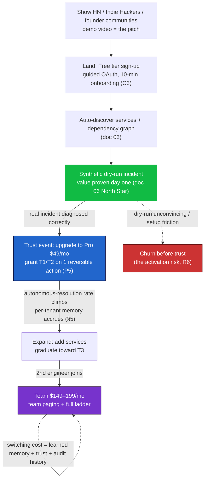

# 08 — Business, GTM, Roadmap & Risk

*The startup case: a wedge nobody serves well (solo founders with prod but no on-call), a self-serve land-and-expand motion where the demo video is the marketing, a 12-week build that produces a real diagnosis by week 5 and an autonomous fix by week 6, and a risk register whose headline answer — "can we trust you near prod?" — is already engineered, not promised.*

This document owns the business: the wedge and why-now, pricing recap, go-to-market, the onboarding/time-to-value engine, defensibility, the elaborated 12-week roadmap, and the risk + open-questions analysis. It is the one doc allowed to be a little narrative — but every business claim ties back to a real architectural mechanism in a sibling doc, because an unbacked claim is the thing an interviewer or investor catches first. It cites the constitution (`00-glossary-and-decisions.md`) for every shared term: the three constraints **C1/C2/C3**, the autonomy tiers **T0–T3** (§00.6), the principles **P1–P10**, and the ADRs.

Lane boundaries: pricing tiers and the unit-economics math live in `07-billing-and-unit-economics.md` — this doc recaps the tiers and the margin logic, it does not re-derive the cost model. The trust posture and threat model live in `05-security-and-trust.md`; the activation metric and SLOs in `06-evaluation-and-observability.md`; the connector moat in `03-connectors-and-integrations.md`; isolation as a sellable feature in `02-data-model-and-isolation.md` + `05`. This doc connects those mechanisms to dollars and adoption.

---

## 1. The wedge

**Who.** Solo founders and 2–4 person engineering teams who have shipped something real — it has paying users, it runs in prod on a PaaS (Vercel, Fly, Railway, Render) with managed Postgres (Supabase/Neon) and error tracking (Sentry) — and who have **no on-call rotation**, because there is no one to put on it. When prod breaks at 3am, the founder *is* the rotation. This is not a niche; it is the modal shape of every YC-batch company, every indie SaaS, every "I quit my job to build this" team in their first two years.

**The pain, precisely.** These teams already pay for tools that *tell them something is wrong* — uptime pings, Sentry errors, a Vercel deploy that 500s. What no tool does is the part that actually costs them: **diagnose the root cause and draft the fix.** Today that work falls on one exhausted human who gets woken up, opens five dashboards half-asleep, correlates a Sentry spike against a deploy three commits back against a Postgres connection-pool exhaustion, and — if they're lucky — ships a fix by sunrise. The alerting tools (PagerDuty, Datadog, BetterStack) are a louder alarm clock. They do not do the triage.

**Why they can't just hire.** A competent SRE is $150k–$220k fully loaded, and won't join a three-person team to babysit one service. A fractional/on-call contractor is $2k–$8k/mo and doesn't know your codebase. The honest alternative most founders pick is *nothing* — they absorb the risk, lose sleep, and occasionally lose a customer to a Saturday outage they didn't catch until Monday. That "nothing" is the competitor we're really displacing.

**What we sell — the outcome, not the tech.** *You sleep, we triage.* Connect your stack in ten minutes (C3). When prod breaks, Sentinel diagnoses the root cause from your logs, metrics, deploys, and errors; drafts the fix as a PR; and only wakes you when it's genuinely stuck — and even then, the page arrives with the full investigation done: suspected cause, evidence chain, competing hypotheses, and a drafted remediation attached (the §00.6 page contract). The human approves in ~15 seconds instead of starting cold at 3am.

**The willingness-to-pay logic.** Price the product against the cost of the *problem*, not the cost of the *tokens*. One churned customer who hit a broken signup flow on a Saturday is worth more than a year of Sentinel. One ruined weekend — the founder's scarcest, least-renewable resource — is worth more than a year of Sentinel. At **$49–199/mo** the decision isn't "is this cheaper than an SRE" (obviously), it's "is one less 3am wake-up worth a dinner out per month." For the target buyer that is not a real question. The pricing is deliberately *trivial* relative to the pain so the buying decision is emotional and fast, which is exactly what a self-serve motion needs (§3).

**Why now.** Three curves crossed. (1) **Agent tooling matured**: LangGraph gives durable, resumable, human-interruptible multi-agent workflows (ADR-006) — an incident that pauses for approval and survives a restart is now a graph state, not a research project. (2) **The provider ecosystem standardized**: PaaS + Sentry + GitHub expose clean OAuth read-APIs and webhooks, so agentless onboarding in ten minutes is real (ADR-002, doc 03). (3) **Frontier models got cheap enough to triage and expensive enough to need rationing** — which is exactly why tiered routing + hard per-tenant ceilings (ADR-008, ADR-010) are in the architecture from day one, not bolted on. The window is the gap between "models are good enough to diagnose" and "the incumbents ship it" — and the incumbents are structurally slow here because their business is the alarm, not the answer.

**Why a solo dev can ship it.** The whole stack is managed and outbound-only (ADR-002): no inbound ports to harden, no bastions, no agent fleet to operate on day one (agentless-first). The moat is *boring breadth* — one more connector adapter at a time (ADR-009) — not a research breakthrough, so a single disciplined engineer compounds it. Multi-tenancy is enforced by Postgres RLS + Qdrant namespaces + JIT creds (P2), three cheap independent mechanisms, rather than a bespoke isolation platform. The 12-week roadmap (§6) is sized for exactly one builder.

---

## 2. Pricing recap (canonical math in doc 07)

The tiers below are owned by `07-billing-and-unit-economics.md`; reproduced here so the GTM motion is self-contained. The land-and-expand path maps directly onto them: you **land** on Free (read-only), expand to **Pro** when you trust us with a real service, expand to **Team** when there's more than one of you and more than one service.

| Tier | Price | Who | What they get | Autonomy ceiling | Margin protection |
|---|---|---|---|---|---|
| **Free** | $0 | First-touch / evaluation | Read-only, **1 service**, diagnose-and-page only | **T0** (observe) hard cap | 1 service + low incident ceiling caps LLM spend; T0 means zero write-action cost |
| **Pro** | **$49/mo** | Solo founder, 1 real prod service | Multi-source diagnosis, fix-drafting, graduated autonomy up to **T2**, Slack/SMS paging | Up to **T2** (approve-to-act) | Per-tenant incident + token ceiling (ADR-010); circuit-breaker degrades to T0+page when tripped |
| **Team** | **$149–199/mo** | 2–4 person team, multiple services | Several services, full autonomy ladder to **T3**, team paging/escalation, learning-loop memory, trust dashboard | Up to **T3** (autonomous) | Higher ceiling sized to keep gross margin positive; usage above ceiling degrades gracefully, never silently eats margin |

**How ceilings protect margin (ADR-010, P7).** Every LLM call, tool call, and incident is metered per tenant, idempotently (retries never double-charge), against a **hard monthly cost ceiling**. The ceiling is not just a finance control — it's a **safety control**: when a tenant's prod generates an incident storm (500 incidents/day), the circuit breaker trips the tenant down to **T0 + page**, which simultaneously caps our COGS *and* caps the blast radius of autonomous action (you can't auto-act 500 times if you've been degraded to observe-only). Margin and safety are the same mechanism. This is why we can offer a generous diagnose-and-page Free tier without fear: a runaway free tenant costs us a bounded, known amount and then stops. The full per-tenant gross-margin derivation — token mix across the tiered models (ADR-008), correlator dedup ratio, expected incidents/tenant/month — is in `07-billing-and-unit-economics.md`.

---

## 3. Go-to-market

**Motion: bottom-up, self-serve, product-led, land-and-expand.** No sales team, no demos-on-request, no "contact us." A founder signs up, OAuths their stack, sees a diagnosis the same day, and upgrades themselves. This is the only motion the unit economics support at $49/mo (§2), and the only one a solo builder can run.

**The demo *is* the marketing.** The single highest-leverage asset is a 90-second video of a **real prod incident** — a deploy that breaks signup — being diagnosed end-to-end by Sentinel while a "founder" sleeps, with a **PR drafted and waiting** in the morning (this is exactly the week-6 CORE DEMO MOMENT made shippable; §6). It shows, not tells, the outcome we sell in §1. Everything else (the landing page, the HN post, the Show-HN title) points at this video. The product's behavior is the pitch; the copy just gets people to press play.

**Launch surfaces, in order.**
1. **Show HN: "I built an AI on-call SRE for solo founders — it diagnosed my prod outage and drafted the fix while I slept."** The title is the value prop. HN's audience *is* the wedge (§1) and rewards a working demo + an honest engineering writeup over hype. The trust posture (outbound-only, read-only default, redact-at-edge — doc 05) is written *for* this audience's first objection ("you want me to give a startup my prod creds?").
2. **Indie Hackers** — the founder-pain narrative ("you sleep, we triage") lands natively; this community buys outcomes and shares wins.
3. **Founder communities** — relevant YC/Slack/Discord spaces, r/SaaS, indie-dev Twitter/X. Seed with the demo video and a free read-only tier that proves value with zero risk.

**Land in read-only → expand to autonomy + more services.** The motion mirrors the autonomy ladder (§00.6) and the pricing tiers (§2):

- **Land** on Free: read-only, one service, **T0**. Zero risk to the tenant — we literally cannot touch their infra (C1, ADR-003). The synthetic dry-run incident (§4) proves value before any real incident occurs.
- **Trust event #1:** a real incident gets diagnosed correctly and a fix drafted. The tenant upgrades to **Pro** and grants **T1/T2** on a reversible action (e.g. `process.restart`) for one allow-listed service.
- **Expand:** as Sentinel's per-tenant memory accrues (§5) and the autonomous-resolution rate on the trust dashboard climbs (doc 06), the tenant adds services and graduates action types toward **T3**. Team plan follows when a second engineer joins.

Every expansion step is a *trust* step the tenant takes deliberately (P5) — which means expansion revenue is a direct readout of earned trust, and the trust dashboard (doc 06) is simultaneously our retention surface and our upsell surface.

---

## 4. Onboarding & the time-to-value engine (C3)

C3 — *onboard in minutes, not days* — is a life-or-death constraint, not a nicety: a solo founder who hits a weekend-long setup never finishes, and we never get the chance to earn trust. The onboarding flow is engineered to drive a single number, the North Star from doc 06: **time-to-first-diagnosis.**

**The flow.**
1. **Guided OAuth (agentless, ADR-002).** The tenant clicks through least-privilege, read-only OAuth for GitHub + Sentry + their PaaS. No port to open, no agent to install, no firewall change (P4) — outbound-only by construction removes the single biggest "I'll do it later" friction. Scopes are read-only by default (C2); write capability is opt-in later via the autonomy ladder.
2. **Auto-discover services & dependency graph (doc 03).** From the connected providers, Sentinel discovers the tenant's services (`svc_…`), maps deploys→errors→metrics, and infers a dependency graph — so correlation has topology to work with from incident one. The founder confirms a graph that was built *for* them, rather than configuring one.
3. **Synthetic dry-run incident.** The decisive moment: Sentinel injects a **safe, synthetic incident** against the discovered topology and runs the full incident graph (correlate → specialists → Commander → Planner) end-to-end, producing a real-looking diagnosis and a sample drafted fix — **on day one, before any real outage.** This is what turns "I'll see if it ever helps" into "oh, *that's* what it does." It de-risks the purchase by proving the outcome on a controlled input, and it's the seed of the launch demo video (§3).

**Instrumentation.** Time-to-first-diagnosis is the North Star (doc 06); the synthetic dry-run guarantees it fires on the first session rather than waiting for an organic incident. Onboarding completion, OAuth drop-off per provider, and dry-run → real-diagnosis conversion are the funnel metrics that tell us where C3 is leaking. The trust dashboard (doc 06) becomes the tenant's home screen the moment the dry-run completes, so the very first thing they see is *evidence of value*, expressed as autonomous-resolution rate and median time-to-diagnosis.

---

## 5. Defensibility & the moat

A skeptic's fair question: "an AI that reads logs and drafts a PR — what stops a weekend hackathon from cloning this?" Three compounding moats, each anchored in the architecture, none replicable overnight.

**1. The connector library (doc 03 — the primary moat).** The hard part isn't the LLM; it's the long, boring tail of provider-specific integrations done *correctly*: Sentry's issue/event JSON, Vercel's deploy lifecycle, Grafana's alert rules, GitHub's PR API, each with its own webhook idempotency, OAuth token refresh, and rate-limit etiquette (doc 03 §3–§5). Every adapter normalizes into the one `CanonicalEvent` envelope (ADR-009) so breadth compounds without the system rotting — adding the 25th provider is one adapter, not a rewrite. This is deep, unglamorous, and exactly the kind of work a demo-chasing competitor under-invests in. Breadth of *correct* connectors is the durable lead.

**2. The per-tenant learning loop (switching cost).** Sentinel gets measurably better at *your* system over time. The Scribe writes postmortems into per-tenant Qdrant memory (P2, doc 04 §439); subsequent incidents retrieve "we've seen this shape before on this service" context, so diagnoses get faster and confidence calibration tightens for that tenant specifically. The longer a tenant stays, the more Sentinel knows about their topology, their recurring failure modes, and their accepted fixes — which is precisely a switching cost: a competitor starts from zero knowledge of your system, while we have months of it. Expansion revenue (§3) and retention are downstream of this loop.

**3. The trust/security posture (doc 05 — hard to fake).** Letting an autonomous agent near prod is the buyer's #1 fear (R1, §7), and the answer is an *architecture*, not a promise: outbound-only (P4), read-only by default with a graduated, tenant-controlled autonomy ladder (P5, ADR-003), redact-at-the-edge so durable stores never hold secrets (P3, ADR-004), JIT-scoped credentials brokered through the MCP Router so a compromised worker holds at most one short-lived token (P9, ADR-005), per-tenant immutable audit log (P8, ADR-011), and defense-in-depth isolation across three independent layers — RLS + Qdrant namespaces + JIT creds (P2, doc 02 + doc 05). A competitor can copy a feature in a sprint; they cannot copy a *trust posture* overnight, because trust is earned through architecture, audits, and time. This is also a *sellable* feature: "your data is isolated three independent ways, redacted before we store it, and we hold no standing credential to your infra" is a closing line, not fine print.

The three reinforce each other: connectors get the tenant in, the trust posture lets them grant autonomy, the learning loop makes leaving expensive — a flywheel, not three separate features.

---

## 6. The 12-week build roadmap

Sized for one disciplined engineer. Grouped into three phases: **Phase A — local single-tenant (wks 1–5)** proves the diagnosis loop works at all; **Phase B — multi-tenant cloud (wks 6–10)** turns it into a safe, billable, isolated SaaS; **Phase C — real design partners (wks 11+)** puts it in front of paying-adjacent founders and launches. The canonical weekly milestones are intact; each is deepened with what's demoable and its hard dependency.

| Wk | Phase | Milestone | Demoable | Depends on |
|---|---|---|---|---|
| **1** | A | **Tenant-zero cluster + 3 chaos scenarios + canonical event schema.** Stand up a local single-tenant stack; build 3 reproducible chaos scenarios (bad deploy, DB pool exhaustion, downstream 5xx); freeze the `CanonicalEvent` shape (§00.5.1). | Trigger a chaos scenario; see raw provider events land. | Docker compose; the §00.5.1 contract (ADR-009). |
| **2** | A | **First connectors: GitHub + Sentry + one PaaS.** Three real adapters normalizing into `CanonicalEvent`; webhook idempotency (doc 03 §3); read-only OAuth (doc 03 §4). | A real Sentry error + a real GitHub deploy normalized into identical-shaped canonical events. | W1 schema; provider OAuth apps. |
| **3** | A | **Ingestion edge + Kafka + edge redaction.** Stand up `ingestion-edge`, produce to `evt.normalized`; wire layered redaction (regex+entropy+classifier) *before* persistence (ADR-004, P3). | Show a secret in a raw log getting stripped before it hits storage; `redaction_meta` populated. | W2 connectors; Kafka; redaction detectors (doc 05). |
| **4** | A | **Correlator + Postgres event store + RLS scaffolding.** Collapse event storms into one `Incident` via dedup windows + topology; persist event-sourced incidents (ADR-011); stand up RLS policies + the non-bypass role (ADR-001). | A storm of 40 events collapses into 1 incident row; RLS blocks a cross-tenant read in a unit test. | W3 stream; Postgres 16; §00.5.3 lifecycle. |
| **5** | A | **LangGraph Commander + Log/Metric specialists → first end-to-end diagnosis to Slack.** First real incident graph (ADR-006): Commander dispatches Log + Metric specialists in parallel, synthesizes a root-cause hypothesis, pages Slack. **First diagnosis.** | A chaos-induced incident → Slack message with suspected root cause + evidence chain. *This is "it works."* | W4 correlator + event store; LangGraph runtime. |
| **6** | B | **Planner drafts a fix + graduated escalation + confidence model. ★ CORE DEMO MOMENT.** Planner turns a hypothesis into a drafted PR/patch (doc 04 §439); the §00.6 escalation matrix runs as executable policy; calibrated confidence gates it (P6, ADR-008). | A broken deploy → Sentinel diagnoses → **drafts a PR with the fix** → pages with it attached. *This becomes the launch video (§3).* | W5 diagnosis loop; GitHub write-API; calibration eval set (doc 06). |
| **7** | B | **MCP Router + Vault JIT brokering + first approval-gated write.** Route every tool call through the MCP Router; mint short-lived scoped creds from Vault per call (ADR-005, P9); execute the first **T2** reversible write after one-tap approval. | One-tap-approve a `process.restart` from a phone; action executes; `action.audit` records it; no standing credential ever held. | W6 escalation policy; Vault; MCP servers per integration. |
| **8** | B | **Full multi-tenancy: 2–3 fake tenants on different stacks; RLS isolation test passing.** Promote everything to multi-tenant (P1): tenant-scoped events, incidents, memory, budgets, creds. Mandatory CI test proves tenant A cannot read tenant B (ADR-001). | Three tenants on different stacks running concurrently; the cross-tenant isolation test goes green in CI. | W7 router (creds already tenant-scoped); §00.4 conventions. |
| **9** | B | **Qdrant per-tenant memory + learning loop + Scribe postmortems.** Scribe writes postmortems into per-tenant Qdrant namespaces (P2); incidents retrieve prior-incident context; the switching-cost loop (§5) turns on. | A second occurrence of the same failure shape gets diagnosed faster, citing the prior postmortem. | W8 multi-tenancy; Qdrant; Scribe agent (doc 04). |
| **10** | B | **Billing/metering + cost ceilings + Stripe test mode.** Idempotent per-tenant metering of every LLM/tool/incident; hard monthly ceiling with circuit-breaker degrade-to-T0 (ADR-010, P7); Stripe in test mode wired to the tiers (§2, doc 07). | A tenant blows its ceiling → auto-degrades to T0+page; Stripe shows a metered test invoice. | W9 stack; Stripe; the §2 tiers (doc 07). |
| **11** | C | **Onboarding + synthetic dry-run + trust dashboard.** Guided OAuth → auto-discover services + dependency graph → **synthetic dry-run incident** (§4); ship the trust dashboard (autonomous-resolution rate, page count, median TTD — doc 06). | A cold sign-up → connected stack → **a diagnosis on a synthetic incident, day one.** Time-to-first-diagnosis instrumented. | W10 full SaaS; discovery (doc 03); North-Star instrumentation (doc 06). |
| **12** | C | **Cloud deploy + Terraform + ArgoCD + canary; recruit 3 design partners; demo video + launch writeup.** Reproducible multi-region infra (Terraform); GitOps eval-gated canary deploys (ArgoCD, doc 06); recruit 3 real design-partner founders; cut the launch video + Show-HN writeup (§3). | A canary deploy gated by the eval suite; 3 design partners onboarded; the launch asset live. | W11 onboarding; Terraform/ArgoCD; eval gates (doc 06). |

**Reading the roadmap as a story:** by **week 5** Sentinel produces a real diagnosis (the "is this possible at all?" question is answered); by **week 6** it drafts a fix and pages with it attached (the pitch exists); by **week 8** it's a genuinely multi-tenant, isolation-proven SaaS (the "is this a product?" question is answered); by **week 11** a stranger can self-serve to value on day one (the GTM motion is real); by **week 12** it's deployed, safe, and launched with paying-adjacent partners.

---

## 7. Risk register

Risks ordered by what an investor/buyer raises first. **Trust is the headline** — and its mitigation is the architecture, not a promise.

| # | Risk | Likelihood | Impact | Mitigation (architectural) | Owner |
|---|---|---|---|---|---|
| **R1** | **TRUST — founders won't let us near prod.** The #1 adoption blocker and the buyer's first objection. | High | Critical | The entire trust posture (doc 05): outbound-only (P4), **read-only by default** with a tenant-controlled graduated autonomy ladder T0→T3 (P5, ADR-003), redact-at-edge so stores never hold secrets (P3, ADR-004), JIT-scoped creds via MCP Router (P9, ADR-005), per-tenant immutable audit log (ADR-011). **Land in T0 read-only** (§3) so trying us is provably zero-risk; trust is earned one graduated grant at a time. | Founder / Security |
| **R2** | **LLM cost blowup** — a tenant's prod storms, or token spend per incident balloons, destroying margin. | Medium | High | Tiered model routing — cheap models for specialists, strong only for Commander/Planner (ADR-008); idempotent per-tenant metering + **hard cost ceiling with circuit-breaker degrade-to-T0** (ADR-010, P7). Correlator dedup collapses storms into single incidents (doc 04) so 40 events ≠ 40 LLM runs. Margin is bounded and *knowable* (doc 07). | Founder / Platform |
| **R3** | **Connector breakage on provider API changes** — a provider ships a breaking webhook/API change; ingestion silently degrades. | High | Medium | Uniform `Connector` Protocol localizes every provider's quirks to one adapter (ADR-009, doc 03); per-connector normalization tests are a dedicated test surface; the golden-incident library (doc 06) regression-gates connector behavior in CI; capability model means a degraded connector fails *closed* (advertises fewer capabilities), it doesn't corrupt downstream. | Connectors |
| **R4** | **False autonomous action** — Sentinel auto-executes a wrong fix and *causes* an outage (a direct C1 violation). | Medium | Critical | **Calibrated** confidence, not raw logprobs (P6, ADR-008); the §00.6 escalation matrix gates every write on confidence × grant × **reversibility**; **irreversible actions always page, even at T3**; uncertain → structurally page-not-act (doc 04 §7); every action is reversible + has a `rollback_ref`; cost ceiling caps action blast radius (R2 mitigation doubles here). | Orchestration |
| **R5** | **Multi-tenant data leak** — one tenant's prod data surfaces in another's incident. Existential for trust (R1). | Low | Critical | **Defense in depth across three independent layers** (P2): Postgres RLS with a non-bypass role (ADR-001), Qdrant per-tenant namespaces, JIT-brokered per-tenant creds via MCP Router (ADR-005) — a bug in any one layer is insufficient to cross tenants. **Mandatory CI test** proves tenant A cannot read tenant B (ships W8). | Data / Security |
| **R6** | **Slow trust adoption / weak activation** — tenants sign up but never grant autonomy or never reach first value, so they churn before expanding. | High | High | The synthetic dry-run proves value **day one** before any real incident (§4); time-to-first-diagnosis is the instrumented North Star (doc 06); land-in-read-only removes the risk of trying (§3); the trust dashboard makes climbing the ladder a visible, low-stakes decision (P5). | Founder / Product |
| **R7** | **Noisy neighbor** — one tenant's alert storm starves another tenant's incident handling. | Medium | High | Tenant-keyed Kafka partitions + **per-tenant fair-share consumption** and per-tenant quotas (ADR-007); workers autoscale on consumer lag (KEDA); whales graduated pool→silo (ADR-001) to dedicated capacity. Isolation holds under load. | Platform |
| **R8** | **Competition** — an incumbent (Datadog/PagerDuty) or a fast startup ships "AI on-call." | Medium | High | Incumbents are structurally slow: their business is the *alarm*, not the *answer*, and our wedge (solo/tiny teams, §1) is beneath their sales motion. Our moats compound (§5): connector breadth (doc 03), per-tenant learning loop (switching cost), and a trust posture that can't be faked overnight (doc 05). We win on *outcome + trust + breadth*, not a single feature. | Founder |
| **R9** | **Churn** — tenants leave after the acute pain fades or after a single bad diagnosis. | Medium | High | The per-tenant learning loop makes Sentinel better at *your* system the longer you stay (§5) — a real switching cost; the trust dashboard surfaces accruing value (resolution rate, pages avoided); graceful degradation (never silently fail, R2/R4) protects the trust that a single bad diagnosis would otherwise burn. Expansion (§3) raises the cost of leaving. | Product |

---

## 8. Open-questions log

Genuine unknowns, grouped by theme. These are the calls that need real data (design partners, evals, pricing experiments) to settle — not hand-waving, but the honest edge of the design.

- **Confidence calibration method.** What's the right calibration technique for autonomy gating (P6, ADR-008) — temperature scaling, isotonic regression, conformal prediction? How much golden-incident data (doc 06) before `HIGH`-band calibration is trustworthy enough to back a T3 grant? How do we calibrate *per-tenant* once the learning loop (§5) has data, without overfitting to one tenant's recent incidents?
- **Silo-graduation thresholds.** At what tenant size/sensitivity/load do we graduate pool→silo (ADR-001)? Is the trigger incident-volume (margin/noisy-neighbor, R7), data-sensitivity (a compliance ask), or a Team-plan entitlement? Where exactly does the bridge step sit?
- **Which providers first.** The W2 set (GitHub + Sentry + one PaaS) is committed — but *which* PaaS leads (Vercel vs. Fly vs. Railway vs. Render)? What's the next-five ordering that covers the most of the wedge's real stacks with the least adapter effort (the moat-building sequence, doc 03)?
- **Pricing elasticity.** Are $49 / $149–199 (§2, doc 07) the revenue-maximizing points for this buyer, or is willingness-to-pay higher than we're charging (the "one ruined weekend" logic, §1, suggests it might be)? Should Pro→Team be seat-based, service-based, or autonomy-tier-based? Does a usage-overage line item help or scare the self-serve buyer?
- **On-call / escalation UX.** What's the right paging surface mix (Slack vs. SMS vs. voice) for a solo founder vs. a 2–4 person team? How does team escalation work without a PagerDuty-style rotation the wedge doesn't have? Is one-tap mobile approval (T2) enough trust UI, or do tenants need a richer pre-approval review?
- **Compliance scope.** When do design partners force SOC 2 / GDPR-grade data-residency commitments? Redact-at-edge (ADR-004) and per-tenant isolation (P2) make the *architecture* compliance-friendly, but the *certification* is real calendar + cost — when does it gate a deal, and which framework first?
- **Agent vs. agentless adoption.** What fraction of tenants will install the optional Sentinel Agent (doc 03 §7) for deeper/write access vs. stay fully agentless? Since write-capable autonomy (T2/T3) often needs the agent or a provider write-API, agent adoption may *gate* expansion revenue (§3) — is that a funnel bottleneck we need to design around?

---

## 9. What you can claim afterwards

Shipping this twelve-week build earns a specific, defensible set of claims — every clause backed by a mechanism, which is what separates a portfolio piece from a pitch deck.

You can claim you **built a multi-tenant agentic SRE that diagnoses real production incidents and drafts fixes autonomously** — and prove it with the week-6 demo: a broken deploy diagnosed end-to-end and a PR drafted while no human was awake (§6). You can claim **trust is engineered, not promised**: outbound-only with no inbound attack surface (P4), read-only by default with a tenant-controlled graduated-autonomy ladder where irreversible actions *always* page even at full autonomy (P5, ADR-003, §00.6), secrets redacted before they ever persist (P3, ADR-004), and no standing tenant credential ever held by a worker (P9, ADR-005). You can claim **tenant isolation is defense-in-depth, proven in CI**: RLS + Qdrant namespaces + JIT creds across three independent layers (P2), with a mandatory test that demonstrates one tenant cannot read another (ADR-001, §6 W8). You can claim **the economics are governed, not hoped**: every LLM and tool call metered per tenant against a hard ceiling whose circuit breaker is simultaneously a margin control and a safety control (ADR-010, P7, doc 07). You can claim **autonomous action is gated on calibrated confidence, not vibes** (P6, ADR-008). You can claim a **defensible business**: a real wedge incumbents structurally under-serve, a self-serve land-and-expand motion proven by an instrumented North-Star activation metric (doc 06), and a compounding moat — connector breadth (doc 03), a per-tenant learning loop that is a literal switching cost (§5), and a trust posture that takes architecture and time to replicate (doc 05). In one line: **a system that earns the right to touch production one graduated grant at a time, and a business whose every claim ties back to a line in the architecture.**

---

## Open questions & risks

The risk analysis and open-questions for this document are **§7 (Risk register)**, **§8 (Open-questions log)**, and the adoption/churn risks woven through §3–§5. They are this doc's risk section by design — the business risks *are* the subject matter here, not an appendix to it.
